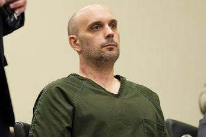

---
# Researched and written October 24, 2026 by Poe. Case status rechecked October 25, 2026. Nothing newer than
# S8 and S9 opens. WeAreIowa reportedly lists an October 26 appearance, but the page returns 403, so that
# date is UNVERIFIED and stays out of the text. Recheck after October 26.
# Legal care: Kelly Joseph Grant is CHARGED with first-degree murder, not convicted. No plea is reported.
# In his interviews with investigators he denied any part in her death (S4, S5, S9). Never state or imply
# he killed Angie. Everything about the night, the 1996 associate, his interviews and the motive comes from
# the criminal complaint as quoted by S3, S4, S5, S8 and S9. Those are separate outlets reading one filing,
# not independent confirmation. The complaint itself has not been opened by the Writer (NEEDS INPUT).
# The witness keeps the complaint's own words. The witness saw "a person who looked like Grant" (S4). S9
# says the witness saw Grant. The text uses S4's wording and gives S9's version as the Courier's.
# In its list of the points behind its conclusion, the complaint words it as "a male matching Grant's
# description" (S3). That phrase appears only as a quote, in that list.
# The complaint's conclusion runs inline, attributed, with his denial and the presumption line in the
# same paragraph. It is never set as a block quote.
# The second man: the complaint calls him "another identified male." No source names him or reports a
# charge against him. Never name him or guess at him. The associate from January 1996 is also unnamed.
# The motive: the complaint says she was "falsely perceived" as an informant. Keep the word falsely
# every time, and never let the alleged motive describe who she was.
# Left out on purpose: the names of her children and her former husband, 1995 coverage of her past arrests
# and the people she was said to know, a 1995 Des Moines killing that police said was not connected, the
# hunters' names, how her body lay, where the wound was, and anything about blood.
# S10 (Iowa Cold Cases) is a nonprofit summary of 1995 Courier and Gazette coverage and her obituary. It is
# the only source for her early life and the 1995 scene. Justin decides whether it stays. Its claims are
# attributed to the Courier where S10 says the Courier reported them.
# Conflicts in the text: arrest date (Oct. 15 in S1, Friday Oct. 16 in S3, S7, S9). Time of the report
# (10:40 a.m. in S7, the hunters crossing about 10:45 in S10). The vehicle (a vehicle in S4, Grant's car in
# S9). Stole from them (S4) or from him (S5). Marijuana given (S4) or thrown (S5).
# Not raised in the text: S8 dates one interview July 1991. S4 and S9 say July 2001, and 1991 predates
# the killing, so it reads as a typo. S8 also says she was assaulted by Grant and another man. S3 says
# Buck, Grant and a third person were in a fight and Buck was assaulted. The text follows S3.
# Distances: about 8 miles east of the Cottage Street house (S4) and about 5 miles east of Waterloo (S9).
# These measure from different places and both are used.
# Quotes are exact. No two quotes were joined. The Neff quote follows S7. S8 and S9 open it "This arrest is a
# great example" and S9 gives only that first sentence, so the quote is tagged S7 alone.
# published is a placeholder for Justin's release date.
# Photos: supplied by Justin on October 25, 2026. Justin identified the two photos of Kelly Grant: the
# booking photo from his October 2026 arrest and a photo of him in a courtroom. Both captions repeat that he
# is charged, not convicted, and has denied it. The court photo is undated, and no source reviewed reports a
# hearing, so its caption gives no date or place. The reward poster is from the Waterloo Police and Cedar
# Valley Crime Stoppers and was issued while the case was unsolved. Its tip numbers are not the sheriff's
# line in tipLine. The Waterloo photo shows downtown and the Cedar River, not a place in the story.
draft: false
title: "Poynter Creek: The Killing of Angie Buck"
seoTitle: "Angela Buck: What Happened in Waterloo, IA"
description: "Angie Buck, 37, was found shot by a creek east of Waterloo, Iowa, in 1995. In 2026, a Minnesota man was charged with her murder. He has denied it."
person: "Angela Buck"
summary: "Angela \"Angie\" Buck, 37, was found dead of a gunshot wound by a creek east of Waterloo, Iowa, on August 11, 1995. [S1] In October 2026, Kelly Grant of Bertha, Minnesota, was charged with first-degree murder. He has denied any part in her death and is presumed innocent. [S1, S5] No court dates had been set as of October 17. [S8]"
status: in-court
town: "Waterloo"
state: IA
incidentDate: 1995-08-11
lastSeenDate: null
resolvedDate: null
lastChecked: 2026-10-25
lastFactChange: null
published: 2026-10-28
agency: "the Black Hawk County Sheriff's Office"
tipLine: "+13192912587"
anonymousTips: null
contentNote: "a shooting death and an alleged kidnapping"
image:
  src: "./angela-buck-1995.jpg"
  alt: "Angie Buck smiling, with feathered dark brown hair, in a portrait against a gray background"
  credit: "Angela Buck in an undated photo"
  license: "Photo published in news coverage of the case"
youtubeId: null
youtubeUploadDate: null
readerQuestion: "According to the complaint, several people were at the house on Cottage Street that night. Thirty-one years later, the sheriff says the investigation is still open. What could still bring their accounts forward?"
sources:
  - { id: S1, title: "Attorney General Brenna Bird Praises Black Hawk County Arrest in 31-Year-Old Case with Assistance from Iowa Division of Criminal Investigation and the Cold Case Unit", publisher: "Iowa Attorney General", url: "https://www.iowaattorneygeneral.gov/newsroom/attorney-general-brenna-bird-praises-black-hawk-county-arrest-in-31-year-old-case-with-assistance-fr", date: 2026-10-16, archive: "https://web.archive.org/web/20261025001534/https://www.iowaattorneygeneral.gov/newsroom/attorney-general-brenna-bird-praises-black-hawk-county-arrest-in-31-year-old-case-with-assistance-fr" }
  - { id: S2, title: "Contact Us", publisher: "Black Hawk County Sheriff's Office", url: "https://www.bhcso.org/contact-us", date: 2026-10-24, archive: "https://web.archive.org/web/20261025002154/https://www.bhcso.org/contact-us" }
  - { id: S3, title: "31 years after homicide, Black Hawk County authorities make arrest", publisher: "KCRG", url: "https://www.kcrg.com/2026/10/16/31-years-after-homicide-black-hawk-county-authorities-make-arrest/", date: 2026-10-16, archive: "https://web.archive.org/web/20261025001622/https://www.kcrg.com/2026/10/16/31-years-after-homicide-black-hawk-county-authorities-make-arrest/" }
  - { id: S4, title: "Cold case arrest: Minnesota man charged in 1995 homicide in Iowa", publisher: "FOX 9", url: "https://www.fox9.com/news/cold-case-arrest-minnesota-man-charged-1995-homicide-oct-16-2026", date: 2026-10-16, archive: "https://web.archive.org/web/20261025001642/https://www.fox9.com/news/cold-case-arrest-minnesota-man-charged-1995-homicide-oct-16-2026" }
  - { id: S5, title: "Bertha, Minn., man accused in 1995 cold case murder of Iowa woman", publisher: "Forum News Service (Wadena Pioneer Journal)", url: "https://www.brainerddispatch.com/news/minnesota/bertha-minn-man-accused-in-1995-cold-case-murder-of-iowa-woman", date: 2026-10-16, archive: "https://web.archive.org/web/20261025001706/https://www.brainerddispatch.com/news/minnesota/bertha-minn-man-accused-in-1995-cold-case-murder-of-iowa-woman" }
  - { id: S6, title: "Arrest made in cold case murder", publisher: "Waverly Newspapers", url: "https://www.communitynewspapergroup.com/waverly_newspapers/arrest-made-in-cold-case-murder/article_4a8a500a-c3e7-4ff1-a1f0-18b62fa372fb.html", date: 2026-10-16, archive: "https://web.archive.org/web/20261025001813/https://www.communitynewspapergroup.com/waverly_newspapers/arrest-made-in-cold-case-murder/article_4a8a500a-c3e7-4ff1-a1f0-18b62fa372fb.html" }
  - { id: S7, title: "Three Decades After Body Found East Of Waterloo, Suspect Arrested In Cold Case Murder (WJON News)", publisher: "KDHL Radio (Townsquare Media)", url: "https://kdhlradio.com/ixp/67/p/murder-suspect-arrested-30-years-later/", date: 2026-10-16, archive: "https://web.archive.org/web/20261025002038/https://kdhlradio.com/ixp/67/p/murder-suspect-arrested-30-years-later/" }
  - { id: S8, title: "Minnesota man arrested for 31-year-old Iowa cold case", publisher: "Des Moines Register, via Yahoo News", url: "https://www.yahoo.com/news/us/articles/minnesota-man-arrested-31-old-155945411.html", date: 2026-10-17 }
  - { id: S9, title: "Minnesota man charged in 1995 cold case murder of Angela Buck in Waterloo", publisher: "Waterloo-Cedar Falls Courier", url: "https://wcfcourier.com/news/local/crime-courts/article_600f2589-d01d-4e8f-8b43-f46483fd06b3.html", date: 2026-10-19, archive: "https://web.archive.org/web/20261025001552/https://wcfcourier.com/news/local/crime-courts/article_600f2589-d01d-4e8f-8b43-f46483fd06b3.html" }
  - { id: S10, title: "Angela Buck (case summary)", publisher: "Iowa Cold Cases", url: "https://iowacoldcases.org/case-summaries/angela-buck/", date: 2026-10-16, archive: "https://web.archive.org/web/20261025002134/https://iowacoldcases.org/case-summaries/angela-buck/" }
timeline:
  - { date: 1958-04-17, text: "Angela Renee Buck is born in Waterloo. [S10]", section: "evansdale" }
  - { date: 1992, text: "Her mother, Lorene, dies after a long illness. [S10]", section: "evansdale" }
  - { date: 1995-08-10, text: "According to the complaint, she is at a house on Cottage Street in Waterloo that night with Grant and others. [S4]", section: "cottage-street" }
  - { date: 1995-08-11, text: "Two men looking for places to set turtle traps find her body along Poynter Creek. [S6, S10]", section: "poynter-creek" }
  - { date: 1995-08-17, text: "Her memorial service is held at Waterloo Memorial Park. [S10]", section: "memorial-park" }
  - { date: 1996-01, text: "An associate of Grant's talks to law enforcement, the complaint says. [S4]", section: "january-1996" }
  - { date: 2001-07, text: "Grant tells investigators he was living in Florida, then changes his account, the complaint says. [S4]", section: "florida" }
  - { date: 2008-12, text: "Sheriff Mike Kubik retires, still thinking about her case. [S10]", section: "two-cases" }
  - { date: 2025-03, text: "Grant describes giving a ride to a woman he said resembled Buck, the complaint says. He denies any involvement. [S4, S5]", section: "a-ride" }
  - { date: 2026-10-16, text: "Grant is arrested and charged with first-degree murder, the sheriff's office says. The Attorney General's office gives October 15. [S1, S3]", section: "bertha" }
updates:
  - { date: 2026-10-28, text: "Story published." }
---
Two men finished the third shift at Eagle Tanning in Waterloo, Iowa, around 10 a.m. on Friday, August 11, 1995. They decided to go looking for places to set turtle traps. [S10]

They crossed the bridge on North Pilot Grove Road, east of town, around 10:45, the Waterloo Courier reported. A woman lay on the creek bank below, about six feet from the water. [S10] "We just kind of looked at each other, with goosebumps," one of them told the Courier. [S10]

She was Angela Renee Buck, 37, of Waterloo, and she had been shot. [S1] Thirty-one years later, in October 2026, a Minnesota man named Kelly Grant was charged with first-degree murder in her death. [S1, S9] In his interviews with investigators, he denied any part in it. [S4, S5] The charge is an accusation, and he is presumed innocent. [S1]

## Evansdale

Her name was Angela, and people called her Angie. [S1] She was born in Waterloo on April 17, 1958. Her mother, Lorene, served on the Evansdale City Council. [S10]

In 1970, at 12, Angie was voted Evansdale Junior Miss. She played violin in the school orchestra, and she loved horseback riding. [S10]

She had four children. [S10] She worked as a nurse's aide, and later at Ravenwood Health Care Center. [S10] Her mother died in 1992, after a long illness. [S10] By the summer of 1995, Angie had been going to school in Madison, Wisconsin, to become a radio announcer. [S10]

## Cottage Street

Everything here about her last night comes from the criminal complaint filed against Grant in October 2026. The sheriff's office released it with its announcement, and news outlets quoted it. [S5] It is an accusation, and none of it has been proven in court. [S1]

Investigators determined that Angie didn't own a car or have use of one. [S4] According to the complaint, she spent the late evening of Thursday, August 10, and the early hours of Friday at a house in the 300 block of Cottage Street in Waterloo. [S4] Several people were there. The complaint lists Grant, who was 28, and a man it calls "another identified male." [S4, S8]

The complaint says Angie, Grant and a third person got into a fight, and Angie was assaulted. [S3]

The complaint also cites a witness. According to the complaint, the witness told investigators they saw a person who looked like Grant, and another man, "forcibly removing Buck from the residence and forcing Buck into a vehicle before driving away." [S4] The Courier, describing the same court records, wrote that the witness saw Grant and the other man force her into Grant's car. [S9] The witness has not been named. [S8]

## Poynter Creek

The two tannery workers went to a nearby farmhouse to call the police. [S10] The sheriff's office says it got the report at about 10:40 a.m. [S7] That is five minutes before the time the Courier gave for the crossing. [S7, S10]

Deputies found her along the creek bank on the east side of the bridge. [S5, S7] The creek was Poynter Creek, and she lay on its north bank. [S6] The bridge is in the 900 block of Pilot Grove Road, about five miles east of Waterloo. [S3, S9] That is about eight miles east of the house on Cottage Street. [S4]

Twenty investigators worked the scene until dark that Friday. They searched the creek, the fields and the ditches, and they carried away bags of what looked like evidence, the Courier reported. [S10] A man who lived in sight of the bridge said they asked him whether the creek had flooded lately. "I think they were wondering if she had washed down the creek," he told the Courier. [S10]

On Saturday, two deputies were posted at the scene. They stopped passing cars and wrote down names and license plate numbers. [S10]

The state medical examiner performed the autopsy that day. [S10] She had died of a gunshot wound, and her death was classified as a homicide. [S1] Fingerprints and dental records identified her. The sheriff's office released her name on Sunday, after it had reached her family. [S10] Sheriff Mike Kubik said officials weren't sure whether she had died at the creek or had been left there. No arrests had been made, he said. [S10]

## Memorial Park

In the Courier that Monday, her cousin Rick Luchtenburg talked about her. [S10]

> "She had a big heart, she cared about people, she worried about things, the stress of life and things like that." [S10]

He said her mother's death had been hard on her. [S10] An aunt said Angie had lived with her mother in Evansdale, and began to drift after she died. [S10]

In 1994, Angie rented the bottom three rooms of a duplex on Prince Street in Waterloo for about four months, and left in the fall. Her landlord, Betty Stewart, lived upstairs. [S10] By then Angie's children were living with their father. Stewart said Angie talked about them often, missed them terribly and wanted Stewart to meet them. Angie moved away before that could happen. [S10]

"She was just a good person mixed up," Stewart told the Courier. [S10]

The memorial service was held on Thursday, August 17, 1995, in the chapel at Waterloo Memorial Park Cemetery, and Angie was buried there. Her family asked that memorials go to the Waterloo DARE program. [S10]

## January 1996

In January 1996, an associate of Grant's talked to law enforcement. [S4] According to the complaint, Grant had insinuated to this person that he and the other man the witness described had killed Angie because they believed she had stolen from them. [S4] The associate said Grant said she "wouldn't be doing this to anyone else again." [S4] Forum News Service, reporting on the same complaint, wrote that Grant believed she had stolen from him. [S5]

A sheriff's deputy then interviewed Grant. The complaint says he "initially denied knowing the identified male." Then he changed his account and admitted "knowing and hanging out with the identified male in the summer of 1995." [S4] He said he hadn't talked to the man since. He denied spending time in the Sumner and Cottage Street area. [S4]

He first said he didn't know Angie. When he was shown her picture, the complaint says, he admitted he knew her as a former coworker at IBP. [S4]

Investigators interviewed Grant several times over the years. They did not charge him. [S6]

## Florida

Investigators talked to Grant again in July 2001. [S4, S9]

This time, according to the complaint, he said he had not been in town when Angie was killed. He said he had been living in Florida, and that he read about her death in the newspaper when he moved back. [S4]

Later he changed that account. He said he had been living in Waterloo for several weeks before August 10. He still denied any involvement in her death. [S4]

## Two cases

Mike Kubik retired as Black Hawk County sheriff in December 2008, after five terms. [S10]

He told the Courier that, for all the cases solved over the years, he still thought about two that hadn't been. One was Angie Buck's. [S10] Investigators hadn't given up on bringing the people responsible to justice, he said. [S10]

## A ride

In March 2025, Grant sat for another interview. [S4]

According to the complaint, he now said he remembered stopping by a house in the Sumner and Cottage Street neighborhood. Waiting there, he said, were "the identified male, a couple of other males and a woman who appeared under duress." [S4] He said the woman resembled Buck. The complaint says he went on calling her Buck for the rest of the interview. [S4]

He said the man, the woman and the other men got into his car. He said he dropped them all off at another place in Waterloo, and the man gave him a bag of weed for the ride. [S4] Forum's account of the complaint says one of the men threw him a bag of marijuana as payment. [S5]

He denied any involvement in her death. [S5, S9]

## An additional motive

Also in 2025, the complaint says, investigators "learned of an additional motive." [S3]

According to the complaint, Angie was "falsely perceived to be providing information to law enforcement regarding drug activity" in the area of the Cottage Street house. [S3] The complaint itself calls the belief false. [S3, S5]

The complaint then lists the points behind its conclusion. They are that motive, the witness's account of "a male matching Grant's description" taking part in forcibly removing Angie from the house, what Grant was said to have told an associate, and his changing stories. [S3] Among those stories, it counts what it calls "Grant's admission which placed Buck and the identified male inside Grant's vehicle." [S3] In that 2025 interview, Grant had described a woman he said resembled Buck. [S4]

From those points, the complaint concludes that Grant "did participate in the kidnapping and murder of Angela Buck on or around August 11, 1995." [S3] Grant has denied any involvement in her death. [S5, S9] He is presumed innocent. [S1]

## Bertha

By 2026, Kelly Joseph Grant was 59 and living in Bertha, Minnesota, in Todd County, northwest of the Twin Cities. [S1, S3, S9] Black Hawk County deputies and agents of the Iowa Division of Criminal Investigation arrested him, with help from the Minnesota Bureau of Criminal Apprehension and the Todd County Sheriff's Office. [S1, S5]

The sheriff's office says the arrest was on Friday, October 16. [S3, S5] The Attorney General's office gives the date as October 15. [S1] He was charged with first-degree murder. [S1, S7]

"This is a great example that highlights the cooperation and tenacity of multiple agencies working together to bring closure to a case that is over 30 years old," Sheriff Nate Neff said. "I would also like to credit the retired deputies who originally worked this case. This arrest would not have happened without their efforts." [S7]

"After 31 years, Angie Buck's family is getting answers," Attorney General Brenna Bird said. [S1] Her office's release added this.

> "A criminal charge is merely an accusation, and the defendant is presumed innocent unless and until proven guilty." [S1]

## Without bond

After his arrest, Grant was held without bond. [S6] On October 17, the Des Moines Register reported that no court dates had been set. [S8] No source reviewed for this story reports a plea, a hearing, or his return to Iowa.

The Courier reported that court records point to the possibility a second man was involved. [S9] No source reviewed for this story names him or reports a charge against anyone else.

In the reports on the complaint, the witness it describes has not been named. [S4, S8] The sheriff's office says the investigation is still going. [S7]
