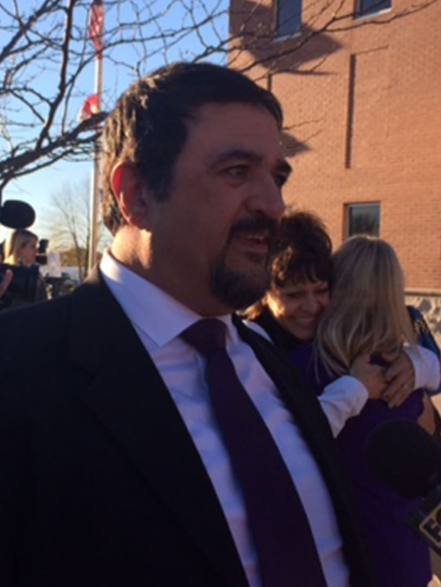
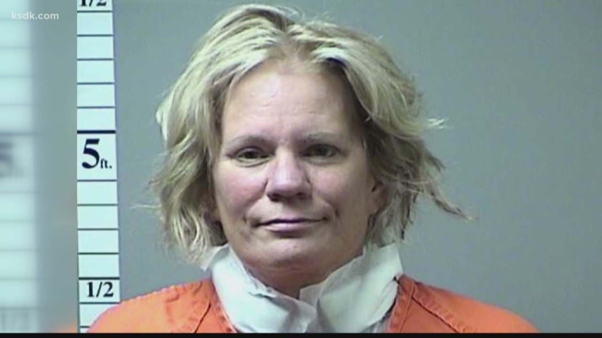

---
# Fact-checked October 9, 2026 against the full text of every source below.
# Rewritten October 11, 2026 from Justin's new draft, using only facts already sourced here.
# Rewritten again October 18, 2026 by Poe at Justin's request, using the mailer-true-crime skill for structure
# and rhythm only: sections split by * * * breaks, short flat paragraphs, a chorus of people on the record,
# and documents quoted as documents. No free indirect discourse. Nobody's thoughts are written unless a
# source records them. Four new sources: two court opinions (S7, S8) and two KSDK reports (S9, S10).
# Legal care: Pam Hupp is CHARGED with Betsy Faria's murder, not convicted. She has pleaded not guilty.
# Never state or imply she killed Betsy. The case against her is always attributed to prosecutors or the
# charging documents (S9). She is shown only from the outside, through her own recorded words.
# Her Gumpenberger conviction (Alford plea, 2019) is a separate case and proves nothing about Betsy's death.
# The Dateline-producer theory stays attributed to prosecutors.
# Russ Faria was acquitted in 2015. Never describe him as a suspect without saying so.
# S7 is a summary-judgment ruling. The judge had to view the facts in Russ's favor. Keep that framing.
# Left out on purpose: Hupp's mother's death (police did not deem it suspicious), the anonymous affair
# allegation against prosecutor Askey (Judge Ohmer said he found no evidence of it), and wound detail
# beyond the count in the court record.
# Conflicts in the text: the voicemail at 7:04 (S1, S7) or about 7:05 (S2). Time since death: at least two hours (S7) or more than an hour (S2). The drive home timed at 23 minutes
# (S2) or 26 and a half (S7). S7 says the appeals court reversed the conviction. S8 and S1 say it remanded
# and Judge Ohmer granted a new trial. S1 says Hupp kept all the money. S8 shows a $100,000 trust funded,
# emptied ($99,700) and revoked.
# Photos: Hupp's booking photo sits in "Where it stands" with a neutral caption. Never caption
# it in a way that ties it to Betsy's death as anything but a charge.
draft: false
title: "The Friend Who Drove Her Home: The Killing of Betsy Faria"
seoTitle: "Betsy Faria: What Happened in Troy, MO"
description: "In 2011, Betsy Faria was killed in Troy, Missouri. Her husband was convicted, then acquitted. Now the friend who drove her home awaits trial."
person: "Betsy Faria"
summary: "Betsy Faria, 42, was stabbed to death at her home in Troy, Missouri, on December 27, 2011. Her husband, Russ, was convicted of her murder, then acquitted at a new trial in 2015. [S1] Her friend Pam Hupp is charged with killing her and has pleaded not guilty. A judge is set to hear the case starting January 31, 2028. [S9, S10]"
status: in-court
town: "Troy"
state: MO
incidentDate: 2011-12-27
lastSeenDate: null
resolvedDate: null
lastChecked: 2026-10-18
lastFactChange: 2026-10-18
published: 2026-10-09
agency: "the Lincoln County Prosecuting Attorney's Office"
tipLine: null
anonymousTips: null
contentNote: "a violent stabbing and a fatal shooting"
image:
  src: "./betsy-faria-2011.jpg"
  alt: "Betsy Faria and Russ Faria seated together at a dinner table"
  credit: "Faria family photo"
  license: "Family photo published in news coverage of the case"
youtubeId: null
youtubeUploadDate: null
sources:
  - { id: S1, title: "Russell Faria", publisher: "The National Registry of Exonerations", url: "https://exonerationregistry.org/cases/11907", date: 2015-11-16, archive: "http://web.archive.org/web/20261006164851/https://exonerationregistry.org/cases/11907" }
  - { id: S2, title: "The unimaginable, infamous case of Pam Hupp", publisher: "St. Louis Magazine", url: "https://www.stlmag.com/longform/pam-hupp/", date: 2017-01-19, archive: "http://web.archive.org/web/20261007120353/https://www.stlmag.com/longform/pam-hupp/" }
  - { id: S3, title: "Prosecutor charges Pam Hupp with first-degree murder, alleges attempt to frame Russ Faria", publisher: "NBC News (Dateline)", url: "https://www.nbcnews.com/dateline/prosecutor-charges-pam-hupp-1st-degree-murder-alleges-attempt-frame-n636841", date: 2016-08-23, archive: "http://web.archive.org/web/20261007120357/https://www.nbcnews.com/dateline/prosecutor-charges-pam-hupp-1st-degree-murder-alleges-attempt-frame-n636841" }
  - { id: S4, title: "Pamela Hupp murder case dropped and refiled in Missouri", publisher: "CBS News and The Associated Press", url: "https://www.cbsnews.com/news/pamela-hupp-murder-case-refiled-missouri-tv-miniseries-the-thing-about-pam/", date: 2023-10-30, archive: "http://web.archive.org/web/20261007120354/https://www.cbsnews.com/news/pamela-hupp-murder-case-refiled-missouri-tv-miniseries-the-thing-about-pam/" }
  - { id: S5, title: "Where Is Pam Hupp Now? The Betsy Faria Murder Case, Explained", publisher: "Biography", url: "https://www.biography.com/crime/a74037485/pam-hupp-betsy-faria-murder", date: 2026-10-05 }
  - { id: S6, title: "Pam Hupp's defense wants Gumpenberger evidence tossed from Betsy Faria murder trial", publisher: "KSDK (5 On Your Side), via Yahoo News", url: "https://www.yahoo.com/news/us/articles/pam-hupps-defense-wants-gumpenberger-221138291.html", date: 2026-09-18 }
  - { id: S7, title: "Faria v. McCarrick, No. 4:16-cv-01175 (memorandum and order on summary judgment)", publisher: "U.S. District Court for the Eastern District of Missouri, via GovInfo", url: "https://www.govinfo.gov/content/pkg/USCOURTS-moed-4_16-cv-01175/pdf/USCOURTS-moed-4_16-cv-01175-1.pdf", date: 2019-09-26 }
  - { id: S8, title: "Day v. Hupp, No. ED104168 (opinion affirming judgment in the life insurance case)", publisher: "Missouri Court of Appeals, Eastern District, via FindLaw", url: "https://caselaw.findlaw.com/court/mo-court-of-appeals/1860779.html", date: 2017-05-16, archive: "http://web.archive.org/web/20250423060209/https://caselaw.findlaw.com/court/mo-court-of-appeals/1860779.html" }
  - { id: S9, title: "Pam Hupp makes first appearance in Betsy Faria murder charge", publisher: "KSDK (5 On Your Side)", url: "https://www.ksdk.com/article/news/crime/pam-hupp-court-appearance-betsy-faria-murder-charge/63-c6f83422-fe29-4b0f-a80a-b062340aee09", date: 2021-07-27, archive: "http://web.archive.org/web/20230608030759/https://www.ksdk.com/article/news/crime/pam-hupp-court-appearance-betsy-faria-murder-charge/63-c6f83422-fe29-4b0f-a80a-b062340aee09" }
  - { id: S10, title: "Death penalty taken off the table for Pam Hupp in Betsy Faria murder case, bench trial set for 2028", publisher: "KSDK (5 On Your Side)", url: "https://www.ksdk.com/article/news/crime/death-penalty-taken-off-table-for-pam-hupp-betsy-faria-murder-case-will-face-bench-trial-in-2028/63-f7fe8c9d-cb9a-47c1-a5b0-141f8a150668", date: 2026-04-28, archive: "http://web.archive.org/web/20260428172555/https://www.ksdk.com/article/news/crime/death-penalty-taken-off-table-for-pam-hupp-betsy-faria-murder-case-will-face-bench-trial-in-2028/63-f7fe8c9d-cb9a-47c1-a5b0-141f8a150668" }
timeline:
  - { date: 2010-01, text: "Betsy is diagnosed with breast cancer. [S2]", section: "the-cruise" }
  - { date: 2011-11, text: "Betsy goes on a cruise and swims with dolphins. [S2]", section: "the-cruise" }
  - { date: 2011-12-23, text: "Betsy makes Pam Hupp the only beneficiary of a $150,000 life insurance policy. [S8]", section: "winghaven" }
  - { date: 2011-12-27, text: "Hupp drives Betsy home. Russ Faria finds her body and calls 911 at 9:40 p.m. [S7]", section: "two-days-after-christmas" }
  - { date: 2012-01-04, text: "Russ is charged with first-degree murder. [S1]", section: "the-slippers" }
  - { date: 2013-03-20, text: "Defense lawyer Joel Schwartz deposes Hupp. [S2]", section: "the-note-to-dr-fischer" }
  - { date: 2013-11-21, text: "A jury convicts Russ. He is sentenced to life without parole. [S1]", section: "the-first-trial" }
  - { date: 2014-07, text: "Hupp revokes the trust she set up for Betsy's daughters. [S8]", section: "the-trust" }
  - { date: 2015-06, text: "A judge grants Russ a new trial. [S1]", section: "the-trust" }
  - { date: 2015-11-06, text: "Russ is acquitted. [S1]", section: "free" }
  - { date: 2016-08-16, text: "Hupp shoots and kills Louis Gumpenberger at her home in O'Fallon. [S3]", section: "the-producer" }
  - { date: 2017-05-16, text: "An appeals court upholds the ruling that lets Hupp keep the insurance money. [S8]", section: "where-it-stands" }
  - { date: 2019-06, text: "Hupp enters an Alford plea in Gumpenberger's death. [S1, S5]", section: "the-producer" }
  - { date: 2020-03, text: "Russ's civil rights lawsuit settles for $2 million. [S1]", section: "the-charge" }
  - { date: 2021-07, text: "Hupp is charged with first-degree murder in Betsy's death. [S4, S9]", section: "the-charge" }
  - { date: 2023-10, text: "Prosecutors drop and refile the charge to seek a trial closer to home. [S4]", section: "the-charge" }
  - { date: 2026-04-28, text: "Hupp gives up a jury trial and prosecutors drop the death penalty. [S10]", section: "the-charge" }
  - { date: 2026-09, text: "Hupp's lawyers ask the judge to keep out evidence about Gumpenberger. [S6]", section: "where-it-stands" }
updates:
  - { date: 2026-10-09, text: "Story published." }
  - { date: 2026-10-11, text: "Story rewritten. No facts changed." }
  - { date: 2026-10-18, text: "Story rewritten in a new structure, with four new sources, including two court opinions." }
---

In November 2011, Betsy Faria went on a cruise. [S2]

She and her husband, Russ, had planned it back when it looked like she had beaten breast cancer. They called it a "Celebration of Life." [S2]

In October, she learned the cancer had spread to her liver. She went anyway. Russ arranged one of her dreams. She swam with dolphins. [S2]

By the end of December, she was dead. [S1, S2]

## The cruise

Betsy Faria was 42. [S1, S7]

She worked in a State Farm office, and on the side she worked as a DJ. St. Louis Magazine wrote that she could coax anybody onto the dance floor. [S2]

She had two daughters, Leah and Mariah Day. In December 2011, Leah was 21 and Mariah was 17. [S8]

Russ was 41. [S1] He liked to fish and ride motorcycles. On Tuesday nights he played role-playing games with friends. [S2]

Rita Wolf had been one of Betsy's best friends since St. Dominic High School. [S2]

* * *

Doctors found the cancer in January 2010. [S2]

An old coworker showed up to help. Pam Hupp had come to work at that State Farm office, and Betsy was the first person she met there. [S2]

That summer, Betsy's father, Ken Meyer, asked whether she had made plans for her daughters. She was worried the girls would spend the money foolishly. She was afraid her husband would "piss it away," Meyer recalled. [S2]

"She asked me about a month later to come to one of her treatments at the cancer place," Meyer said, "but when I got there, Pam Hupp was already sitting beside her, so we couldn't really talk. From then on, Pam Hupp took Betsy to every one of those sessions." [S2]

## WingHaven

In October 2011, Betsy asked Rita Wolf to be the beneficiary on her life insurance. Wolf said no, and more than once she told Betsy to name one of her sisters instead. [S8]

Between Thanksgiving and Christmas, Wolf testified, the two of them sat down and planned the money. A wedding for each girl. Leah's cosmetology license. Mariah's graduation, a car and college. Betsy took notes. [S8]

They went through "pretty much with a fine-tooth comb where she wanted every dollar to go," Wolf said. All of it was for the girls. [S8]

* * *

On December 23, Betsy and Pam Hupp went to the WingHaven branch of the St. Charles City-County Library. A librarian, Lauren Manganelli, witnessed Betsy sign a change-of-beneficiary form. [S2, S8]

It took Russ off her $150,000 State Farm policy and made Pam Hupp the only beneficiary. [S8] Russ stayed the beneficiary of a separate $100,000 policy. [S1]

## Two days after Christmas

On Tuesday, December 27, Pam Hupp went to Betsy's mother's apartment in Lake Saint Louis to drive Betsy to chemotherapy. [S2]

"They're gone already," Janet Meyer told her. [S2]

Betsy had texted Pam not to bother. Bobbi Wann, a family friend who used to babysit her, was in town. "Bobbi is going, and I want to spend one-on-one time with her," Betsy wrote. [S2]

Pam later said she never got the text. Phone records show her reply: "Bummer." [S2]

* * *

Pam drove to Siteman Cancer Center in St. Peters anyway. [S2]

"Betsy was quite surprised when she showed up," Wann said later. [S2]

Wann testified that during the treatment, Betsy said she had taken her husband off the policy because she wanted the girls to get the money. Wann said Hupp answered that she would make sure they did. [S8]

* * *

Russ worked from home that day. Around noon he texted Betsy. "Going to game and then come get you. Will call when on way. Should not be too late." [S2]

"Okay great, honey," she wrote. [S2]

After chemo, a new text. "Pam Hupp wants to bring me home to bed." Her white blood cell count was low, she wrote, and she needed rest. [S2]

"She is bringing you?" Russ asked. [S2]

"Yes, she offered and I accepted. Didn't get much sleep. Mom snored." [S2]

A federal judge later described texts in which Hupp insisted on driving Betsy home. For Hupp it meant an hour's round trip. For Russ it was a short detour. [S7] Hupp later said Betsy asked. [S2]

* * *

Russ left the house around 5. [S7]

5:16 to 5:20, gas at the Conoco in Troy. 5:31, cigarettes at a U-Gas in Wentzville. 5:52, a bag of dog food at Green's Country Store in Lake Saint Louis. 5:56 to 5:58, two bottles of iced tea at a QuikTrip in O'Fallon. Three of the four stops were on camera. The fourth had a timestamped receipt. [S7]

He got to Mike Corbin's house around 6. The five who came smoked marijuana and watched movies. [S7]

* * *

Pam went home to O'Fallon for dinner with her husband, Mark, then came back and waited while Betsy, Bobbi and Janet finished a game of Upwords. Then she drove Betsy to Troy. [S2]

In the driveway, Pam called Mark and put Betsy on the phone. He didn't pick up. [S2, S7]

"Merry Christmas and Happy New Year!" Betsy sang into his voicemail. [S2]

The federal court put that voicemail at 7:04. St. Louis Magazine put it at about 7:05. [S2, S7]

* * *

Around 7, Leah talked to her mother. Leah needed her to approve a phone upgrade from the store. Betsy said she would be on the couch with her phone next to her. [S7]

Leah called from the store at 7:21. No answer. She called at 7:26 and 7:30. No answer. [S7]

At 7:27, a call from Pam Hupp's phone went unanswered too. [S7] The phone was still in Troy. [S2]

Hupp told officers she was calling to say she had reached the part of the drive where she knew the way home. She later gave two slightly different reasons. [S7] When phone records put her in Troy, she said she had pulled over at a fork in the road to call. [S2]

The federal court called the voicemail the last evidence that Betsy was alive. [S7]

* * *

At 9:09, Russ ordered two junior cheddar melts at the Arby's in Lake Saint Louis. [S7]

The drive home was 25 miles. Officers later timed it at 26 and a half minutes. [S7]

He carried the dog food in, set it down inside the door, took off his coat, and saw Betsy on the floor. [S7]

At 9:40, he was on the phone with 911. He was sobbing. He told the dispatcher he believed his wife had killed herself. She had talked about it before. [S7]

She had been stabbed about 55 times. [S7]

* * *

A fire captain found her body cold and stiff and judged she had been dead at least two hours. [S7] St. Louis Magazine says he and an EMS supervisor put it at more than an hour. [S2]

## The slippers

That night, two officers questioned Russ for ten and a half hours. His story didn't change. His clothes were clean. Testing later found none of Betsy's DNA on his clothes, feet or hands. [S7]

"I wasn't there. I didn't kill her," he kept saying. [S2]

The next afternoon, he took a polygraph. The examiner said it showed deception, and he was arrested. [S7]

* * *

At 6:40 a.m. on December 28, while Russ was still being questioned, two officers knocked on Pam Hupp's door. She answered with wet hair. She had just showered, she said, and she had showered the night before too. [S7]

"I don't like messing around with somebody who's been sweaty from all day," she told them. [S2]

She first said she hadn't gone inside Betsy's house. Later in the same interview she said, twice, that she had. [S7]

She said the marriage was in trouble. She said Russ had once held a pillow over Betsy's face while she slept. The federal court noted that none of Betsy's other friends or family could back that up. [S7]

She told them about a document on Betsy's laptop that showed Betsy was afraid of Russ. She said she had never seen it. Then she described it in detail. [S7]

* * *

Police found Russ's bedroom slippers in his closet, smeared with Betsy's blood. [S1]

A week after the murder, investigators sprayed the house with a chemical that glows on contact with blood and some other substances. Detective Sgt. Ryan McCarrick, who took over the investigation when the Major Case Squad disbanded, wrote that it showed blood had been cleaned up. [S2, S7] Lab tests later found no human blood in the samples. [S7]

On January 4, 2012, after Betsy's funeral, Russ was charged with first-degree murder and armed criminal action. [S1]

## The note to Dr. Fischer

Russ's cousin hired a defense lawyer named Joel Schwartz. [S2]

Reading the police reports, Schwartz kept stopping, St. Louis Magazine reported. Pam Hupp was the last person known to have seen Betsy alive. She had become the beneficiary four days earlier. She had given several versions of the night. [S2]

* * *

Hupp had agreed to a polygraph. Then she cited head injuries, and police asked for a doctor's clearance. [S2]

Her note to her doctor read:

> **PAM HUPP**, handwritten note to Dr. Ronald Fischer:
>
> "Dear Dr. Fischer, could you please write Detective Kaiser a letter stating that I was not able to do a polygraph due to medical reasons. Don't need any more detailed than that." [S2]

Fischer wrote the letter. Later, under oath, Schwartz asked him if any condition kept her from taking one. [S2]

"I would say there's not any condition that would prevent her from doing it," Fischer said. [S2]

In her own deposition, Hupp denied writing the note. [S2]

* * *

On March 20, 2013, Schwartz deposed her. She brought up her husband's life insurance. [S2]

> **PAM HUPP**, deposition, March 20, 2013:
>
> "I said amazingly he's still alive, because it's a lot. And I sold it to him, so..."
>
> **JOEL SCHWARTZ:**
>
> "What do you mean by that?"
>
> **PAM HUPP:**
>
> "I mean, I guess, if I wanted a lot of money, I could kill him instead of her."
>
> **JOEL SCHWARTZ:**
>
> "Instead of who?"
>
> **PAM HUPP:**
>
> "Betsy."
>
> **JOEL SCHWARTZ:**
>
> "Who said you killed Betsy?"
>
> **PAM HUPP:**
>
> "You did. Or your private detectives told my friends that." [S2]

A moment later she said, "I did not kill Betsy." Asked if she would still take a polygraph, she said, "No." [S2]

## The first trial

The trial opened in Lincoln County on November 18, 2013. [S1, S2] Lincoln County prosecutor Leah Askey told the jury the motive was greed. [S1, S2]

The judge kept out cell phone evidence that appeared to show Hupp had stayed near the house for as long as 30 minutes after she said she left. [S1] Schwartz wasn't allowed to raise her motive either, because the prosecutor argued she had "no direct connection" to the case. [S2]

A 911 supervisor who hadn't taken the call testified that Russ went in and out of hysteria, suggesting his demeanor was staged. [S1]

Hupp testified that she dropped Betsy off and left right away. [S1]

Out of the jury's hearing, she said she had put $100,000 in a trust for Betsy's daughters. [S2, S8]

* * *

In closing, Askey said Russ had planned the murder as "the ultimate role play." [S2]

The jury convicted him on November 21, 2013. [S1] One juror had scribbled a note: "They're trying to pin this on Pam Hupp." [S2]

Russ was sentenced to life without parole. [S1]

## The trust

In December 2013, the month after the trial, Hupp took $99,700 out of the trust. [S8]

In February 2014, the St. Louis Post-Dispatch and KTVI Fox 2 tracked down the 911 operator who actually took Russ's call, Tammy Vaughn. [S1]

"You can't fake that," Vaughn said. "You can't fake that emotion. In my personal opinion, you can't." [S1]

* * *

Betsy's daughters had sued Hupp for the insurance money. [S8]

In July 2014, Hupp sat for a deposition in the daughters' case. A few days before, she had revoked the trust. She said it was because the daughters had said hurtful things about her. [S8]

"Today, I intend on doing nothing with that money," she said. Asked on the next question if she planned to spend it, she said, "I do." [S8]

* * *

The deposition reached Schwartz. It didn't match what Hupp had said under oath at the trial, and he took it to the appeals court as new evidence. [S2, S8] On February 24, 2015, the court sent the case back. [S8]

In June 2015, Circuit Judge Steven Ohmer granted Russ a new trial. He walked out on bond on June 15. [S1] He had spent three and a half years locked up, he said. [S6]

## Free

That summer, Hupp brought detectives something new. She said she and Betsy had been lovers, and that Russ had found out and was angry. [S1, S2]

She also said Betsy had planned to tell Russ that night she was leaving him. Bobbi Wann, who was with Betsy that day, said that was "not true at all." Betsy just wanted Russ to move with her to her parents' house in Lake Saint Louis, Wann said. [S2]

In October, Hupp said she remembered a "silver-ish" car parked near Betsy's house that night, with two men inside. One of them, she said, was Russ. [S2]

* * *

Before the retrial, the defense found more than 100 crime scene photographs that police had never turned over. [S1]

A crime scene investigator, Amy Buettner, testified that the slippers didn't look like they had stepped in blood. They looked more like they had been dipped. She had seen no sign of a cleanup. [S2]

A defense expert found the laptop document was the only one with its author listed as "Unknown." [S2] Rita Wolf's reaction, as St. Louis Magazine recorded it: "Betsy would never articulate things that way." [S2]

* * *

Russ chose to have Judge Ohmer decide the case. The state didn't call Hupp. [S1]

On November 6, 2015, Ohmer acquitted Russ of both charges. [S1] He called the investigation "rather disturbing." [S2]

Schwartz called the U.S. Attorney's Office and asked for a review. If Lincoln County couldn't look past Russ, he told them, "Somebody else is going to die." [S2]

## The producer

In July 2016, Russ sued the prosecutor, the detectives and Lincoln County. [S1, S7]

On August 10, a woman in St. Charles County called 911. A woman in a dark SUV, saying she was a producer for NBC's Dateline, had offered her $1,000 to record a sound bite about 911 calls. When the driver couldn't show any credentials, she backed out. [S3]

Her home security camera caught the SUV's license plate. It matched one registered to Pam Hupp. She later picked Hupp out of a photo lineup. [S3]

* * *

On August 16, at 12:08 p.m., Hupp called 911 from her home in O'Fallon. Someone had broken in, she said, and she had shot him. [S3]

His name was Louis Gumpenberger. He was 33. [S3] A car crash in 2005 had left him with mental and physical disabilities. [S2, S4] He limped. His left hand didn't work. He left his mother's house alone only for short walks. [S2]

Hupp told police he had held a knife on her and demanded she take him to a bank "to get Russ's money." [S4]

In his pockets, police found $900 and a note. According to the probable cause statement, it appeared to be instructions to kidnap Hupp, get Russ's money from her bank and kill her to collect the rest of $10,000. The name Faria was on it. [S3]

Prosecutors said she had lured him to her house by posing as a Dateline producer, to make it look as if Russ had hired a hit man. [S3, S4] In June 2019, she entered an Alford plea to first-degree murder, which means she didn't admit guilt but agreed the evidence could convict her. That August she was sentenced to life without parole. [S1, S5]

## The charge

In July 2021, Lincoln County Prosecuting Attorney Mike Wood charged Pam Hupp with first-degree murder and armed criminal action in Betsy's death. [S4, S9] She pleaded not guilty. [S9]

The charging documents allege that she waited until Betsy was weak from chemotherapy and stabbed her as she lay on the couch under a blanket. They allege she then dipped Betsy's socks in her blood and spread it around the house to make it look like her husband did it. [S9]

* * *

Russ's lawsuit had settled in March 2020 for $2 million. [S1] The year before, a federal judge let it go forward against three detectives, viewing the facts in Russ's favor as the law requires at that stage. He wrote that much of what McCarrick's probable cause statement said about a cleanup wasn't supported by the evidence. [S7] The officers did not admit wrongdoing. [S9]

* * *

In October 2023, Wood dropped the charge and refiled it, to get a trial closer to Lincoln County than Springfield, four hours away. [S4]

On April 28, 2026, Hupp gave up her right to a jury. Prosecutors agreed not to seek the death penalty. [S10] A judge will hear the case starting January 31, 2028. [S5, S10]

* * *

"Nearly 15 years ago was when this all started," Russ said in September. "When Pam Hupp allegedly murdered my wife, Betsy, and then pinned it on me." [S6]

He is waiting to testify. [S6]

## Where it stands

Pam Hupp is charged with killing Betsy Faria. She has pleaded not guilty and is presumed innocent. Her trial is set for January 31, 2028. [S5, S9, S10] She is already serving life without parole for Louis Gumpenberger's death. [S5]

In September 2026, her lawyers asked the court to keep out all evidence about Gumpenberger. A hearing was set for October 19. [S6]

Where the sources disagree: the minute of the voicemail, how long Russ's drive took, and whether the appeals court reversed his conviction or sent it back. [S1, S2, S7, S8] The Exoneration Registry says her deposition showed she had kept all the money. The appeals court record shows she funded a trust, emptied it and revoked it. [S1, S8] A civil judge let her keep the money, and the appeals court upheld that in 2017. [S8]

What's alleged and not proven: everything in the charging documents. [S9]

What no one has answered in court: who killed Betsy Faria.

* * *

In the daughters' case, the judge singled out what Hupp told police the day after Betsy died, and called it credible. [S8]

"She said, I'm going to make you the beneficiary. If you could, when my daughters are older, give them some money. I said, 'Okay.'" [S8]

Rita Wolf remembered the list. The weddings. The cosmetology license. The graduation, the car, the college. [S8]

Betsy wrote it all down, Wolf said. Then she took the notes with her. [S8]

Before the trial, a judge has to decide whether to hear about a man who died in O'Fallon nearly five years after Betsy died in Troy. [S6] Should Louis Gumpenberger's death be part of the case for Betsy's?
