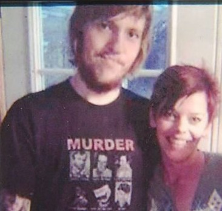
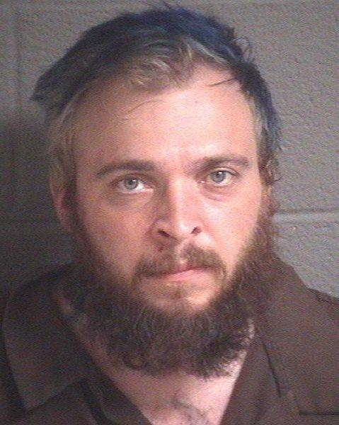

---
# Fact-checked October 11, 2026 against every source below. S8 is checked against the chapter
# summary only. The full chapter is paywalled.
# Family wishes: in April 2015, Rex Taylor's aunt asked people to "let him rest." Keep Rex at the
# edges of the story and never describe how he died beyond what is here.
# Keep Charles at the center. No lead photo until there is one of him confirmed. His obituary
# (S10) shows a stag, not a portrait. The Gun Memorial page's photos are not reliably identified. Never describe or link the
# photo taken at the scene, and never name the Tumblr blog or the website it was sent to.
# Amanda Taylor's claims about Charles were never proven. Always attribute them to her.
# Photos: the only photo of Rex is the one his family gave WSLS, cropped to remove the child.
# Never show the couple's children. Captions say who, nothing more.
draft: false
title: "The 2015 killing of Charles Taylor in Montgomery County, Virginia"
seoTitle: "Charles Taylor: What Happened in Montgomery County, VA"
description: "Charles Taylor was killed in his Virginia home in 2015. His killer blamed his late son. His family says Rex loved his father."
person: "Charles Taylor"
summary: "Charles Taylor, 59, was killed at his home in Montgomery County, Virginia, on April 4, 2015. [S1] His daughter-in-law, Amanda Taylor, blamed him for her husband's death. [S5] A jury convicted her of murder, and she was sentenced to life in prison. [S5] Sean Ball pleaded guilty to first-degree murder. [S6]"
status: solved
town: "Montgomery County"
state: VA
incidentDate: 2015-04-04
lastSeenDate: null
resolvedDate: 2015-11-12
lastChecked: 2026-10-11
lastFactChange: 2017-03-23
published: 2026-10-11
agency: "the Montgomery County Sheriff's Office"
tipLine: null
anonymousTips: null
contentNote: "a violent killing and a suicide"
image: null
youtubeId: null
youtubeUploadDate: null
sources:
  - { id: S1, title: "Police believe suspect Amanda Taylor caused Sean Ball's severe injuries", publisher: "WSLS 10", url: "https://www.wsls.com/news/2015/04/07/police-believe-suspect-amanda-taylor-caused-sean-balls-severe-injuries/", date: 2015-04-06 }
  - { id: S2, title: "Amanda Taylor now facing federal attempted murder charges", publisher: "WSLS 10", url: "https://www.wsls.com/news/2015/04/09/amanda-taylor-now-facing-federal-attempted-murder-charges/", date: 2015-04-08 }
  - { id: S3, title: "Family of Rex and Charles Taylor speak out on Amanda Taylor", publisher: "WSLS 10", url: "https://www.wsls.com/news/2015/04/25/family-of-rex-and-charles-taylor-speak-out-on-amanda-taylor/", date: 2015-04-24 }
  - { id: S4, title: "Attorneys debate who took crime scene selfie during Amanda Taylor trial", publisher: "WSLS 10", url: "https://www.wsls.com/news/2015/11/12/attorneys-debate-who-took-crime-scene-selfie-during-amanda-taylor-trial/", date: 2015-11-12 }
  - { id: S5, title: "Amanda Taylor will spend life in jail", publisher: "WSLS 10", url: "https://www.wsls.com/news/2015/11/12/amanda-taylor-will-spend-life-in-jail/", date: 2015-11-12 }
  - { id: S6, title: "Sean Ball pleads guilty to murder of Montgomery County man", publisher: "WSLS 10", url: "https://www.wsls.com/news/2016/03/15/sean-ball-pleads-guilty-to-murder-of-montgomery-county-man/", date: 2016-03-15 }
  - { id: S7, title: "EXCLUSIVE: Amanda Taylor talks about Montgomery Co. murder, planned crime spree", publisher: "WDBJ7", url: "https://www.wdbj7.com/content/news/EXCLUSIVE-Amanda-Taylor-talks-about-Montgomery-Co-murder-planned-crime-spree-373366421.html", date: 2016-03-24 }
  - { id: S8, title: "The murder of Charles Taylor (chapter in Social Media Homicide Confessions, by Elizabeth Yardley)", publisher: "Bristol University Press, via Cambridge Core", url: "https://www.cambridge.org/core/books/social-media-homicide-confessions/murder-of-charles-taylor/10C4C897B806E0EA774F091ED27B915E", date: 2017-01-01 }
  - { id: S9, title: "Appeals court upholds life sentence for woman who killed father-in-law", publisher: "WSET", url: "https://wset.com/news/local/appeals-court-upholds-life-sentence-for-woman-who-killed-father-in-law", date: 2017-03-23 }
  - { id: S10, title: "Charles Earnest Taylor obituary", publisher: "Horne Funeral Home & Cremation Service", url: "https://www.hornefuneralservice.com/obituaries/Charles-Taylor-15/", date: 2015-04-04 }
timeline:
  - { date: 1955-08-08, text: "Charles Earnest Taylor is born. [S10]", section: "a-father-and-a-son" }
  - { date: 2014-08, text: "Rex Taylor, Charles's son, dies by suicide. [S3]", section: "a-father-and-a-son" }
  - { date: 2015-04-04, text: "Charles Taylor is killed at his home on Den Hill Road. [S1]", section: "april-4-2015" }
  - { date: 2015-04-05, text: "Amanda Taylor is arrested in North Carolina after a chase on I-40. Sean Ball is found injured on the Blue Ridge Parkway. [S1]", section: "the-road-south" }
  - { date: 2015-04-07, text: "A federal grand jury indicts Amanda Taylor on charges including attempted murder. [S2]", section: "the-road-south" }
  - { date: 2015-11-12, text: "A jury convicts Amanda Taylor of murder. She is sentenced to life in prison. [S5]", section: "what-we-know-now" }
  - { date: 2016-03-15, text: "Sean Ball pleads guilty to first-degree murder and is sentenced to 60 years. [S6]", section: "what-we-know-now" }
  - { date: 2017-03, text: "The Virginia Court of Appeals upholds Amanda Taylor's life sentence. [S9]", section: "what-we-know-now" }
updates:
  - { date: 2026-10-11, text: "Story published." }
---

Hope Marvin had one thing she needed people to understand, and she said it plainly.

Rex loved his father.

Three weeks earlier, Rex's father, Charles Taylor, had been killed in his own home in Montgomery County, Virginia. [S1] The woman charged with killing him was Rex's widow. [S3] And the reason she gave for it carried Rex's name. [S3]

Marvin was Rex's aunt. When she sat down with WSLS in April 2015, she did not argue about evidence or motive. She talked about her nephew. [S3]

"Rex wouldn't of wanted his father to be killed," she said. "He would not have wanted his father to be dead. Rex loved his father." [S3]

Then she asked for something harder. She asked everyone to let him rest. [S3]

## A father and a son

Charles Earnest Taylor was born on August 8, 1955. [S10] He was 59 when he died. He lived on Den Hill Road, in the Ellett area of Montgomery County. [S1] His elderly father, Allen, lived with him and was bedridden. [S4, S8] His son, Rex, was living with him too, in the last part of his life. [S3]

His obituary lists the people he left behind. His father. A brother in North Carolina. Two aunts in Christiansburg. Two grandchildren. Nieces and nephews. His mother, Ruth, had died before him, and so had a brother, James, and his son. The family kept the services private and asked that any gifts go to the cemetery at North Fork Baptist Church. [S10]

That is very nearly all the surviving record says about Charles, and it's worth stopping on how little that is. Notice where the record spends its words. Hold onto that. It matters later.

Rex died by suicide in August 2014. His family said he had struggled with depression. [S3] He was married to Amanda Taylor, which made her Charles's daughter-in-law. They had two small children. [S3]

After Rex died, Amanda blamed Charles. She accused him of causing Rex's drug addiction, and she held him responsible for her husband's death. [S4, S8] Those were her accusations. Nothing in the public record shows that any of it was true.

Rex's family saw it differently. In their telling, Rex was a young man who suffered from depression and who loved his father. [S3] Those two accounts never met in the middle, and Rex was no longer there to settle it.

Eight months passed between Rex's death and the day Amanda went to his father's house.

## April 4, 2015

Amanda was 24. Sean Ball was 32. [S1]

On April 4, Ball drove her to Charles's home. [S8] She had been there that morning, prosecutors said, to get money for her children's Easter presents. She came back that evening. [S4]

She carried a bayonet, bought at a military store. [S5] Ball brought a tire iron. [S6] Charles's father was in the house. [S4]

Charles was killed there, in his own home. [S5] That is all this story will say about how.

Then someone took a picture.

Amanda posed for a photograph at the scene. [S5] At her trial, the lawyers argued over whether she took it herself or Ball did. [S4] That question mattered in court. What matters here is simpler. The picture existed, and it was of her.

The photograph did not stay in that house.

## The road south

Before they left, the two took money from Charles's wallet, police said, and headed for North Carolina. [S4]

On Sunday, April 5, North Carolina troopers spotted Amanda's car on Interstate 40. After a two-mile chase, they stopped it with spike strips and arrested her. [S1]

Ball was not with her.

Just after 7 p.m. that evening, a 911 caller reported an injured, unresponsive man at milepost 386 of the Blue Ridge Parkway. Investigators connected that call to Ball, who ended up in a North Carolina hospital with a life-threatening injury. [S1, S2] The Parkway's chief ranger said the evidence pointed to Amanda, including a statement she gave to the Highway Patrol. [S1] Two days later, a federal grand jury in North Carolina indicted her on charges including attempted murder. [S2] In a 2016 phone interview with WDBJ7, she said she shot him. He survived. [S7] How the federal case ended is not part of the record we have.

So within about a day, the two people who had gone to Charles's home together were apart. One was in custody. The other was hurt beside a mountain road, shot by the woman he'd gone there with.

## The picture

Go back to the photograph, because here is where the story turns cold.

Amanda sent it to a friend, who posted it on what was described in court as a serial killer website. [S5] A scholarly account of the case traces it further. That same day, it says, the image went up on Amanda's Tumblr blog and was sent to an online friend who ran a website about serial killers. [S8]

Sit with the timeline. Within hours of Charles Taylor's death, while the people who loved him were only beginning to learn what had happened, a picture from that house was already traveling toward an audience that collects stories about killers.

The picture was made to show her. It was her in the frame, posed, and that is where it pointed every eye that saw it.

Remember how little the record holds about Charles: his age, his road, his father, his son. Now you can see why. The attention went exactly where that photograph sent it. Toward her.

Hope Marvin seemed to understand this before anyone else said it out loud. In that April interview, she said she did not want Amanda getting any more attention. She said she thought it was about Amanda trying to make herself look good. [S3] And then she brought the conversation back, again, to Rex.

"They need to let him rest and quit talking about him," she said. [S3]

## What we know now

Amanda pleaded not guilty. At her trial, her own lawyers opened by conceding that she killed Charles Taylor. [S4]

On November 12, 2015, a Montgomery County jury deliberated for less than 25 minutes and found her guilty. She was sentenced to life in prison that same evening. [S5]

Sean Ball took a different route. On March 15, 2016, he pleaded guilty to first-degree murder. He was sentenced to 60 years, with 41 years and one month to serve, followed by 10 years of probation. [S6] He was not a bystander to what happened in that house. He admitted taking part, and he apologized to Charles's family and to his own. [S6]

In March 2017, the Virginia Court of Appeals upheld Amanda's life sentence. [S9]

Those are the verdicts. They settle who killed Charles Taylor. They do not settle everything.

The accusation Amanda made against Charles, that he had a hand in his son's addiction and death, was never proven. It survives only as her claim. The question of who held the camera was argued in court and never cleanly answered in the reporting. [S4] And the federal case over the shooting on the Blue Ridge Parkway trails off without an ending.

Here's where the record goes quiet on the thing that matters most. We don't know who Charles Taylor was on an ordinary Tuesday. We don't know what he did for work, what he cared about, or what his son remembered about him as a boy. We know he shared his home with his father and, at the end, with his son, and that his family chose to grieve him privately. Someone knows the rest. It just isn't what got written down.

## What the family asked for

Rex's aunt drew a line in that interview, and it is the clearest thing anyone said about this case.

A son's death did not prove his father's guilt. A widow's grief did not make her choices anyone's but her own. And a crime committed in Rex's name was not Rex's crime.

"He didn't commit this crime," Marvin said. [S3]

We have tried to honor what she asked by keeping Rex at the edges of this story, and by refusing to put the photograph or its subject at the center. Charles deserves to be the one remembered here, even if the record left us so little of him to remember.

Which leaves a question we'd like to hear your thoughts on. When the person who did the harm is the one who wanted the camera, and the people who were harmed can no longer speak, what do we owe them in the way we tell it?
