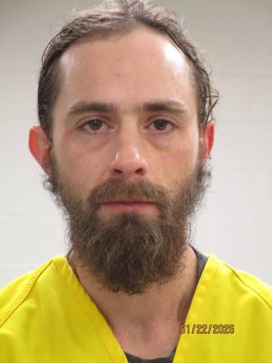

---
# Researched and written October 21, 2026 by Poe. Case status checked October 21, 2026.
# Legal care: Albert John Wolfe is CHARGED with first-degree murder in Christian's death, not convicted.
# He has pleaded not guilty. Never state or imply he killed Christian. The case against him is always
# attributed to the complaint and affidavit (S1) or to prosecutors. Christian's body has not been found.
# Wolfe's own statements (he took the car apart, he found a phone by his mailbox, he knew nothing about
# Christian) are given as his statements, from S1.
# The friend: the affidavit calls her "MW." She is the alleged eyewitness to a shooting and is Wolfe's
# former girlfriend. No source reports a charge against her. Never name her or print her initials, and
# never suggest she took part in anything beyond what she told investigators. Her account is an
# allegation in a charging document, not a finding.
# His mother and the woman who went to the farm with her on May 5, 2020, are not part of any allegation.
# The separate case: Wolfe is charged with sexual abuse, grooming and lascivious conduct involving a minor
# (S12). Trial set November 17. One line only. Never give the complainant's age, sex, town or anything
# else that could identify them. No source connects that case to Christian's.
# Left out on purpose: Wolfe's date of birth and street address (both in S1), the farm's street number,
# the names of Christian's sons (minors), and any detail of the alleged killing beyond the one sentence in S1.
# Photos: all from Justin, October 21, 2026: Christian (a close crop and a photo with two young children),
# a 1997 Toyota Corolla, and Wolfe's booking photo (dated January 22, 2026 on the image). The children's
# faces are blurred and they are not identified. The Corolla is similar to Christian's, not his car, and
# the caption says so. The booking caption is neutral and repeats the not-guilty plea.
# Conflicts in the text: date reported missing (May 2 in S2 and S11, May 3 in S4, S5 and S6, formally
# entered May 5 in S1). Last contact (6:45 a.m. phone ping May 2, but the family's report to police
# describes silence since about 2 a.m. May 3, both S1). Hometown (Rockwell City S4, S5, Farnhamville S6,
# S10, Carroll S3). Arrest date (January 22 in S2, S3, January 21 in S11). The farm is "north" of Carroll
# (S3, S5) or "northeast" (S1). The car "found burned in a shed" (S3) or found buried under rubble at
# the burn site during the search (S1). Who called in the fire: a neighbor (S1). KTIV (S7) says an
# officer. The text follows S1 and doesn't raise the KTIV wording.
# Rewritten October 22, 2026 in the house voice. No new facts. "Where it stands" is gone: the trial date,
# the prosecutors and the still-active line moved to "Not guilty", the line on the friend's untested account
# and the May 2/May 3 gap line stay there (the gap line now carries [S1]), and the recap paragraph is cut as a
# repeat. Cut: "This story's case status was last checked on October 21, 2026" (the case file shows it), the
# tip paragraph with the coldcase@ag.iowa.gov email (S3. tipLine carries the number), and "no one yet knows
# what a jury will make of the friend's account". The 2021 "carbon copy" quote moved to "Four years of
# searching". May 5 is now its own section, "The driveway". The reader question moved to readerQuestion.
# Same origin: S7, S8, S9 and S10 all report S1 (and the S2 and S3 releases). They are not independent
# confirmation of the friend's account.
draft: false
title: "The Car in the Shed: The Disappearance of Christian Balke-Thompson"
seoTitle: "Christian Balke-Thompson: What Happened Near Carroll, IA"
description: "Christian Balke-Thompson, 26, vanished in Iowa in May 2020. A burned car believed to be his was found on a farm. In 2026, a man was charged with murder."
person: "Christian Balke-Thompson"
summary: "Christian Balke-Thompson, 26, was last seen in the early hours of May 2, 2020, in Iowa. A burned car believed to be his was found on a farm north of Carroll. [S1, S3] He has never been found. In 2026, Albert Wolfe was charged with first-degree murder. He has pleaded not guilty, and his trial is set for January 2027. [S11, S12]"
status: in-court
town: "Carroll"
state: IA
incidentDate: 2020-05-02
lastSeenDate: 2020-05-02
resolvedDate: null
lastChecked: 2026-10-22
lastFactChange: null
published: 2026-10-22
agency: "the Iowa Attorney General's Cold Case Unit"
tipLine: "+18002425100"
anonymousTips: null
contentNote: "an alleged shooting and the burning of a body, and separate sexual abuse charges involving a minor"
image:
  src: "./christian-balke-thompson-2020.jpg"
  alt: "Christian Balke-Thompson smiling, in dark-framed glasses, with a mustache"
  credit: "Christian Balke-Thompson in an undated photo"
  license: "Photo supplied to Bone Chilling Tales"
youtubeId: null
youtubeUploadDate: null
sources:
  - { id: S1, title: "Complaint and Affidavit, State of Iowa v. Albert John Wolfe (murder in the first degree)", publisher: "Iowa District Court for Carroll County, released by the Iowa Department of Public Safety", url: "https://dps.iowa.gov/media/2956/download?inline", date: 2026-01-22, archive: "https://web.archive.org/web/20261021191324/https://dps.iowa.gov/media/2956/download?inline" }
  - { id: S2, title: "Suspect Arrested for First Degree Murder in 2020 Missing Person Case", publisher: "Iowa Department of Public Safety", url: "https://dps.iowa.gov/press-release/2026-01-22/suspect-arrested-first-degree-murder-2020-missing-person-case", date: 2026-01-22 }
  - { id: S3, title: "Attorney General Bird's Iowa Cold Case Unit Announces Murder Charge for the 2020 Disappearance of Christian Balke-Thompson", publisher: "Iowa Attorney General", url: "https://www.iowaattorneygeneral.gov/newsroom/attorney-general-birds-iowa-cold-case-unit-announces-murder-charge-for-the-2020-disappearance-of-ch", date: 2026-01-22 }
  - { id: S4, title: "Rockwell City man missing", publisher: "The Messenger (Fort Dodge)", url: "https://www.messengernews.net/news/local-news/2020/05/rockwell-city-man-missing/", date: 2020-05-13, archive: "https://web.archive.org/web/20261021190626/https://www.messengernews.net/news/local-news/2020/05/rockwell-city-man-missing/" }
  - { id: S5, title: "Missing man's car found in shed fire near Carroll", publisher: "Carroll Times Herald", url: "https://carrollspaper.com/news/missing-man-s-car-found-in-shed-fire-near-carroll/article_4e0db974-a5ad-11ea-848a-738aa5b0dea0.html", date: 2020-06-03, archive: "https://web.archive.org/web/20261021190730/https://carrollspaper.com/news/missing-man-s-car-found-in-shed-fire-near-carroll/article_4e0db974-a5ad-11ea-848a-738aa5b0dea0.html" }
  - { id: S6, title: "'Someone knows something': Farnhamville man has been missing for a year", publisher: "The Messenger (Fort Dodge)", url: "https://www.messengernews.net/news/local-news/2021/05/someone-knows-something/", date: 2021-05-15, archive: "https://web.archive.org/web/20261021190846/https://www.messengernews.net/news/local-news/2021/05/someone-knows-something/" }
  - { id: S7, title: "Suspect charged with first-degree murder in connection to May 2020 disappearance of Iowa man", publisher: "KTIV", url: "https://www.ktiv.com/2026/01/23/suspect-charged-with-first-degree-murder-connection-may-2020-disappearance-iowa-man/", date: 2026-01-23, archive: "https://web.archive.org/web/20261021191000/https://www.ktiv.com/2026/01/23/suspect-charged-with-first-degree-murder-connection-may-2020-disappearance-iowa-man/" }
  - { id: S8, title: "State investigators make arrest in 2020 Iowa cold case", publisher: "KCRG", url: "https://www.kcrg.com/2026/01/23/state-investigators-make-arrest-2020-iowa-cold-case/", date: 2026-01-23, archive: "https://web.archive.org/web/20261021191105/https://www.kcrg.com/2026/01/23/state-investigators-make-arrest-2020-iowa-cold-case/" }
  - { id: S9, title: "Lanesboro man charged with first-degree murder", publisher: "The Messenger (Fort Dodge)", url: "https://www.messengernews.net/news/local-news/2026/01/lanesboro-man-charged-with-first-degree-murder/", date: 2026-01-24, archive: "https://web.archive.org/web/20261021191223/https://www.messengernews.net/news/local-news/2026/01/lanesboro-man-charged-with-first-degree-murder/" }
  - { id: S10, title: "Lanesboro man arrested for murder of Farnhamville man", publisher: "Carroll Times Herald", url: "https://carrollspaper.com/news/lanesboro-man-arrested-for-murder-of-farnhamville-man/article_1aac84ce-1f53-47b2-a908-c03c7f689fbe.html", date: 2026-01-27, archive: "https://web.archive.org/web/20261021191243/https://carrollspaper.com/news/lanesboro-man-arrested-for-murder-of-farnhamville-man/article_1aac84ce-1f53-47b2-a908-c03c7f689fbe.html" }
  - { id: S11, title: "Man pleads not guilty, details released in 2020 missing person case", publisher: "WHO 13", url: "https://who13.com/news/iowa-news/man-pleads-not-guilty-details-released-in-2020-missing-person-case/", date: 2026-02-06, archive: "https://web.archive.org/web/20260209134315/https://who13.com/news/iowa-news/man-pleads-not-guilty-details-released-in-2020-missing-person-case/" }
  - { id: S12, title: "Trials set for Lanesboro man charged with sexual abuse, murder", publisher: "Carroll Times Herald", url: "https://carrollspaper.com/news/trials-set-for-lanesboro-man-charged-with-sexual-abuse-murder/article_45065900-3332-41e1-a90a-99892509625c.html", date: 2026-09-16, archive: "https://web.archive.org/web/20261021191308/https://carrollspaper.com/news/trials-set-for-lanesboro-man-charged-with-sexual-abuse-murder/article_45065900-3332-41e1-a90a-99892509625c.html" }
timeline:
  - { date: 2020-04-28, text: "Christian buys a green 1997 Toyota Corolla. It is his only way to get around. [S1]", section: "the-green-corolla" }
  - { date: 2020-04-29, text: "His mother last sees him, at his son's birthday party. [S4]", section: "b-t" }
  - { date: 2020-05-02, text: "Christian and a friend leave Fort Dodge around 5:30 a.m. His phone last pings near a farm north of Carroll at 6:45 a.m. [S1]", section: "the-green-corolla" }
  - { date: 2020-05-03, text: "Family and friends ask Rockwell City police to try to find him. [S1]", section: "the-fire" }
  - { date: 2020-05-04, text: "A neighbor reports a fire in a shed on the farm. A small car inside burns. [S1]", section: "the-fire" }
  - { date: 2020-05-05, text: "Christian is entered as a missing person. Officers search the farm that night and find a burned car under rubble. [S1]", section: "the-driveway" }
  - { date: 2020-06, text: "Searches of the property begin. They continue until March 2024. [S1]", section: "four-years-of-searching" }
  - { date: 2024-07, text: "The Iowa Attorney General launches a statewide Cold Case Unit. [S3]", section: "the-charge" }
  - { date: 2026-01-22, text: "Albert Wolfe is charged with first-degree murder. [S2, S3]", section: "the-charge" }
  - { date: 2026-02-06, text: "Wolfe pleads not guilty. Bond is set at $500,000 cash only. [S11]", section: "not-guilty" }
  - { date: 2026-09-16, text: "The murder trial is set for January 26, 2027. [S12]", section: "not-guilty" }
updates:
  - { date: 2026-10-22, text: "Story published." }
  - { date: 2026-10-22, text: "Story rewritten for flow. Wording on the burned car and on the friend's account was made more precise, and the closing question no longer puts words in his mother's mouth." }
  - { date: 2026-10-22, text: "Story rewritten. No facts changed." }
readerQuestion: "In 2020, his mother asked why anyone wouldn't help him come home. If you know something about what happened to Christian, what's stopping you?"
---
On April 29, 2020, Michelle Balke saw her son Christian at his son's birthday party. It was the last time she saw him. [S4] "He wanted to talk to me, we didn't get to talk that night," she told The Messenger a few weeks later. [S4]

That Saturday, May 2, she tried to call and text him, and his phone was off. "I just thought it was off or dead and didn't think much of it," she said. [S4]

Within days, officers found a burned car believed to be his on a farm north of Carroll. [S1, S3] Nearly six years later, the man who lived on that farm was charged with first-degree murder in Christian's death. He has pleaded not guilty. [S1, S2, S3, S11] Christian has never been found. [S1, S3] The account at the center of the charge comes from a woman who was with him that night, and it hasn't been tested in court. [S1]

## B-T

Christian Daniel Balke-Thompson was 26, and people called him "B-T." [S1, S4] He was six foot one and wore glasses. He had a bullet tattooed on the side of his neck and his mother's name tattooed on his left forearm. [S4]

He had two young sons. [S4] He liked to skateboard and spend time with them. [S6] His mother, talking to The Messenger in 2021, remembered him as funny, helpful, generous and stubborn. [S6] "He'd give you his pair of shoes and walk off," she said. She also called him "such a mama's boy." [S6]

The reports disagree on where he lived. In 2020, both local papers called him a Rockwell City man. [S4, S5] A year later, The Messenger said he was from Farnhamville. [S6] The Attorney General's office later said Carroll. [S3]

## The green Corolla

Around April 28, Christian bought a green 1997 Toyota Corolla from a private seller. According to the charging documents, it was his only way to get around. [S1]

Those documents, a complaint and affidavit filed in January 2026, give the investigators' account of the days that followed. Most of what comes next is drawn from them. [S1]

On the evening of Friday, May 1, Christian and a female friend drove the Corolla to a get-together at a house in Rockwell City. They stayed a while, then left in his car. [S1] Around 3 a.m. on Saturday, May 2, they stopped at a convenience store in Lake City. Then they drove to another one on the west side of Fort Dodge, where they stayed until about 5:30 a.m. [S1]

At 6:45 a.m., his phone pinged for the last time that investigators have reported. It pinged near a farm about five miles north of Carroll. [S1, S3]

A man named Albert Wolfe lived alone on that farm. The affidavit describes him as an acquaintance of the friend who was with Christian that night, and her former boyfriend. [S1]

## The fire

Christian's family noticed the silence. [S1, S4] On Sunday night, May 3, at 8:55 p.m., family and friends called the Rockwell City Police Department and asked officers to try to find him. Nobody had heard from him in about 18 hours, they said, and that wasn't like him. [S1]

The next night, Monday, May 4, at about 9 p.m., one of Wolfe's neighbors called 911 to report a fire on his farm. [S1] The fire seemed to have started in or near a small four-door sedan parked inside a shed. The shed was a total loss, and the car was burned past recognizing. [S1] At the time, the affidavit says, Carroll County authorities didn't know the farm had any connection to a missing man. [S1]

## The driveway

On Tuesday afternoon, May 5, Christian's mother and another woman drove out to the farm. [S1] According to the affidavit, Wolfe "came down the driveway and denied knowing anything about Balke-Thompson before kicking them off his property." [S1]

About 5 p.m. that day, a Rockwell City officer called Carroll County dispatch and asked for help finding him. The officer said family and friends hadn't heard from Christian since around 2 a.m. on May 3. [S1] The affidavit's own phone record puts his phone near the farm at 6:45 a.m. on May 2. [S1] His mother said his phone was already off when she tried him that Saturday. [S4]

At 10 p.m., Rockwell City police formally entered Christian as a missing person. [S1] The state's arrest release says he was reported missing May 2. [S2] News reports from 2020 and 2021 say May 3. [S4, S5, S6]

## What was under the rubble

Later that night, officers served a search warrant on the farm. [S1] A Carroll County deputy and an Iowa State Patrol trooper saw what the affidavit calls "fresh activity around the burn site, including a car buried underneath rubble." A skid loader nearby appeared to have been used to pile dirt, manure and debris on top of it. [S1] The Attorney General's office describes it differently, saying a vehicle believed to be his was "found burned in a shed." [S3]

The car was too badly burned, and too deeply buried, for anyone to find a vehicle identification number. The deputy compared what was left of the engine compartment and the rear light moldings to pictures of a 1997 Toyota Corolla online, and determined that they were consistent. [S1] Calls to Christian's phone went straight to voicemail. [S1]

Wolfe talked to investigators. According to the affidavit, he admitted taking the Corolla apart and cutting it up, but he denied knowing anything about Christian's disappearance. He said that when the car caught fire, it burned the car, the shed and some of what was inside. [S1] He also told them he had found a phone in a plastic bag near his mailbox. [S1] Investigators later determined it was Christian's. [S1]

## Four years of searching

In mid-May 2020, the Iowa Division of Criminal Investigation still wasn't saying much in public. [S4] "We're just continuing running down leads and really don't know if he left on his own," Special Agent Ray Fiedler told The Messenger. "I can't say there was foul play, I can't say he left on his own, I just don't know." [S4]

His mother did her own asking. She told The Messenger that May that she had been "going around in circles," talking to his friends and trying to learn where he was. [S4] "Why wouldn't you help somebody come home to their children and their mother, whether it gets you in trouble or not?" she said. "It's just unbelievable." [S4]

The DCI wouldn't say whether Christian was believed to have a vehicle with him. "There are certain things that we're looking at, but I don't want to give that out because only certain people would know that," Fiedler said. [S4] In June, the Carroll Times Herald reported that officers had recovered what they believed was "debris" from Christian's car. Further details were being withheld while the investigation went on. [S5]

A year later, his mother told The Messenger she had "slammed and picked and poked and prodded at every person I could possibly." [S6] The family had told his boys that their father was in heaven. "We told the boys that he was gone because we had no other choice," she said. [S6] She didn't think he was still alive. He had gone through two Mother's Days without calling her, she said, and he never would have. [S6]

"Somebody knows something," she said. His oldest boy, she said, is "a carbon copy of Christian." [S6]

From June 2020 through March 2024, investigators searched Wolfe's property more than once. They didn't find Christian. [S1]

## The friend's account

The woman who was with Christian that night kept talking to investigators. According to the affidavit, she gave them her account in interviews over the next three years. [S1] What follows is that account as the affidavit sets it out. It is her account, and it hasn't been tested in court. [S1]

She said she was driving the Corolla when they got to Wolfe's farm, because Christian was asleep. She said Wolfe told her to pull the car into a shed, and she did. Then she went into the house, leaving Christian in the car. [S1]

Minutes later, she said, she heard what she described as a shotgun blast. She said she ran to the shed and saw that Wolfe had shot Christian. [S1] She said Christian was wrapped in a tarp, taken to a burn pile on the property, and set on fire. [S1]

She also told investigators she stayed on Wolfe's farm for an extended time afterward, the affidavit says. [S1] No source reviewed for this story reports any charge against her.

## The charge

In July 2024, Iowa Attorney General Brenna Bird launched a statewide Cold Case Unit. Her office said the unit gave the case "a focused team to meet with witnesses and pursue leads." [S3]

On January 22, 2026, Albert John Wolfe, 33, of Lanesboro, was arrested and charged with first-degree murder in Christian's death. [S2, S3] One TV report, citing court records, gives the arrest date as January 21. [S11] The investigation was conducted by the Carroll County Sheriff's Office, the Iowa Division of Criminal Investigation and the Attorney General's Cold Case Unit. [S2]

"This arrest is a milestone in securing justice for Christian Balke-Thompson and his family," Bird said. "No one should get away with murder, and no family should have to wait for answers." [S3] A criminal charge is an accusation, and Wolfe is presumed innocent unless proven guilty. [S2, S3]

## Not guilty

On February 6, court filings showed Wolfe had entered a written plea of not guilty and demanded a speedy trial. [S11] He had been held without bail after his arrest. At a hearing that day, a $500,000 cash-only bond was set, and that afternoon he was still in the Carroll County Jail. [S11] If convicted of first-degree murder, he could be sentenced to life in prison with no possibility of parole. [S10]

In a separate case, Wolfe is also charged with five counts of third-degree sexual abuse, plus grooming and lascivious conduct with a minor. The charges are for conduct alleged in late 2025. He has not been convicted, and a jury trial in that case is set for November 17. [S12] Nothing in the reports reviewed for this story connects that case to Christian.

Wolfe's murder trial is set for January 26, 2027, in Carroll County. The Attorney General's office and the Carroll County Attorney's Office will prosecute. [S3, S12] The Attorney General's office says the investigation is still active. [S3] The sources reviewed for this story don't say whether Wolfe is still in jail.

The claim that Wolfe shot Christian, and that his body was burned on the farm, comes from the friend's account in the affidavit. A court hasn't tested it. [S1] No one has publicly explained the gap between a phone ping at the farm on the morning of May 2 and a last contact his family put at May 3. [S1]

In 2021, his mother said what she wanted most. "That's all I want to know, what happened, because then he's not missing, he's not missing," she said. [S6]

Christian has not been found. [S1, S3]
