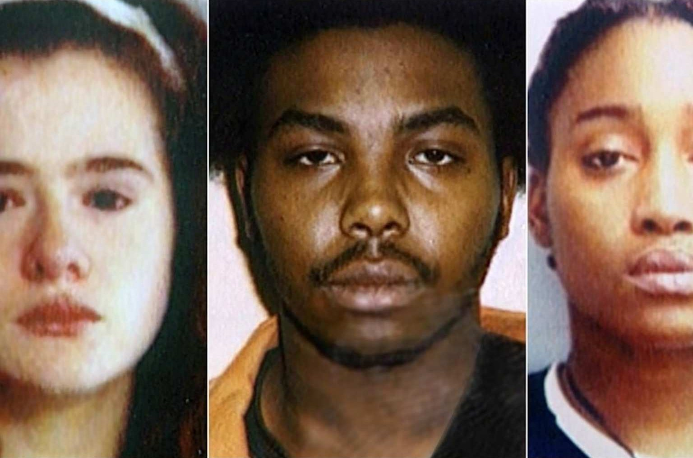
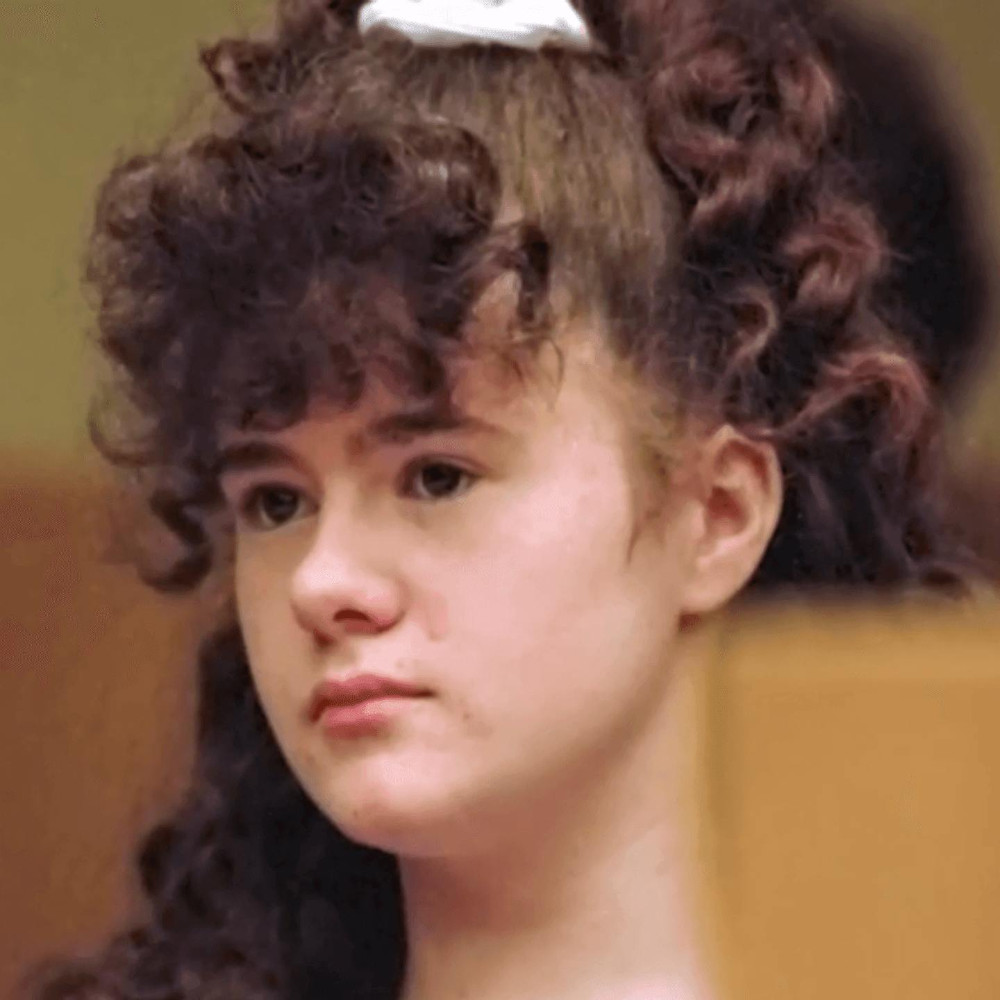
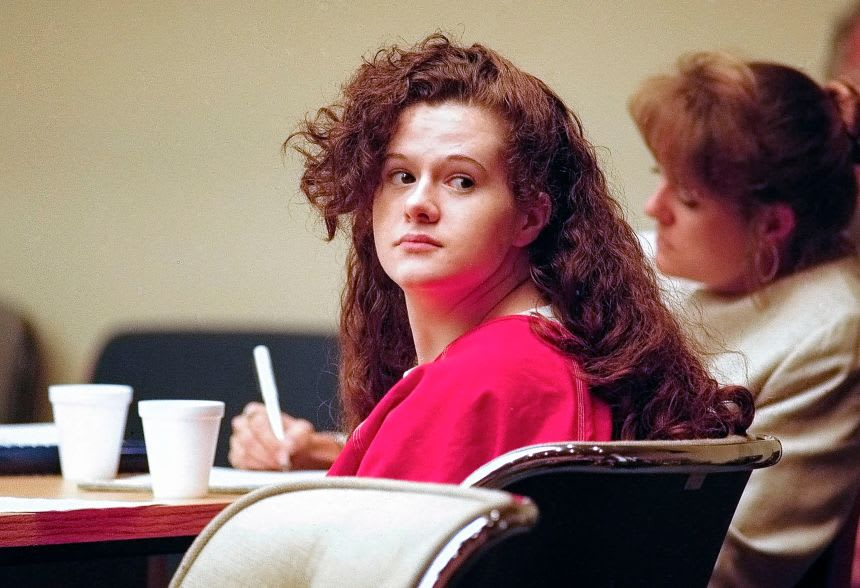
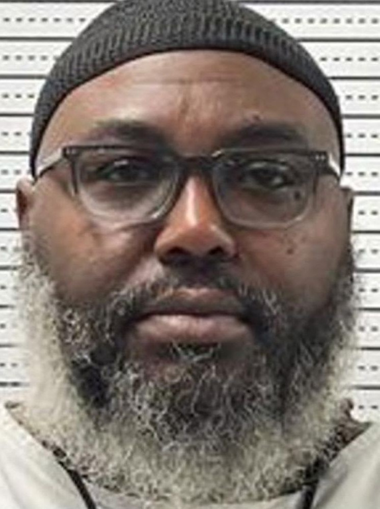
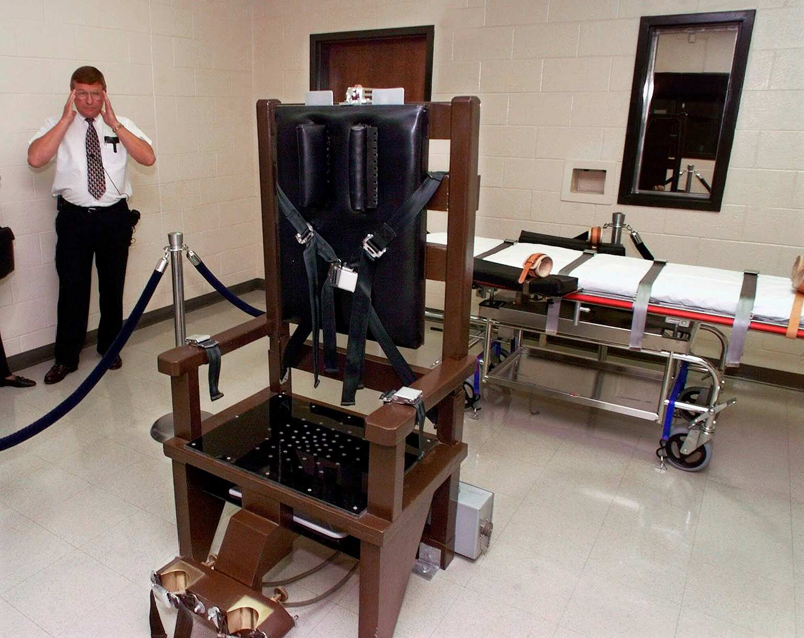
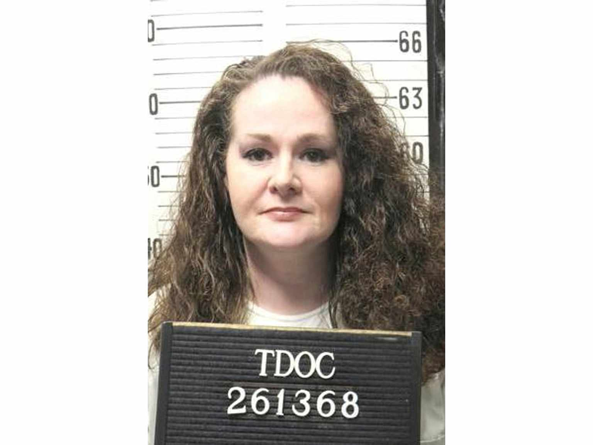

---
# Fact-checked October 9, 2026 against the full text of every source below.
# Rewritten October 11, 2026 from Justin's new draft. New facts checked against S1 (via S10), S2, S3, S7, S8, S10, S11, S12.
# Rewritten again October 18, 2026 by Poe at Justin's request, using the mailer-true-crime skill for structure
# and rhythm only: titled parts, sections split by * * * breaks, short flat paragraphs, a chorus of people
# on the record, and documents quoted as documents. No free indirect discourse. Nobody's thoughts are
# written unless a source records them saying it. Three new sources (S13, S14, S15) cover September 30 and after.
# S1's own page (tncourts.gov) blocks non-browser readers. Its full fact section is quoted word for word in S10,
# and that is the text these facts were checked against.
# Legal care:
# - Pike and Shipp were convicted. Peterson was convicted as an accessory. Their acts are stated as the
#   court record gives them. Anything that comes only from Pike's own statement is attributed to her.
# - Pike's claims about Colleen (the boyfriend, the talk, provoking her) are Pike's account, attributed.
# - The defense team's testimony about Dr. McCoy and the lead prosecutor, William Crabtree, is sworn
#   post-conviction testimony as summarized by the federal court (S10). It stays attributed to Rice and
#   Talman. Nobody found that it was improper. Don't add to it.
#   Talman's side is kept with it: McCoy told him she never discussed the case with Crabtree, and he never
#   doubted either one (S10, pp. 25-26). Keep those lines if the dating line stays.
# Pike's letter is quoted from WVLT's English text (S16), not from Telemundo's Spanish translation (S9).
# - Wound details and the carving are left out on purpose. Sources disagree on who carved it: Pike denied
#   it in her statement (S1), her own expert agreed on cross-examination that she did (S1), Shipp later
#   said he did (S7), and S13 states it as Shipp.
# - Execution night: kept to times, words spoken and what the lawyer and officials said. No medical detail
#   beyond what her lawyers stated about her arms and her condition.
# Conflicts in the text: Peterson's sentence, probation (WVLT) or parole (UT Knoxville), both via S7.
# S14 gives the execution times in Eastern time. S8 and S13 give the same moments in Central. The story uses Central.
# Rewritten October 22, 2026 in the house voice. No new facts. The opening adds the three convictions (S7),
# the death sentence (S1) and the failed execution (S6), restated from later sections. "The trial" is split
# into "The trial", "Dr. McCoy" and "Shipp and Peterson". The * * * breaks are gone. Cut: "She never said
# from whom" (the cleaver, S1), "Only a little of it needs to be told here", "And there were the computers",
# the media-rights release and Talman's book talk with Carrie Ross (S10), Officer Mark Waggoner fetching the
# gloves (S1), the Jacksonville fundraising (S5), the reporters interrupted by emergency vehicles (S8), and
# Ed Stanton named to lead the review (S6). The outside review itself stays. The closing question moved to
# readerQuestion, reworded October 22 to count 30 years from the verdict and to match the commutation request (S18). Two Pike quotes and two Martinez quotes are joined without a second "she said". No words changed.
# Updated October 22, 2026 from S17 and S18. S18 reports what her lawyers told TMZ, so her condition stays
# attributed to them. A Davidson County evidence-preservation order appears in search results but no source
# for it could be opened, so it is left out.
# Phil Keith: police chief "when Pike was sentenced" (S11) or "during the 1995 murder" (S15). The story uses S11.
draft: false
title: "Four Walked Out, Three Came Back: The Murder of Colleen Slemmer"
seoTitle: "Colleen Slemmer: What Happened in Knoxville, TN"
description: "Colleen Slemmer, 19, left Florida to study computers at Knoxville Job Corps. In 1995, four students walked out. Only three came back."
person: "Colleen Slemmer"
summary: "Colleen Slemmer was 19 and training at the Knoxville Job Corps Center when she left the center with three fellow students on January 12, 1995. [S1] She was killed that night. Christa Pike was sentenced to death. [S1] On September 30, 2026, Tennessee tried to execute Pike and failed. [S6] She is back in prison. [S8]"
status: in-court
town: "Knoxville"
state: TN
incidentDate: 1995-01-12
lastSeenDate: null
resolvedDate: null
lastChecked: 2026-10-22
lastFactChange: 2026-10-22
published: 2026-10-09
agency: "Knox County Criminal Court"
tipLine: null
anonymousTips: null
contentNote: "a prolonged, violent killing and childhood sexual abuse"
image:
  src: "./colleen-slemmer-1995.jpg"
  alt: "Colleen Slemmer as a smiling teenager in a striped shirt, in a school portrait"
  credit: "Slemmer family photo"
  license: "Family photo published in news coverage of the case"
youtubeId: null
youtubeUploadDate: null
sources:
  - { id: S1, title: "State of Tennessee v. Christa Gail Pike, No. 03S01-9712-CR-00147 (opinion affirming the conviction and death sentence)", publisher: "Tennessee Supreme Court", url: "https://tncourts.gov/node/19969", date: 1998-10-05 }
  - { id: S2, title: "Pike v. Warden, application for extension of time to file a petition for certiorari (describes the Sixth Circuit's 2019 ruling)", publisher: "Supreme Court of the United States, No. 19A642", url: "https://www.supremecourt.gov/DocketPDF/19/19A642/124745/20191206143532120_Pike%20cert%20extension%20request.pdf", date: 2019-12-06 }
  - { id: S3, title: "Board denies parole for man convicted in 1995 'Job Corps Murder'", publisher: "WVLT", url: "https://www.wvlt.tv/2025/10/21/board-denies-parole-man-convicted-1995-job-corps-murder/", date: 2025-10-21, archive: "http://web.archive.org/web/20261008211945/https://www.wvlt.tv/2025/10/21/board-denies-parole-man-convicted-1995-job-corps-murder/" }
  - { id: S4, title: "'It's hard to deal with': 'Job Corps Murder' victim's mother continues to fight for justice in brutal Knoxville case", publisher: "WVLT", url: "https://www.wvlt.tv/2025/10/09/its-hard-deal-with-murder-victims-mother-continues-fight-justice-brutal-1995-murder/", date: 2025-10-09, archive: "http://web.archive.org/web/20260917160204/https://www.wvlt.tv/2025/10/09/its-hard-deal-with-murder-victims-mother-continues-fight-justice-brutal-1995-murder/" }
  - { id: S5, title: "Mother of Christa Pike's victim says she is owed an apology after botched execution", publisher: "Good Morning America (ABC News)", url: "https://www.goodmorningamerica.com/news/story/mother-christa-pikes-victim-speaks-botched-execution-broke-136950906", date: 2026-10-02 }
  - { id: S6, title: "Tennessee's outgoing prison chief had a history of execution missteps before Christa Pike, officials say", publisher: "CNN", url: "https://www.cnn.com/2026/10/05/us/christa-pike-execution-tennessee", date: 2026-10-05 }
  - { id: S7, title: "Christa Pike wasn't the only one who tortured, killed Colleen Slemmer. Here's what happened to the other 2", publisher: "WSMV", url: "https://www.wsmv.com/2026/10/02/christa-pike-wasnt-only-one-who-tortured-killed-colleen-slemmer-heres-what-happened-other-2-who-were-involved/", date: 2026-10-02, archive: "http://web.archive.org/web/20261010204814/https://www.wsmv.com/2026/10/02/christa-pike-wasnt-only-one-who-tortured-killed-colleen-slemmer-heres-what-happened-other-2-who-were-involved/" }
  - { id: S8, title: "Christa Pike (case updates)", publisher: "Death Penalty Information Center", url: "https://deathpenaltyinfo.org/tag/christa-pike", date: 2026-10-10 }
  - { id: S9, title: "'No tengo miedo de morir': Tennessee ejecuta hoy a una mujer, la primera en más de 200 años", publisher: "Telemundo Nashville, via KTTC (in Spanish)", url: "https://www.kttc.com/2026/09/30/no-tengo-miedo-de-morir-tennessee-ejecuta-hoy-una-mujer-la-primera-en-ms-de-200-aos/", date: 2026-09-30, archive: "http://web.archive.org/web/20261004114330/https://www.kttc.com/2026/09/30/no-tengo-miedo-de-morir-tennessee-ejecuta-hoy-una-mujer-la-primera-en-ms-de-200-aos/" }
  - { id: S10, title: "Pike v. Freeman, No. 1:12-cv-35 (memorandum opinion denying habeas relief, quoting the Tennessee Supreme Court's account of the trial)", publisher: "U.S. District Court for the Eastern District of Tennessee, via GovInfo", url: "https://www.govinfo.gov/content/pkg/USCOURTS-tned-1_12-cv-00035/pdf/USCOURTS-tned-1_12-cv-00035-1.pdf", date: 2016-03-11 }
  - { id: S11, title: "Colleen Slemmer, murdered by Christa Pike, remembered as a 'computer geek' with a nurturing heart", publisher: "CNN, via KION", url: "https://kioncentralcoast.com/news/national-world/cnn-national/2026/10/09/colleen-slemmer-murdered-by-christa-pike-remembered-as-a-computer-geek-with-a-nurturing-heart/", date: 2026-10-09, archive: "http://web.archive.org/web/20261009111253/https://kioncentralcoast.com/news/national-world/cnn-national/2026/10/09/colleen-slemmer-murdered-by-christa-pike-remembered-as-a-computer-geek-with-a-nurturing-heart/" }
  - { id: S12, title: "Colleen Slemmer's family asks public to remember victim after failed execution attempt", publisher: "WZTV (Fox 17 Nashville)", url: "https://fox17.com/news/local/colleen-slemmers-family-asks-public-to-remember-victim-after-failed-execution-attempt", date: 2026-10-02, archive: "http://web.archive.org/web/20261002141909/https://fox17.com/news/local/colleen-slemmers-family-asks-public-to-remember-victim-after-failed-execution-attempt" }
  - { id: S13, title: "Inside the chamber: The agonizing moments of Christa Pike's stalled execution", publisher: "FOX 5 Atlanta (FOX Television Stations), from the accounts of six media witnesses", url: "https://www.fox5atlanta.com/news/christina-pike-stalled-execution-witnesses-describe-chaos", date: 2026-09-30 }
  - { id: S14, title: "Witnesses to Christa Pike's failed execution say their view was blocked multiple times", publisher: "WVLT/Gray News, via KOLD", url: "https://www.kold.com/2026/10/01/witnesses-christa-pikes-failed-execution-say-their-view-was-blocked-multiple-times/", date: 2026-10-01, archive: "http://web.archive.org/web/20261007211203/https://www.kold.com/2026/10/01/witnesses-christa-pikes-failed-execution-say-their-view-was-blocked-multiple-times/" }
  - { id: S15, title: "911 call transcript from botched Christa Pike execution released", publisher: "WSMV", url: "https://www.wsmv.com/2026/10/12/911-call-transcript-botched-christa-pike-execution-released/", date: 2026-10-12, archive: "http://web.archive.org/web/20261013122909/https://www.wsmv.com/2026/10/12/911-call-transcript-botched-christa-pike-execution-released/" }
  - { id: S16, title: "In letter, Christa Gail Pike says 'I am not afraid to die' ahead of Tennessee execution", publisher: "WVLT, via WSMV", url: "https://www.wsmv.com/2026/09/29/letter-christa-gail-pike-says-i-am-not-afraid-die-ahead-tennessee-execution/", date: 2026-09-29 }
  - { id: S17, title: "Christa Pike hearing in Nashville chancery court cancelled", publisher: "WZTV (Fox 17 Nashville)", url: "https://fox17.com/news/local/christa-pike-hearing-in-chancery-court-cancelled", date: 2026-10-22, archive: "https://web.archive.org/web/20261022205447/https://fox17.com/news/local/christa-pike-hearing-in-chancery-court-cancelled" }
  - { id: S18, title: "Christa Pike speaks in full sentences weeks after botched execution, lawyers say", publisher: "The National News Desk, via WBFF (Fox 45 Baltimore)", url: "https://foxbaltimore.com/news/nation-world/christa-pike-speaks-in-full-sentences-weeks-after-botched-execution-lawyers-say-lethal-injection-death-row-drug-medical-emergency-cognitive-psychological-functions-first-words-commutation-colleen-slemmer-killing", date: 2026-10-22, archive: "https://web.archive.org/web/20261022205513/https://foxbaltimore.com/news/nation-world/christa-pike-speaks-in-full-sentences-weeks-after-botched-execution-lawyers-say-lethal-injection-death-row-drug-medical-emergency-cognitive-psychological-functions-first-words-commutation-colleen-slemmer-killing" }
timeline:
  - { date: 1975-09-20, text: "Colleen Slemmer is born in Orange Park, Florida. [S9]", section: "orange-park" }
  - { date: 1994-10-31, text: "Colleen says goodbye to her family and leaves for Job Corps in Knoxville. [S9]", section: "orange-park" }
  - { date: 1995-01-11, text: "Pike tells another student she plans to kill Colleen. [S1]", section: "job-corps" }
  - { date: 1995-01-12, text: "Around 8 p.m., Colleen leaves the center with Pike, Shipp and Peterson. Only three come back. [S1]", section: "the-steam-plant" }
  - { date: 1995-01-13, text: "A university grounds worker finds Colleen's body near the agricultural campus greenhouses. [S1]", section: "the-greenhouses" }
  - { date: 1995-01-14, text: "Pike gives police a recorded statement. [S1]", section: "the-jacket" }
  - { date: 1995-01-17, text: "Job Corps staff turn over Pike's jacket. A piece of bone is in the pocket. [S1]", section: "the-jacket" }
  - { date: 1996-03-22, text: "A Knox County jury convicts Pike of first-degree murder and conspiracy. [S7, S10]", section: "the-trial" }
  - { date: 1998-10-05, text: "The Tennessee Supreme Court upholds the conviction and death sentence. [S1]", section: "thirty-one-years" }
  - { date: 2019-08-22, text: "A federal appeals court rules against Pike's habeas appeal. [S2]", section: "thirty-one-years" }
  - { date: 2026-09-28, text: "Gov. Bill Lee denies clemency. [S8]", section: "thirty-one-years" }
  - { date: 2026-09-30, text: "Tennessee's attempt to execute Pike fails. [S6]", section: "september-30" }
  - { date: 2026-10-06, text: "Pike's lawyers say she is conscious and speaking. [S8]", section: "vanderbilt" }
  - { date: 2026-10-10, text: "Pike is released from the hospital and returned to prison. [S8, S15]", section: "vanderbilt" }
  - { date: 2026-10-22, text: "A hearing set for October 23 in Pike's chancery court case against the attorney general is taken off the docket. [S17]", section: "still-waiting" }
updates:
  - { date: 2026-10-09, text: "Story published." }
  - { date: 2026-10-11, text: "Story rewritten, with three new sources." }
  - { date: 2026-10-18, text: "Story rewritten in a new structure, with three new sources on the September 30 execution attempt and Pike's return to prison." }
  - { date: 2026-10-22, text: "Updated: Pike's lawyers renewed their request for commutation, and a chancery court hearing in her case against the attorney general was taken off the docket." }
  - { date: 2026-10-22, text: "Story rewritten. No facts changed." }
readerQuestion: "A jury decided in 1996 what justice for Colleen should be. Thirty years later, the sentence hasn't been carried out. As of early October, the state hadn't said whether it would try again. Pike's lawyers have since renewed their request for the governor to commute it. What do you think should happen now, and whose voice should count most?"
---
On Halloween 1994, Colleen Slemmer said goodbye to her family in Orange Park, Florida, and headed north. [S9] She was 19. She was going to study computers in Knoxville, Tennessee. [S11] It was the last time her family saw her. [S9]

Three of her fellow Job Corps students were convicted in her death, one of them as an accessory. [S7] One, Christa Pike, was sentenced to death. [S1] On September 30, 2026, Tennessee tried to execute Pike and failed. [S6]

## Orange Park

She was born on September 20, 1975. [S9] She grew up in Orange Park with her mother, May Martinez, her stepfather and her little sister. [S11]

"Colleen loved doing things," Martinez said. "She babysat. She loved to do anything with kids and I think it was part of me because I had daycare for 40 years." [S4]

She volunteered with the Special Olympics. She worked with children with disabilities and autism. On her lunch break she fed them and played with them, her mother said. [S11] She ran marathons. She roller skated every weekend. [S4] Her teachers remembered her as mild-mannered and sweet. Her family and friends talked about how independent she was. [S11]

"She was a computer geek to begin with," her mother said. "She and my husband would build and tear apart the computers constantly." [S11]

She wanted to make a career of it. She signed up for Job Corps, a federal job-training program, to study computing. [S9, S11] Her mother wasn't sure she wanted to see her move that far away. Colleen was set on going. [S9] The center was more than 500 miles from home. [S11]

"She trusted everybody," her mother said later, "and that was her downfall." [S11]

## Job Corps

Colleen had been in Knoxville about three months. [S11] Christa Gail Pike was a student there too. She was 18. Her boyfriend, Tadaryl Shipp, was 17. Shadolla Peterson was 18. [S1, S2, S7]

What Pike had against Colleen comes from Pike. [S1] She later told police the two of them had been having problems for some time. She said Colleen had been after her boyfriend and had been talking about her everywhere. She said Colleen had been provoking her on purpose, knowing one more fight would get Pike thrown out of the program. [S1]

On January 11, 1995, Pike talked to her friend Kim Iloilo, another student. She told Iloilo she was going to kill Colleen. The reason she gave was that she "had just felt mean that day." [S1]

On the night of January 12, Colleen talked to her mother on the phone. The reception was bad. The call was short. When May Martinez called back, Colleen didn't pick up. [S11] The record doesn't say what time that was.

## The steam plant

Around 8 p.m. that night, Kim Iloilo saw four people walking away from the center toward 17th Street. Pike. Shipp. Peterson. And Colleen. [S1]

Pike had asked Colleen to go with her to the Blockbuster Music store. On the way, she told her she had a bag of weed hidden in Tyson Park. That is how Pike described it to police. [S1] She had a box cutter with her, and a miniature meat cleaver. She said she had borrowed the cleaver. [S1] They walked to the steam plant on the University of Tennessee's agricultural campus. [S1]

Most of what is known about the next hour comes from Pike's own statement. [S1] She said she and Colleen exchanged words. Then she started hitting her. She said Colleen kept asking, "Why are you doing this to me?" [S1]

Colleen said she would report her. She tried to run. She was caught and pushed down. [S1] She begged. She said if they let her go, she would walk back home to Florida. She wouldn't even go back to the center for her things. [S1]

Pike told her to shut up. It "was harder to hurt somebody when they're talking to you," Pike said. [S1] At one point Pike thought she heard a noise. She left to check that no one was around. Then she came back. [S1]

The medical examiner, Dr. Sandra Elkins, found that Colleen died of blunt force injuries to her head. [S1]

At about 10:15, Kim Iloilo saw Pike, Peterson and Shipp come back to the center. Colleen was not with them. [S1]

## La, la, la

Later that night, Pike went to Iloilo's room. She told her she had just killed Colleen. She showed her a piece of bone. She said it was from Colleen's skull, and that she had brought it back as a souvenir. [S1] Iloilo said Pike was dancing in a circle while she told it. Smiling. Singing "la, la, la." [S1]

At breakfast the next morning, Iloilo asked her what she had done with it. Pike said it was in her pocket. "And yes, I'm eating breakfast with it." [S1]

Later that morning, in class, Pike talked to another student, Stephanie Wilson. She pointed to brown spots on her shoes. "That ain't mud on my shoes, that's blood." She took a napkin out of her pocket and showed Wilson the bone. [S1]

Neither Iloilo nor Wilson went to the police right away. [S1]

## The greenhouses

At about 8:05 that morning, January 13, a man from the University of Tennessee grounds department found Colleen near the greenhouses on the agricultural campus. He called the police. [S1] The officers kept finding more. Blood, clothing, footprints, broken plants. The crime scene grew to three times its size, 100 feet long by 60 feet wide. [S1]

That same day, Pike went to see Robert Pollock, an orientation specialist at the center, about a misplaced ID card. When she left, Pollock noticed a black leather jacket hanging on the chair where she had been sitting. He locked the room at about 4 p.m. The jacket was still on the chair. [S1]

Between 4 and 5 that afternoon, Pike walked up to the tape with three to five other young women. University of Tennessee police officer Harold Underwood was guarding the scene. [S1] Pike asked him why the area was marked off. She asked who the victim was. She asked if police had any suspects. [S1]

Underwood said Pike seemed amused. She giggled and moved around. He noticed her necklace. It was a pentagram. [S1] At roll call the next day, he learned something about the victim that made him think of it. He reported Pike to his superiors. [S1]

## The jacket

Investigator Randy York of the Knoxville Police Department interviewed Pike and Shipp separately on January 14. Pike waived her rights and talked. Her statement was tape-recorded. The transcript came to 46 pages. [S1]

> **CHRISTA PIKE**, recorded statement to Investigator Randy York, January 14, 1995, as quoted by the Tennessee Supreme Court:
>
> Colleen had been "trying to get her boyfriend" and "running her mouth."
>
> She hadn't planned to kill her. She meant to fight her and let her know "to leave me the hell alone."
>
> It lasted "for about thirty minutes to an hour."
>
> Near the end, she asked, "Colleen, do you know who's doing this to you?" [S1]

The court wrote that Colleen's only answer was a groan. [S1]

Pike told York her jeans were still in her room. She had rubbed the mud from her shoes onto them to hide the blood. [S1] She said she had thrown Colleen's black gloves and two of her ID cards in a trash can at a Texaco station on Cumberland Avenue. [S1]

She agreed to a search of her room. Then she went with York to the Job Corps center and retraced her steps from that night. She led him to the exact spot where Colleen was found. [S1] The Tennessee Bureau of Investigation found that blood on the clothing of both Pike and Shipp matched Colleen's DNA. [S1]

Robert Pollock came back to his office at 7:30 on the morning of January 17. The black leather jacket was still on the chair. [S1] Over the weekend he had heard that Pike was a suspect. He gave the jacket to William Hudson, the center's safety and security captain. Hudson called the police. [S1]

Officer Arthur Bohanan found a small piece of bone in the inside pocket. He took it straight to Dr. Murray Marks, a forensic anthropologist at the university. [S1] Marks had reconstructed Colleen's skull. One piece was missing. The bone from the jacket fit. [S1]

## The trial

Psychologist Eric Engum testified for the defense. He called Pike an "extremely bright young woman." She had an IQ of 111. She had no brain damage, he said, and she wasn't insane. [S1] He diagnosed a very severe borderline personality disorder. Once the attack started, he said, she had lost control. [S1]

On cross-examination, Engum said there was no question Pike had killed Colleen. [S1] He agreed she had enticed Colleen to the park. He agreed that carrying weapons showed deliberation. He agreed that when she walked off to check on the noise, she had time to calm down and think about what she was doing. [S1]

On March 22, 1996, a Knox County jury found Pike guilty of first-degree murder and conspiracy. [S7, S10] At sentencing, the state put on no new evidence. [S1]

The defense called three family members. Her aunt, Carrie Ross, said Pike had been raised by her paternal grandmother until the grandmother died in 1988. Her father, Glenn Pike, said he had kicked her out of his house twice. Her mother, Carissa Hansen, said she had smoked marijuana with her daughter to "establish a friendship." [S1] The state called Officer Underwood. He told the jury about the giggling at the tape. [S1]

The jury found two reasons for a death sentence. The killing involved torture or serious physical abuse beyond what it took to kill. And it was done to keep Colleen from reporting her. [S1] The sentence was death by electrocution, plus 25 years for the conspiracy. [S1, S10]

## Dr. McCoy

Pike's lawyers had hired a mitigation specialist, Dr. McCoy. She put together a three-volume report on Pike's life. The jury never heard from her. [S10]

Years later, at a hearing on Pike's appeal, her co-counsel, Julie Martin Rice, testified that several theories had been "floating around" about why they didn't call her. She wasn't sure which one decided it. One was that they had learned Dr. McCoy was dating the lead prosecutor, William Crabtree. [S10]

The lead lawyer, Bill Talman, testified that the main reason was that she wouldn't back up Engum. Talman testified to the relationship too. When he asked Dr. McCoy, she told him she had never talked to Crabtree about the case. He said he "never doubted Dr. McCoy's work or Mr. Crabtree's integrity." [S10]

Talman said the decision was made the morning the sentencing began, in "one of those little huddles outside during a break." [S10] "One of those last minute decisions that . . . you just [make]," he said. [S10] The courts later ruled that the decision didn't make her lawyers ineffective. [S10]

## Shipp and Peterson

Shipp was tried as an adult and convicted of first-degree murder and conspiracy. At 17, he was too young for the death penalty. He got life in prison with the possibility of parole. [S7]

Peterson became an informant. She was convicted as an accessory. [S7] WVLT reported six years' probation. The University of Tennessee says she received parole. [S7]

## Thirty-one years

The Tennessee Supreme Court upheld the conviction and the death sentence in 1998. [S1] The appeals kept coming back to the report the jury never saw. [S2] Her later lawyers described sexual abuse that began when she was 2, along with neglect, PTSD and bipolar disorder. [S8, S10]

In 2019 a federal appeals court ruled against her. Judge Jane Stranch agreed with the result but wrote separately. She called whether 18-year-olds should be sentenced to death "an issue with which our society must be concerned." At 17, like Shipp, Pike would not have been eligible. [S2]

In Florida, May Martinez said she had waited decades for the state to carry out the sentence. [S13] "Justice has to serve," she said in October 2025. "It cannot go on like this." [S4] What she couldn't get past was the skull. "Something you don't want to face, your daughter's skull in front of you everyday and have it passed around like it was a piece of meat," she said. [S4]

At a hearing on August 13, 2026, a lawyer for the state conceded the abuse. "I think we all wish that . . . she was not on death row," the lawyer said. [S8] The fight was over what that meant in law. [S2, S8]

On September 28, 2026, Governor Bill Lee denied clemency. [S8] Pike had written a letter before he decided. [S16]

> **CHRISTA PIKE**, letter, September 2026, as quoted by WVLT:
>
> "Whether my clemency is granted or not, I am at peace. I am not afraid to die. I am only nervous about the process." [S16]

## September 30

The execution was set for that Wednesday morning at Riverbend Maximum Security Institution in Nashville. Less than an hour before, a federal appeals court paused it. [S14] The state went to the U.S. Supreme Court. Just before 6 p.m., the court let it go ahead. Three justices dissented. [S13]

May Martinez and her husband had come up from Florida. She held a photo of Colleen as she stood in the gallery. [S11] Six reporters were there as media witnesses. They were seated in the witness room by 6:41. The curtains opened at 7:27. [S13]

Pike gave her last statement. "I just want to say that I'm going to leave this world the way I spent most of my life, and that is with love," she said. "I'm at peace, and I'm ready to go." [S13] She sang with her spiritual advisor. [S13]

At 7:34 she said, "The vein in my arm feels like it's about to bust." The advisor told her to relax. "I'm trying," she said. [S13]

The execution team gave her two doses of pentobarbital. [S15] The curtain closed at 7:46. It opened again three minutes later. Pike was snoring. [S8, S13] At 8:05 the curtain closed for the last time. The witnesses could still hear her behind it. [S8, S13]

"I cannot mention enough how much happened behind a closed curtain as Christa Pike was still alive," one witness said. [S14]

One of Pike's lawyers, Randy Spivey, witnessed it. He said he counted at least seven needles in her left arm alone. He said he had to leave his client in the middle of it and go through six locked doors to reach a phone. The number the Tennessee Supreme Court had given him went to voicemail. [S8]

At 8:40, a 911 call came in from the prison. [S15] At 8:53 the warden cut the microphone and told the witnesses to leave. [S8, S13]

The Department of Correction put out a statement. [S8, S14]

> "The Tennessee Department of Correction followed every step of the State's lawful, established execution protocol approved by the Attorney General's Office." [S8, S14]

May Martinez was told that Pike had been taken to the hospital. [S11] "She was laying on the table, talking, still laughing, picking up her head," she said the next day. [S5] She asked what would happen now. "'I don't know what we're doing with her yet.' That's the answer I got," she said. [S5]

"I said, 'Here we are, 31 years, and you're laughing in my face again.'" [S5]

## Vanderbilt

Pike was taken to Vanderbilt University Medical Center. [S15] Two days later, her lawyers said she was unconscious and on a ventilator, with significant injuries to both arms. [S5]

The next day, Governor Lee ordered an outside review and stopped all executions for the rest of the year. "There is no one that wanted what happened last night to happen," he said. "It shouldn't have happened." [S5] Asked whether he had talked to Colleen's family, he said he had not. [S5]

On October 3, the governor announced that the prisons chief, Frank Strada, would step down. [S6, S8]

On the evening of October 5, Pike's lawyers understood that she was brain dead. The hospital planned to take her off life support. [S8] The next morning she woke up and started talking. [S8, S15]

Phil Keith was the Knoxville police chief when Pike was sentenced. [S11] For Keith, her upbringing is no excuse. "If everyone that had an abusive lifestyle killed someone, there'd be a lot more murders in this country," he said. [S15]

A friend of Pike's, Misty Armstrong, said Pike spent much of her time in prison trying to help other inmates. "She changed and became a completely different person," Armstrong said. [S15] Stephen Ferrell, one of Pike's lawyers, put it this way. "This has been a serious punishment for a very serious and awful crime. I don't think that attempting another execution is going to bring justice." [S6]

On October 10, Pike was released from the hospital. She went back to the Deborah K. Johnson Rehabilitation Center, the prison where she has been held for more than 30 years. [S8, S15]

## Still waiting

Tadaryl Shipp is in prison. The parole board turned him down in October 2025, citing the seriousness of the crime. His next review is in October 2031. [S3] Shadolla Peterson has kept a private life. Where she is now isn't known. [S7]

Christa Pike's death sentence still stands. [S6] As of October 4, the state hadn't said whether it would try again, her lawyer said. [S6] By October 22, her lawyers said, she was speaking in full sentences and walking better without help. Her legal team has renewed its request for Governor Lee to commute her sentence to life in prison without parole. [S18]

Pike has a case in Nashville chancery court against the state attorney general, Jonathan Skrmetti. A hearing set for October 23 was taken off the docket. The judge's order says the attorney general's motion for a deadline for her to amend her complaint will be decided without oral argument. [S17] Governor Lee leaves office in January. [S6]

Colleen's niece, Morgan Sealy, said the family had gone into that week expecting justice. She asked people to think about Colleen, "and the pain that she suffered and the times that she missed out on." [S12]

"I think the state owes me a big apology," May Martinez said. "And as a mother, I failed her." [S5]

Colleen's family marked her birthday in September. She would have been 51. [S11] "Not a day goes by, or a minute goes by that I do not think about Colleen," her mother said. "Holidays are the worst." [S11]

The last time they saw her was Halloween. [S9]
