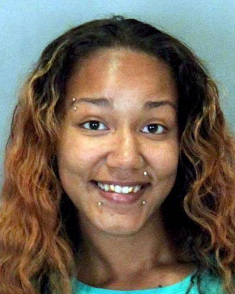
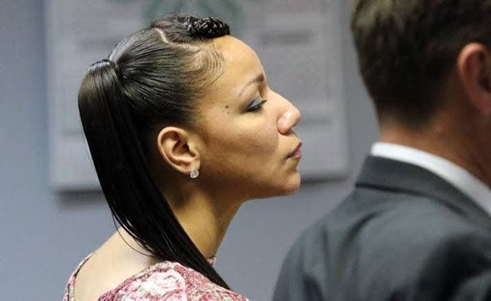
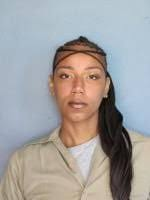
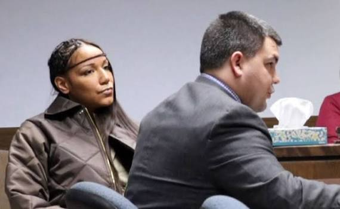

---
# Fact-checked October 14, 2026 against S1, S2 and S3 in full, and the news reports below.
# From Justin's draft "Brother and Sister." Changes from the draft: the four left the house in two
# groups, Lolo moved to the driver's seat, Easterling said Erica was "upset with Nikko," and the
# Bordeaux assault follows S3's order (hair, punches, then the padlock).
# "Spring Lake Park" is not named in any source here (S2 says "near a park"). Add it back once a
# source names it.
# Still open before this goes on main: victim-family privacy screening (flagged in the brief),
# the 2025 sentence in the second prison assault (not found), and dispositions for Lori Jenkins,
# Melonie Jenkins and Priscilla Fields. Erica's new legal name is left out on purpose.
# Keep the four people killed at the front. Nikko and Erica are never the lead photo.
# Photos: all from Justin. Lead is Curtis. An album cover with a photo of a boy and a man
# ("Murderface II") was left out: it is someone's artwork, and who is in it is unclear.
# Other victims' photos go in the section on the people lost. A fifth Erica photo, a professional
# portrait in a white sweater (Radiance Refined Photography watermark), was left out until it's confirmed to be her.
draft: false
title: "Brother and Sister: The Jenkins Siblings and the Omaha Killings of August 2013"
seoTitle: "Curtis Bradford: What Happened in Omaha, NE"
description: "In August 2013, Nikko and Erica Jenkins left a trail through Omaha. A shotgun slug led to their mother, and their own family testified."
person: "Curtis Bradford"
summary: "Curtis Bradford, 22, was shot and killed in Omaha on the night of August 18, 2013. [S1, S4] He was one of four people killed that month. [S7] Nikko Jenkins was sentenced to death. [S7] His sister Erica was convicted of Bradford's murder on the testimony of her own family and sentenced to life. [S1, S6]"
status: solved
town: "Omaha"
state: NE
incidentDate: 2013-08-18
lastSeenDate: null
resolvedDate: 2015-01-14
lastChecked: 2026-10-14
lastFactChange: 2024-12-20
published: 2026-10-14
agency: "the Omaha Police Department"
tipLine: null
anonymousTips: null
contentNote: "the shooting deaths of four people and a violent assault"
image:
  src: "./curtis-bradford-2013.jpg"
  alt: "Curtis Bradford in a blue baseball cap and an earring"
  credit: "Curtis Bradford, in a photo published in news coverage of the case"
  license: "Photo published in news coverage of the case. Original source not confirmed"
youtubeId: null
youtubeUploadDate: null
sources:
  - { id: S1, title: "State v. Jenkins, 294 Neb. 475 (opinion affirming Erica Jenkins's conviction for the murder of Curtis Bradford)", publisher: "Nebraska Supreme Court", url: "https://www.nebraska.gov/apps-courts-epub/public/viewCertified?docId=N00010015PUB", date: 2016-08-19 }
  - { id: S2, title: "State v. Jenkins, 294 Neb. 684 (opinion affirming Erica Jenkins's robbery convictions)", publisher: "Nebraska Supreme Court", url: "https://www.nebraska.gov/apps-courts-epub/public/viewCertified?docId=N00010026PUB", date: 2016-09-09 }
  - { id: S3, title: "State v. Jenkins, 28 Neb. App. 931 (opinion affirming Erica Jenkins's conviction for assaulting Christine Bordeaux)", publisher: "Nebraska Court of Appeals", url: "https://www.nebraska.gov/apps-courts-epub/public/viewAdvanced?docId=N00007414PUB", date: 2020-10-06 }
  - { id: S4, title: "Omaha man accused of four murders to be held without bond", publisher: "Associated Press, via KIOS", url: "https://www.kios.org/crime/2013-09-05/omaha-man-accused-of-four-murders-to-be-held-without-bond", date: 2013-09-05 }
  - { id: S5, title: "Erica Jenkins found guilty", publisher: "KLKN", url: "https://www.klkntv.com/?p=168190", date: 2015-01-14 }
  - { id: S6, title: "Judge adds 7 years to Erica Jenkins' life sentence", publisher: "Associated Press, via KIOS", url: "https://www.kios.org/crime/2015-06-02/judge-adds-7-years-to-erica-jenkins-life-sentence", date: 2015-06-02 }
  - { id: S7, title: "Man who killed 4 people in Omaha sentenced to death", publisher: "Associated Press, via KIOS", url: "https://www.kios.org/crime/2017-05-30/man-who-killed-4-people-in-omaha-sentenced-to-death", date: 2017-05-30 }
  - { id: S8, title: "Nikko Jenkins' sister convicted of assaulting woman who helped prosecutors", publisher: "KLKN", url: "https://www.klkntv.com/?p=54004", date: 2019-02-28 }
  - { id: S9, title: "Death row inmate's sister and convicted killer found guilty of assault in York, again", publisher: "KOLN (10/11 Now)", url: "https://www.1011now.com/2024/12/20/death-row-inmates-sister-convicted-killer-found-guilty-assault-york-again", date: 2024-12-20 }
timeline:
  - { date: 2013-02, text: "Someone fires shots at Erica Jenkins's home. [S1]", section: "the-people-lost-that-august" }
  - { date: 2013-08-11, text: "Juan Uribe-Pena and Jorge Cajiga-Ruiz are found shot in a pickup near a park in Omaha. [S2, S4]", section: "the-people-lost-that-august" }
  - { date: 2013-08-18, text: "Nikko and Erica Jenkins, their sister Lolo and Curtis Bradford drive toward \"the bottoms.\" [S1]", section: "the-kitchen-and-the-car" }
  - { date: 2013-08-19, text: "Around 7 a.m., Bradford is found dead near a garage at 18th and Clark Streets. [S1]", section: "after-midnight" }
  - { date: 2013-08-21, text: "Andrea Kruger, 33, is killed on her way home from work. [S4, S7]", section: "the-people-lost-that-august" }
  - { date: 2013-08-29, text: "A Brenneke shotgun slug leads police to Nikko Jenkins. He is arrested. [S1]", section: "the-slug" }
  - { date: 2014, text: "Nikko Jenkins pleads no contest to four counts of first-degree murder. [S7]", section: "what-family-said" }
  - { date: 2015-01-14, text: "A jury convicts Erica Jenkins of first-degree murder in Bradford's death. [S5]", section: "what-family-said" }
  - { date: 2016-08-19, text: "The Nebraska Supreme Court upholds the murder conviction. [S1]", section: "what-family-said" }
  - { date: 2016-09-24, text: "Erica Jenkins assaults her cousin Christine Bordeaux in their prison cell. [S3]", section: "the-cousin-in-the-cell" }
  - { date: 2017-05-30, text: "A three-judge panel sentences Nikko Jenkins to death. [S7]", section: "what-family-said" }
  - { date: 2020-10-06, text: "The Nebraska Court of Appeals upholds the assault conviction. [S3]", section: "the-cousin-in-the-cell" }
  - { date: 2024-12, text: "A York jury convicts her of another assault at the same prison. [S9]", section: "the-cousin-in-the-cell" }
updates:
  - { date: 2026-10-14, text: "Story published." }
---

"Turn off your phones."

According to his sister, that's what Nikko Jenkins told everyone in the car. [S1] It was the night of August 18, 2013, in Omaha, and he was driving his girlfriend's car toward an area known as "the bottoms." [S1]

Curtis Bradford, 22, sat beside him up front. [S1, S4] In the back sat two of Nikko's sisters, Erica Jenkins and Lori "Lolo" Sayles. [S1]

The two men were dressed in black. There was a rifle in the car, and a shortened shotgun. [S1]

One sister would stay behind in the car. The other would walk up a dark driveway with her brother and Bradford. [S1]

A few hours later, a cousin would say, the brother and sister were at his house, cleaning the rifle. [S1]

## The people lost that August

Before the brother and sister, the people they took from the world.

Juan Uribe-Pena was 26. Jorge Cajiga-Ruiz was 29. Curtis Bradford was 22. Andrea Kruger was 33. [S4]

That is nearly all the public record holds about them. The court opinions describe where they were found and who was convicted. They don't say what these four people did for a living, who waited for them at home, or what anyone said about them at their funerals. Their stories deserve more than ages, and that gap is worth naming before going further.

The Jenkins family was large, and it stayed close enough that most of what the courts would learn about that August came from inside it. There was Erica. Her brother, Nikko. Her sisters, Lori "Lolo" Sayles and Melonie Jenkins. [S1] A cousin, Brian Easterling. [S1] Another cousin, Christine Bordeaux. [S8] And their mother, also named Lori Jenkins. [S1]

Earlier that year, in February, someone fired shots at Erica's home. [S1] Remember that.

On the night of August 10, Bordeaux would later testify, Nikko came up with a plan. She and Erica would lure men to a place where he could rob them. [S2] Early on August 11, Uribe-Pena and Cajiga-Ruiz were found in a pickup truck near a park in Omaha. Both had been shot in the head, and their wallets were gone. [S2] Nikko was convicted of murdering them. [S2]

A week later, Nikko walked into his mother's house with Curtis Bradford and a rifle. [S1]

## The kitchen and the car

Sayles was at the house with Erica on August 18 when the two men arrived. She watched them examine the rifle in the kitchen. [S1]

When their mother came home, Bradford wrapped the rifle in a jacket and put it behind the couch. [S1]

Soon after, around 11:30 or midnight, Sayles, Nikko and Bradford left the house, and Erica went after them. Nikko drove. Bradford rode up front. Erica and Sayles sat in back. [S1] Sayles testified that Nikko and Bradford talked about a robbery on the way, and that Nikko told everyone to turn off their phones as they got close to "the bottoms." [S1]

Nikko backed into a driveway on Clark Street, between Florence Boulevard and 18th Street. [S1]

Three people got out. Nikko carried the shortened shotgun. Bradford carried the rifle. Erica went with them. Sayles said she did not see Erica with a gun that night. [S1]

Sayles stayed in the car. Nikko told her to move to the driver's seat. [S1]

Picture it from her seat. Half a minute or so of quiet. One shot. Then about fifteen seconds of nothing. Then a second shot, louder than the first, and a flash in the rearview mirror. [S1]

She didn't see who fired. She never said she did.

Three people walked up that driveway. Two came back running. [S1]

## After midnight

Brian Easterling testified that Erica and Nikko showed up at his house around 1 a.m. He said they washed the rifle there. [S1]

He said Erica was upset with Nikko. The way he told it, she had shot Bradford first, and then Nikko shot him. He said she took a revolver out of her purse. [S1]

Melonie Jenkins later told a jury something close to that. Erica described shooting Bradford in the back of the head with a revolver, and Nikko following with the shotgun. [S1]

Neither Easterling nor Melonie saw the shooting. Both were describing what they said Erica told them. [S1]

Around 7 a.m. on August 19, someone called emergency services. Bradford was outside, near a garage around 18th and Clark. He was dead. [S1]

Neighbors later said they'd heard gunshots the night before. Some put it around 10:30. Others said closer to midnight. [S1] The record never settles on one time.

Prosecutors would argue Erica wanted revenge for that February shooting at her home, and that she believed someone associated with Bradford was responsible. [S1] Nothing in the record shows Bradford had anything to do with it.

The brother and sister went home. The shotgun had left something behind.

## The slug

Investigators recovered a Brenneke-brand shotgun slug at the scene. [S1]

The lead detective went looking for where it came from. He found only one store in the area that sold that particular model of shell. Police released a surveillance image of its most recent buyer. [S1]

The woman in the picture was Lori Jenkins. Erica and Nikko's mother. [S1]

That led police to Nikko, who was arrested around August 29. In his Birch Street apartment, officers found a shortened shotgun and a rifle in a gym bag, partly under a bed. Sayles identified them as the guns the two men carried that night. [S1]

Erica, Melonie and their mother were arrested around the same time. [S1]

The court later noted there was no evidence connecting Erica to that apartment. [S1]

The physical evidence pointed hard at Nikko and only weakly at his sister. The smaller bullet could have come from a 9 mm, a .38 or a .357, and a database search turned up 26 possible guns. Bradford's DNA was strongly linked to the rifle and to blood in the car. Mixed DNA on the rifle couldn't rule out Erica or several relatives, but the analyst admitted that result carried very little weight. [S1]

The case against Erica would come down to family.

## What family said

Family accounts did not hold perfectly still.

Sayles first told police Nikko carried both weapons back to the car. Later she said Erica carried the rifle, and admitted she'd been trying to protect her sister. [S1] Sayles and Melonie also described a later argument between Erica and their mother differently. One said it began over a niece damaging a plant. The other said it was about the killing. [S1]

Nikko Jenkins pleaded no contest in 2014 to four counts of first-degree murder for the killings that August. In 2017, a three-judge panel sentenced him to death. [S7]

In January 2015, a jury convicted Erica of first-degree murder in Bradford's death, along with two weapons counts. [S5] She was sentenced to life. [S6] Separately, she was convicted of the two robberies near the park, not of those men's murders, and sentenced to two back-to-back terms of 30 to 50 years. [S2] Nothing in this record ties her to Andrea Kruger's death.

The Nebraska Supreme Court upheld the murder conviction on August 19, 2016. [S1] Three years to the day after Bradford was found.

Erica wasn't finished with the people who had testified.

## The cousin in the cell

Christine Bordeaux, the cousin, had been Erica's codefendant in earlier felony proceedings. She testified against Erica in exchange for a reduced sentence. [S3, S8]

About two weeks before September 24, 2016, inside the Nebraska Correctional Center for Women in York, Erica asked Bordeaux to sign an affidavit and other documents taking that testimony back. Bordeaux understood they were meant to help Erica get a new trial. She kept putting her off. She never signed. [S3]

A few days before the 24th, prison officials moved Erica into the cell Bordeaux shared with two other women. Whether Erica asked for that move is disputed. One employee remembered her wanting it. Defense witnesses said she opposed it. [S3]

That afternoon, Bordeaux came back from the shower and sat at the sink to brush her hair. Cameras in the common area showed Erica following her in. [S3] Bordeaux testified that Erica pulled her to the floor from behind and beat her, and then hit her again and again with a padlock. Another inmate, Priscilla Fields, joined in and kicked her. [S3] Fields, who testified under a plea deal, first told investigators it was a mutual fight. At trial, she said she saw Erica hitting Bordeaux with the padlock. [S3]

Afterward, by Bordeaux's account, Erica told her she was sorry, and that now Bordeaux was going to sign the papers. [S3]

Bordeaux left that cell in a wheelchair, with a broken nose, a broken finger and a concussion. A jury convicted Erica of assault, though it acquitted her of a separate weapons count. She received another 20 to 40 years. [S3, S8] An appeals court upheld it in 2020. [S3]

In December 2024, KOLN reported that a York jury had convicted her of another assault at the same prison, under a new legal name. [S9] We have not checked that report against the court file, or found a report of the sentence.

## What's left

Nikko went to prison on physical evidence that led back to his own mother's purchase. Erica went to prison on the words of her sisters and her cousins. Then she tried to make one of them take those words back.

Why a cooperating witness ended up in the same cell as the woman she had testified against is a question the record doesn't answer.

And four people from that August are still, in public, little more than ages. If you knew Juan Uribe-Pena, Jorge Cajiga-Ruiz, Curtis Bradford, or Andrea Kruger, and want them remembered as more than names in a court file, we'd like to hear from you.
