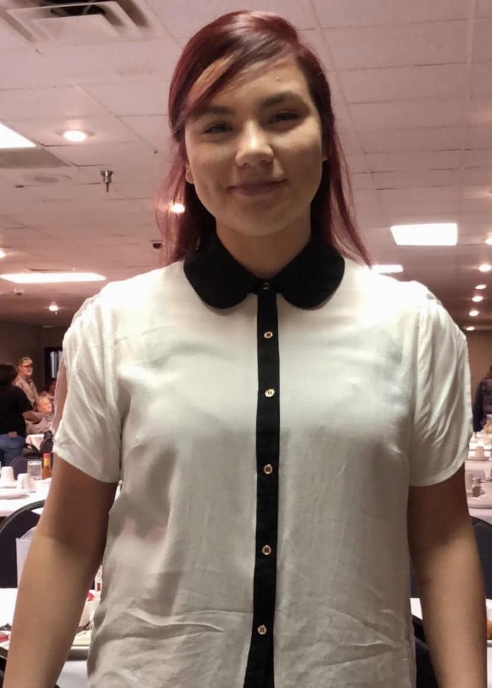
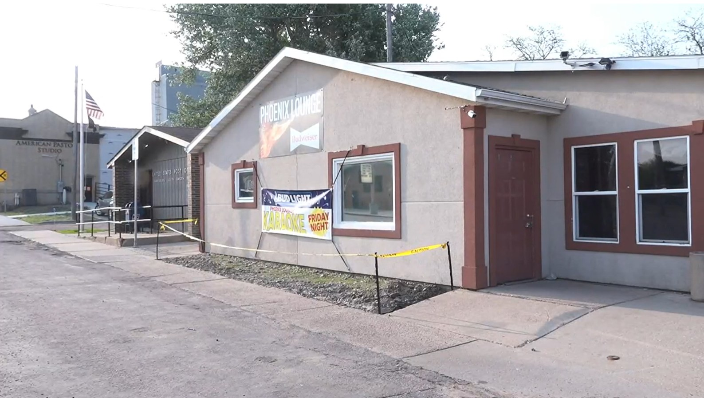
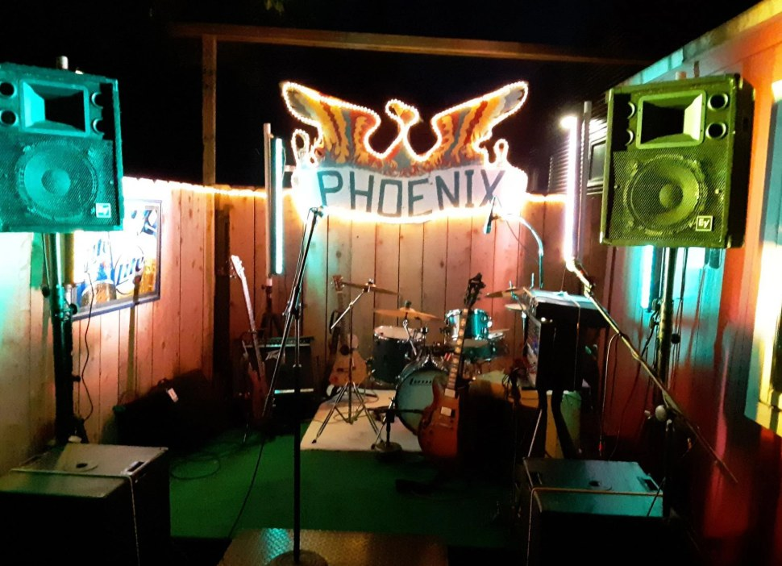

---
# Written October 18, 2026 by Poe from the six news and family sources below, plus the sheriff's
# page for the phone number (S7). Justin approved writing this as "a no-foul-play death with family
# questions" and accepted news-only sourcing for the official position (Buzz #stories, October 18, 2026).
# Follows the "Deaths ruled suicide or no foul play" section of agents/STYLE_GUIDE.md.
# Legal care:
# - Officials never called this a homicide. The sheriff's office said foul play was not suspected and
#   treated it as an unattended death (S2, S3). The word "suicide" comes only from the Harrisburg mayor,
#   relaying what he said investigators concluded (S6). Never state or imply that someone killed Kara.
# - "Who pulled the trigger" and "was the fight connected" are the family's questions (S6), attributed
#   to them. They are not findings.
# - The women in the bar fight are not named in any source, and none is a suspect in her death. The mayor
#   said the sheriff's office did not believe they were directly involved and that they would face
#   assault charges (S6). No source confirms charges were filed. Do not write that anyone was charged.
# - The friend who was with Kara is unnamed in S6 and is not accused of anything. Her account is
#   attributed to her ("she said," "by her account").
# - Method: the story says she died of a gunshot and the gun had been stolen from a vehicle, because the
#   official account and the family's questions turn on it (S3, S6). No further detail.
# Conflicts left in the text: "Greger" (S4, S5) vs. "Gregor" (S6). Prom queen and "Little Miss Fish
# Days" (grandmother, S6) vs. 2018 Homecoming Queen and 2018 Miss Fish Days Queen (S5). Susan Patterson
# is a cousin in S6. S5 lists her among survivors on her own and says Kara lived with her.
# Archive links: existing Wayback snapshots, found by Sherlock in fact-check. S4 had none and was saved October 18, 2026.
# Photos: all seven from Justin, October 18, 2026 (Buzz #stories). Justin confirmed he has the family's
# permission for the five photos of Kara. Captions say only what each photo shows: no dates, places or
# events beyond what is visible. The Ed Sheeran truck photo is not evidence she went to that concert.
# Phoenix Lounge exterior: appears to be a TV news frame, rights unconfirmed. Justin chose to use it anyway
# (October 18, 2026). Remove it if a station or the bar objects. Stage photo: from the Phoenix Lounge's
# Facebook page, per Justin. Credited in the caption. Neither is from the night she died.
# Rewritten October 19, 2026 at Justin's request, using the mailer-true-crime skill for structure and
# rhythm only: titled parts, numbered sections, short flat paragraphs, sources quoted as documents. No free
# indirect discourse. Nobody's thoughts are written unless a source records them. Same sources and facts.
# Status: "unresolved" ("Questions remain"), added in PR #10 for this case. Justin chose it October 18, 2026.
draft: false
title: "The Call for a Ride: The Death of Kara Greger"
seoTitle: "Kara Greger: What Happened in Harrisburg, SD"
description: "Kara Greger, 21, died of a gunshot in Harrisburg, SD, in 2022 after a fight at a concert. Officials found no foul play. Her family still has questions."
person: "Kara Greger"
summary: "Kara Greger, 21, of Lake Andes, South Dakota, died of a gunshot in Harrisburg early on September 10, 2022, after a fight at a concert earlier that night. [S3, S5, S6] The Lincoln County Sheriff's Office said foul play was not suspected. [S2] Her family has publicly questioned what happened. [S6]"
status: unresolved
town: "Harrisburg"
state: SD
incidentDate: 2022-09-10
lastSeenDate: null
resolvedDate: null
lastChecked: 2026-10-18
lastFactChange: null
published: 2026-10-20
agency: "the Lincoln County Sheriff's Office"
tipLine: "+16057645651"
anonymousTips: { name: "the sheriff's online tip form", url: "https://lincoln-so-sd.zuercherportal.com/#/submit_tip" }
contentNote: "a gun death that officials have called a suicide"
image:
  src: "./kara-greger-2022.jpg"
  alt: "Kara Greger smiling, with long dark red hair and a crown of pink flowers, in a crowd at an indoor event"
  credit: "Kara Greger in an undated photo"
  license: "Family photo, used with the family's permission"
youtubeId: null
youtubeUploadDate: null
sources:
  - { id: S1, title: "Fatal shooting early Saturday morning in Harrisburg", publisher: "Dakota News Now", url: "https://www.dakotanewsnow.com/2022/09/10/fatal-shooting-early-saturday-morning-harrisburg/", date: 2022-09-10, archive: "https://web.archive.org/web/20220910153127/https://www.dakotanewsnow.com/2022/09/10/fatal-shooting-early-saturday-morning-harrisburg/" }
  - { id: S2, title: "Lincoln County Sheriff: Foul play not suspected in Harrisburg death", publisher: "Sioux Falls Argus Leader, via Yahoo News", url: "https://sports.yahoo.com/lincoln-county-sheriff-foul-play-195604708.html", date: 2022-09-12, archive: "https://web.archive.org/web/20220914154239/https://sports.yahoo.com/lincoln-county-sheriff-foul-play-195604708.html" }
  - { id: S3, title: "Police: No foul play in Harrisburg's unattended death", publisher: "Dakota News Now", url: "https://www.dakotanewsnow.com/2022/09/12/police-no-foul-play-saturdays-harrisburg-unattended-death/", date: 2022-09-12, archive: "https://web.archive.org/web/20220914011321/https://www.dakotanewsnow.com/2022/09/12/police-no-foul-play-saturdays-harrisburg-unattended-death/" }
  - { id: S4, title: "Kara Greger", publisher: "Yankton Press & Dakotan", url: "https://www.yankton.net/obituaries/article_ab0abf5c-3307-11ed-999c-3f9b915cae1f.html", date: 2022-09-12, archive: "https://web.archive.org/web/20261018210720/https://www.yankton.net/obituaries/article_ab0abf5c-3307-11ed-999c-3f9b915cae1f.html" }
  # The obituary page shows no publication date. Funeral was September 16, 2022.
  - { id: S5, title: "Kara Lynn Greger obituary", publisher: "Peters Funeral Home", url: "https://www.petersfh.net/obituaries/kara-greger", date: 2022-09-12, archive: "https://web.archive.org/web/20260607233105/https://www.petersfh.net/obituaries/kara-greger" }
  - { id: S6, title: "One month after shooting in Harrisburg, family wants answers in Kara Gregor's death", publisher: "Dakota News Now", url: "https://www.dakotanewsnow.com/2022/10/17/one-month-after-shooting-death-harrisburg-family-wants-answers-kara-gregors-death/", date: 2022-10-17, archive: "https://web.archive.org/web/20250821164914/https://www.dakotanewsnow.com/2022/10/17/one-month-after-shooting-death-harrisburg-family-wants-answers-kara-gregors-death/" }
  # Agency contact page. Date is the day it was checked.
  - { id: S7, title: "Sheriff", publisher: "Lincoln County, South Dakota", url: "https://www.lincolncountysd.gov/198/Sheriff", date: 2026-10-18 }
timeline:
  - { date: 2000-11-10, text: "Kara Lynn Greger is born. [S5]", section: "lake-andes" }
  - { date: 2018, text: "Named Homecoming Queen at Andes Central and Miss Fish Days Queen. [S5]", section: "lake-andes" }
  - { date: 2019, text: "Graduates from Wagner Community School and moves to Sioux Falls. [S5]", section: "lake-andes" }
  - { date: 2021, text: "Moves home to Lake Andes that summer. [S5]", section: "lake-andes" }
  - { date: 2022-09-10, text: "Deputies respond to a report of gunshots in Harrisburg around 1 a.m. and find Kara dead. [S2, S3, S6]", section: "elm-and-railroad" }
  - { date: 2022-09-12, text: "The sheriff's office says foul play is not suspected. [S2, S3]", section: "no-foul-play" }
  - { date: 2022-09-16, text: "Funeral at the 4-H building in Lake Andes. [S4, S5]", section: "no-foul-play" }
  - { date: 2022-10-17, text: "Her family asks people with information to come forward. [S6]", section: "a-month-later" }
updates:
  - { date: 2026-10-20, text: "Story published." }
---

## Lake Andes

### 1

Kara Greger liked to stay up late cooking. [S5]

She cooked with her mom and her dad and her Uncle Joe Swatek. While they cooked she talked. Stories, theories, observations and ideas. All night and all day, her family wrote. [S5]

She was born on November 10, 2000. Her mother was Larina. Her father was Todd. [S5]

She grew up in Lake Andes and Wagner and Sioux Falls. [S5, S6]

For a while she lived in Wagner with her Grandma Bernadette Patterson and with Susan Patterson. [S5]

### 2

She went to high school at Andes Central in Lake Andes. [S5]

In 2018 she was the Andes Central Homecoming Queen. That same year she was the Miss Fish Days Queen. That is how her obituary has it. [S5]

Her grandmother Stephanie Cournoyer had it a little different. [S6]

"She was the prom queen. The Little Miss Fish Days," she told Dakota News Now. "She was very popular with everybody." [S6]

Kara finished her last semester at Wagner Community School. She graduated with the Class of 2019. [S5]

Then she moved to Sioux Falls. Her family put it this way. She went "to live young, wild and free." [S5]

That lasted until the summer of 2021. [S5]

### 3

When she came home to Lake Andes she worked three jobs. [S5]

The Lake Andes Carnegie Public Library. Knotheads Bar & Grill. The Gus Stop. [S5]

The library wasn't new. She had worked there all through high school, with Mary Jo Parker. Her family wrote that Kara absolutely adored her. [S5]

Before that she had a summer youth job at the Native American Women's Health and Education Resource Center, with her good buddy Everdale Song Hawk. [S5]

She volunteered at tribal and community events. [S5]

"She was very responsible. She had three jobs," her grandmother said. [S6]

### 4

She watched shows about history. Shows about aliens. A lot of odd comedy. [S5]

She sang in the shower as loud as she could. [S5]

On roller skates or on a dance floor, nobody could keep up with her. Her family called her a roller skating and dancing machine. [S5]

Halloween was the big one. The costumes, the makeup, the hair. She made sure she found the best haunted houses. [S5]

### 5

Her family wrote down where she went with her aunts. Fairs. Festivals. Carnivals. Concerts. Powwows. [S5]

There was family bingo, with snacks. [S5]

And there was Grandma Stephanie. [S5]

The family called the two of them "our version of Thelma & Louise." You never knew if they were rummaging in some nearby town or eating at some restaurant in the area. [S5]

She was good with kids, her family wrote. Patient with them. Kind. [S5]

She had a hearty laugh. [S5]

If somebody came up with a cool idea, she was in. She loved adventures. [S5]

There were the Hopkins cousins and Liz Patterson. There was the whole Sioux Falls crew. [S5]

She made friends with anyone, her family wrote. She took people as they were. [S5]

## The Phoenix Lounge

### 6

In September 2022, Kara and a friend went to a concert at the Phoenix Lounge in Harrisburg. [S6]

Her grandmother would say it more simply later. "She went to a dance with a friend." [S6]

Nobody on the record says who was playing. Nobody says what time they got there.

### 7

A fight broke out at the bar. [S3, S6]

Kara was told to leave. [S6]

Later a video went around on social media. It showed a woman getting beaten up. [S3]

The mayor of Harrisburg said Kara was part of the altercation. He said he couldn't say what her role was. [S3]

The reporting doesn't say if Kara is the woman in the video.

### 8

The calls started after that. People in Kara's family were getting asked for a ride. [S6]

One call came to Susan Patterson. Dakota News Now called her Kara's cousin. [S6]

It was Kara. She needed a ride. [S6]

Patterson sent her brother. [S6]

### 9

The friend remembered a different part of the night. [S6]

She recorded a message on her phone, nearly four minutes long, and sent it to the family. [S6] Dakota News Now quoted parts of it.

> **THE FRIEND**, recorded message to Kara's family, as quoted by Dakota News Now:
>
> "Are you going to be okay?"
>
> "I'll take you home if you want to go home. And she said, 'no, I'll be okay. I'll stay in the car.' I searched around Harrisburg for her for 15 minutes, and I couldn't find her at all." [S6]

The message doesn't say whose car. It doesn't say what time it was. The record doesn't say if this came before Kara's call to her cousin or after.

## Elm and Railroad

### 10

A call came in to the Lincoln County Sheriff's Office around 1 a.m. on Saturday, September 10. Somebody had heard gunshots. [S2, S3]

Witnesses said it happened at Elm Street and Railroad Avenue. [S3]

Deputies got there and found Kara dead. [S2, S3, S6]

She was 21. [S4]

### 11

Susan Patterson's brother was still on his way. [S6]

"He made it down there too late because he's seen two sheriffs go by," she said. [S6]

### 12

A neighbor heard the shots. [S3]

The neighbor looked outside and didn't see anything. [S3]

By Monday somebody had set up a vigil on the boulevard in front of a house nearby. [S3]

## No foul play

### 13

> **HARRISBURG, S.D.**, Saturday, September 10, 2022. The Lincoln County Sheriff's Office confirmed one person was fatally shot early that morning. It called it an isolated incident. It said there was no threat to the public. [S1]

### 14

> **Monday, September 12, 2022.** Sheriff Steve Swenson said in a news release that the death was being investigated as an unattended death. Foul play was not suspected. Given the nature of the death, no more details would be released. [S2, S3]

No arrests were announced. [S3]

Nobody from the sheriff's office used the word suicide in any statement we could find.

### 15

The mayor did. [S6]

Derick Wenck talked to Dakota News Now just after the shooting. [S6]

> **DERICK WENCK**, mayor of Harrisburg:
>
> "They're 100% positive that it was a suicide. A gun was stolen out of a vehicle." [S6]

He said the night's events began earlier in the evening, with the fight at the bar. [S3]

He said the women from the fight would still face assault charges. He said the sheriff's office didn't believe they were "directly involved" in the death. [S6]

That was the mayor talking. It isn't a court record. We could not find any public record that shows whether anyone was charged.

### 16

The wake started that Tuesday at the 4-H Center in Lake Andes. [S4, S5]

On Friday, September 16, at 11 a.m., there was a funeral at the 4-H building. Peters Funeral Home in Wagner handled the arrangements. [S4, S5]

## A month later

### 17

On October 17, 2022, Kara's family talked to Dakota News Now. [S6]

> **STEPHANIE COURNOYER**, Kara's grandmother:
>
> "She went to a dance with a friend, and how did you end up dead? I just can't believe that." [S6]

The family had questions. Was the fight connected to the shooting? Who pulled the trigger? [S6]

Those were their questions. No investigator has said anyone else was involved. [S2, S3, S6]

### 18

By then the sheriff's office said the bar fight was still under investigation. Some of the people in it had been identified. [S6]

The shooting was still an unattended death. No foul play. [S6]

### 19

> **STEPHANIE COURNOYER**:
>
> "I'd like to know how they're pursuing this crime." [S6]

She didn't want it brushed under the rug. [S6]

> **SUSAN PATTERSON**:
>
> "We want to know the truth." [S6]

### 20

The family believed some people knew the identity of others involved. [S6]

"I'm asking people to please come forward," her grandmother said. "This could happen to your child." [S6]

That interview is the last public reporting we could find about Kara's death.

## Where it stands

**What's documented:** Kara Greger, 21, of Lake Andes, died early on September 10, 2022, in Harrisburg. [S4, S5] Deputies responding to a report of gunshots around 1 a.m. found her dead. [S2, S3, S6] The sheriff's office said foul play was not suspected and released no more details. [S2] Earlier that night, a fight broke out at the Phoenix Lounge and Kara was told to leave. [S6] The mayor said she was part of it, but couldn't say what her role was. [S3]

**Where the sources disagree:** Her obituary and death notice spell her name Greger. [S4, S5] Dakota News Now uses both spellings, and its headline says Gregor. [S6] Her obituary says Homecoming Queen and Miss Fish Days Queen in 2018. Her grandmother said prom queen and Little Miss Fish Days. [S5, S6]

**What's reported but not proven:** The mayor said investigators were "100% positive" it was a suicide and that the gun had been stolen from a vehicle. [S6] He said the women in the fight would face assault charges. [S6] We could not find a sheriff's report, a death certificate or a court record that confirms any of it.

**What no one has publicly answered:** Whose gun it was, and who reported it stolen. How much time passed between the fight, the calls for a ride and the gunshots. Whether the friend's offer and Kara's call to her cousin came before or after one another. Whether anyone was ever charged for the fight. And what, if anything, the people at the Phoenix Lounge that night told investigators.

Her family asked people with information to come forward. [S6]

If you were at the Phoenix Lounge that night, or near Elm Street and Railroad Avenue, call the Lincoln County Sheriff's Office at [605-764-5651](tel:+16057645651). [S7] Don't post it in the comments.

If you or someone you know is struggling, call or text 988 to reach the 988 Suicide and Crisis Lifeline.

Kara called for a ride. It never reached her. What do you think her family deserves to know about that night?
