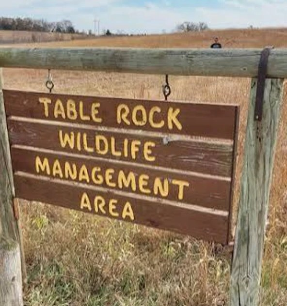

---
# Written October 25, 2026 by Poe from Phantom's October 20 handoff. Justin picked the case October 25, 2026.
# Legal care: no one has been charged. KOLN reported in 2021 that no arrests had been made (S5), and
# the 2026 NSP release reports no arrest (S12). The man Linda argued with at the farm is unnamed in
# every source we cite (S5). Never name him, describe him beyond S5, or call him a suspect. Never line
# him up with the warrant language or with the search results. Paywalled coverage that we could not
# read (Lincoln Journal Star, March 2022) reports in its headline that a Table Rock man maintains his
# innocence. That is a legal referral for Justin, and nothing from it is in the story.
# Missing case: never state or imply that she is dead or where she is. "Remains" appears once, inside
# quotation marks in NSP's own words (S11), and the story says "didn't find her" instead.
# The wig find (S5) is told in "A different outfit", apart from the warrant language. S5 doesn't
# say when the property was searched or tie the find to the warrant. Keep them apart. NSP's crime theory (S5, S6, S9, S11)
# and the possibility that she fell (S10) both stay in, attributed.
# Drinking and meth use at the farmstead come from court records as KOLN reported them (S5). They are
# stated once, attributed, because they explain the setting. Don't repeat them.
# Left out on purpose: the Charley Project, which names a man and repeats allegations we can't source
# to an agency or court record, any claim about what Linda told her family before she disappeared,
# the tattoo with a name and the tattoo with a date (S1, they may identify other people), and the
# NSP Investigative Services number in S9 (news, not the agency's own page).
# Single origin: KOLN's court records paragraph (S5) is repeated word for word in S8. Count it once.
# Conflicts in the text: age 58 in the 2026 release (S12) versus 55 then and 59 now on the state
# record (S1). Weight 130 (S2, S4) versus 125 (S1). Hair brown, possibly dyed blonde (S2) versus
# naturally blonde (S1). The first outfit (S2) versus the revised one (S4). Search size of about 600
# acres (S10), 600 to 700 (S8), or the wildlife area plus 200 to 300 acres of private land (S9),
# and more than 1,100 acres when it ended (S11). KLKN says her residence was near the wildlife area
# (S10). NSP says she was from Fairbury (S12). KOLN says she lived near Fairbury (S5).
# Tip line: NSP's own 2026 release sends tips to Nebraska Crime Stoppers at 800-422-1494 (S12).
# The state record lists the Pawnee County Sheriff's Office as the reporting agency (S1).
# Photos: both were released by the Nebraska State Patrol with its missing person record (S1) and
# its 2021 releases. Justin approved using them on October 25, 2026. The second photo is cropped at
# the left edge to remove part of another person. Nothing else was changed.
# Justin supplied two more photos on October 28, 2026: the Aware Foundation flyer, which repeats the
# July 7 release (S2) and its first outfit, and the Table Rock Wildlife Management Area sign. Origin
# of the sign photo not recorded. Both added as supplied, the sign converted from WebP to JPEG.
draft: false
title: "Not in This Area: The Disappearance of Linda Dillard"
seoTitle: "Linda Dillard: What Happened in Table Rock, NE"
description: "Linda Dillard, 55, was last seen near Table Rock, Nebraska, in June 2021. A search of more than 1,100 acres didn't find her. She is still missing."
person: "Linda Dillard"
summary: "Linda Dillard, 55, of Fairbury, Nebraska, was last seen in the rural Table Rock area on June 16, 2021. [S2, S12] The Nebraska State Patrol believes she may have been the victim of a crime. [S11] She has not been found, and the investigation remains open. [S12]"
status: missing
town: "Table Rock"
state: NE
incidentDate: 2021-06-16
lastSeenDate: 2021-06-16
resolvedDate: null
lastChecked: 2026-10-28
lastFactChange: null
published: 2026-10-25
agency: "Nebraska Crime Stoppers"
tipLine: "+18004221494"
anonymousTips: { name: "Nebraska Crime Stoppers", url: "https://www.nebraskacrimestoppers.com/" }
contentNote: null
image:
  src: "./linda-dillard-2021.jpg"
  alt: "Linda Dillard with long silver hair, a beaded necklace and tattoos on her chest"
  credit: "Photo released by the Nebraska State Patrol"
  license: "Released by the Nebraska State Patrol with its missing person record"
youtubeId: null
youtubeUploadDate: null
poster:
  - { label: "Age then", text: "55 [S1, S2]" }
  - { label: "Height", text: "5 feet [S1, S2]" }
  - { label: "Weight", text: "125 to 130 pounds [S1, S2]" }
  - { label: "Hair and eyes", text: "Brown or blonde, and blue [S1, S2]" }
  - { label: "Last place", text: "The rural Table Rock area, Pawnee County, Nebraska [S2]" }
  - { label: "Case", text: "The Nebraska State Patrol says the investigation remains open. [S12]" }
readerQuestion: "Investigators searched more than 1,100 acres near Table Rock and say they are confident she isn't in that area. What do you think it would take for someone who knows where she went to come forward?"
sources:
  - { id: S1, title: "Missing Persons: Linda Dillard (record 10025276)", publisher: "Nebraska State Patrol Missing Persons Clearinghouse", url: "https://statepatrol.nebraska.gov/services/missing-persons", date: 2026-10-25 }
  - { id: S2, title: "NSP Seeks Information Regarding Missing Jefferson County Woman", publisher: "Nebraska State Patrol", url: "https://statepatrol.nebraska.gov/nsp-seeks-information-regarding-missing-jefferson-county-woman", date: 2021-07-07, archive: "https://web.archive.org/web/20210707190918/https://statepatrol.nebraska.gov/nsp-seeks-information-regarding-missing-jefferson-county-woman" }
  - { id: S3, title: "NSP Renews Request for Information Regarding Missing Woman", publisher: "Nebraska State Patrol", url: "https://statepatrol.nebraska.gov/nsp-renews-request-information-regarding-missing-woman", date: 2021-07-23, archive: "https://web.archive.org/web/20210922171707/https://statepatrol.nebraska.gov/nsp-renews-request-information-regarding-missing-woman" }
  - { id: S4, title: "Updated Information in Search for Missing Jefferson County Woman", publisher: "Nebraska State Patrol", url: "https://statepatrol.nebraska.gov/updated-information-search-missing-jefferson-county-woman", date: 2021-09-10, archive: "https://web.archive.org/web/20210910171712/https://statepatrol.nebraska.gov/updated-information-search-missing-jefferson-county-woman" }
  - { id: S5, title: "NSP: Missing Nebraska woman may have been killed", publisher: "KOLN 10/11 NOW", url: "https://www.1011now.com/2021/10/18/nsp-missing-nebraska-woman-may-have-been-killed/", date: 2021-10-18, archive: "https://web.archive.org/web/20211204125523/https://www.1011now.com/2021/10/18/nsp-missing-nebraska-woman-may-have-been-killed/" }
  - { id: S6, title: "NSP Renews Request for Information in the Disappearance of Linda Dillard", publisher: "Nebraska State Patrol", url: "https://statepatrol.nebraska.gov/nsp-renews-request-information-disappearance-linda-dillard", date: 2022-03-18, archive: "https://web.archive.org/web/20220320033450/https://statepatrol.nebraska.gov/nsp-renews-request-information-disappearance-linda-dillard" }
  - { id: S7, title: "Nebraska State Patrol Conducts Large-Scale Search for Linda Dillard", publisher: "Nebraska State Patrol", url: "https://statepatrol.nebraska.gov/nebraska-state-patrol-conducts-large-scale-search-linda-dillard", date: 2022-03-24, archive: "https://web.archive.org/web/20220324202318/https://statepatrol.nebraska.gov/nebraska-state-patrol-conducts-large-scale-search-linda-dillard" }
  - { id: S8, title: "Nearly 150 people searching for missing woman in Southeast Nebraska", publisher: "KOLN 10/11 NOW", url: "https://www.1011now.com/2022/03/24/nsp-conducting-large-scale-search-southeast-nebraska-missing-woman/", date: 2022-03-24, archive: "https://web.archive.org/web/20260904175821/https://www.1011now.com/2022/03/24/nsp-conducting-large-scale-search-southeast-nebraska-missing-woman/" }
  - { id: S9, title: "Nebraska State Patrol Searches Table Rock Area for Linda Dillard, Who Went Missing in June 2021", publisher: "Nebraska Public Media", url: "https://nebraskapublicmedia.org/en/news/news-articles/nebraska-state-patrol-searches-table-rock-area-for-linda-dillard-who-went-missing-in-june-2021/", date: 2022-03-24, archive: "https://web.archive.org/web/20250610183755/https://nebraskapublicmedia.org/en/news/news-articles/nebraska-state-patrol-searches-table-rock-area-for-linda-dillard-who-went-missing-in-june-2021/" }
  - { id: S10, title: "Nebraska State Patrol begins large-scale search for longtime missing woman", publisher: "KLKN", url: "https://www.klkntv.com/nebraska-state-patrol-begins-large-scale-search-for-longtime-missing-woman/", date: 2022-03-24, archive: "https://web.archive.org/web/20220415035140/https://www.klkntv.com/nebraska-state-patrol-begins-large-scale-search-for-longtime-missing-woman/" }
  - { id: S11, title: "NSP Completes Three-Day Search Operation near Table Rock", publisher: "Nebraska State Patrol", url: "https://statepatrol.nebraska.gov/nsp-completes-three-day-search-operation-near-table-rock", date: 2022-03-27, archive: "https://web.archive.org/web/20220327203344/https://statepatrol.nebraska.gov/nsp-completes-three-day-search-operation-near-table-rock" }
  - { id: S12, title: "NSP Renews Call for Public Assistance in Long-Term Cases", publisher: "Nebraska State Patrol", url: "https://statepatrol.nebraska.gov/nsp-renews-call-public-assistance-long-term-cases", date: 2026-09-01, archive: "https://web.archive.org/web/20261025133224/https://statepatrol.nebraska.gov/nsp-renews-call-public-assistance-long-term-cases" }
  - { id: S13, title: "Nebraska State Patrol seeking public input in missing person case", publisher: "KLZA, via MSC News", url: "https://mscnews.net/local-news/930737", date: 2026-09-03, archive: "https://web.archive.org/web/20260903215005/https://mscnews.net/local-news/930737" }
timeline:
  - { date: 2021-06-16, text: "Linda is last seen in the early morning hours in the rural Table Rock area of Pawnee County. [S2]", section: "the-farmstead" }
  - { date: 2021-07-07, text: "The Nebraska State Patrol says she is believed to be missing under suspicious circumstances. Crime Stoppers offers a reward of up to $1,000. [S2]", section: "four-days" }
  - { date: 2021-09-10, text: "NSP says it has recovered the clothes first described and revises what she was last seen wearing. [S4]", section: "a-different-outfit" }
  - { date: 2021-10-18, text: "KOLN reports that an NSP search warrant says she may have been the victim of a crime. [S5]", section: "the-warrant" }
  - { date: 2022-03-24, text: "A three-day search begins near the Table Rock State Wildlife Management Area. [S7, S8]", section: "table-rock" }
  - { date: 2022-03-27, text: "NSP says the search covered more than 1,100 acres and that investigators are confident she is not in that area. [S11]", section: "three-days" }
  - { date: 2026-09-01, text: "NSP renews its call for information. The investigation remains open. [S12]", section: "five-years" }
updates:
  - { date: 2026-10-25, text: "Story published." }
---

In the early morning hours of Wednesday, June 16, 2021, Linda Dillard was seen in the rural Table Rock area of Pawnee County, in southeast Nebraska. She was 55. [S2]

It is the last time anyone is known to have seen her. [S2, S12]

The Nebraska State Patrol believes she may have been the victim of a crime. [S11] In 2022, KLKN reported that authorities also believed she could have fallen in a wildlife area near Table Rock. She had hip problems, KLKN said. [S10] More than five years later, the investigation is still open, and searches have not found her. [S12]

## Linda

Linda Marie Dillard was from Fairbury, in Jefferson County, the patrol says. [S1, S2, S12] KOLN reported in 2021 that she lived near Fairbury. [S5] The patrol describes her as 5 feet tall, with blue eyes. [S1, S2] The patrol's 2021 description put her at 130 pounds. The state's missing persons record says 125. [S1, S2]

Her hair was harder to pin down. The 2021 release called it brown, possibly dyed blonde. [S2] The state record says it was naturally blonde, and that she might dye it, wear a wig or wear hair extensions. [S1]

She usually wore a lot of jewelry. [S1] The words "Heaven's Door" were tattooed under her chin. She had two dark wings on her chest and two Derringer pistols on her abdomen. [S1] A medical condition made it hard for her to walk long distances, and sometimes she used a cane. [S2]

Her daughter is Winterstar Schaber. [S8] "I want everyone to remember that Linda has a family, she's a mother, she's a grandmother," Lt. Eric Jones of the patrol said in 2022, Nebraska Public Media reported. [S9]

The sources for this story say little more about her life than that.

## The farmstead

According to court records, as KOLN 10/11 reported them in October 2021, the patrol believes Linda left in mid-June to join friends at a farmstead in Pawnee County. According to those records, the group drank and smoked meth there. [S5]

People who were at the farm told investigators that Linda and a man at the property had an argument, according to the patrol. [S5] Then, they said, she left. She has not been seen since. [S5]

## Four days

Linda was reported missing four days after she was last seen, KLZA reported in 2026. [S13]

On July 7, the patrol asked the public for help. Its release said she was "believed to be missing under suspicious circumstances." [S2] It said she was last seen in a white tank top, jean shorts, a white and purple wig, and brown, lace-up sandal boots. [S2] Nebraska Crime Stoppers offered a reward of up to $1,000. [S2]

On July 23, the patrol asked again. The investigation remained ongoing, it said. [S3]

## A different outfit

On September 10, the patrol revised its own description. Investigators had recovered the white tank top, the jean shorts and the sandal boots. [S4] They now believed she had been wearing something else. [S4]

> Investigators now believe that when she was last seen on June 16, Dillard was wearing a black t-shirt, black DKNY boxer brief shorts, and brown Birkenstock type sandals. [S4]

The release didn't say where the first outfit was found. [S4]

A month later, KOLN reported that a wig belonging to Linda had been found after a search of the property, along with clothes that belonged to her. [S5] KOLN didn't say when the search took place, or whether those clothes were the ones the patrol had recovered. [S5]

## The warrant

By October 2021, the patrol had carried out numerous searches and interviews. No arrests had been made, KOLN reported, and Linda had not been found. [S5]

Investigators had also filed a search warrant. In it, KOLN reported, they wrote that she may have been the victim of a crime of: [S5]

> "theft, assault, kidnapping, and/or murder." [S5]

Search warrants were filed in Lancaster and Pawnee counties, according to KLZA. [S13]

## Tall grass

On March 18, 2022, the patrol renewed its request for information. Multiple searches had been made where she was last seen, it said. Investigators believed she may have been the victim of a crime "which led to her disappearance." [S6]

The patrol had held off on a search this large because the vegetation was so thick, KLKN reported. [S10] When the next search began, Jones told KOLN about the earlier attempts near Table Rock. [S8]

> "We were out here in July and several other occasions throughout the fall months, but as you can imagine, the grass was high, the corn was tall and it just wasn't conducive to doing a really thorough search of the area." [S8]

## Table Rock

The search began on Thursday, March 24, near the Table Rock State Wildlife Management Area. [S7, S8] The patrol said the area had been identified as part of the investigation. [S7]

Nearly 150 people took part. Some rode horses. There were K-9 teams and drones. [S8, S10] Anthropology students from the University of Nebraska-Lincoln came to help. [S10] Teams came from several states, including NecroSearch International and units from three Kansas counties. [S7]

Jones was the lead investigator. He said new information had led the patrol to believe she may have been the victim of a crime. [S9] That information, and the conditions on the ground, made it the right time and place for a search, he said. He would not discuss leads. [S9]

KLKN reported a second possibility. Authorities believed Linda, who had hip problems and hip dysplasia, could have fallen somewhere in the area. [S10] The wildlife area has creeks and heavy woods. She may have fallen into one and been unable to get back up, KLKN reported. [S10]

The size of the search was given three ways that morning. KLKN said about 600 acres. [S10] KOLN said 600 to 700. [S8] Jones said it would include the wildlife area and "200-300 acres of private ground surrounding that area." [S9] KLKN also reported that Linda's residence was not far from the wildlife area, and that this was why the patrol searched there. [S10]

Winterstar told KOLN she was thankful. [S8]

> "I just want everybody to know how thankful that me and my family are that Nebraska State Patrol has put together a huge search to help us find her and get some resolution today or hopefully this weekend." [S8]

## Three days

The search ran three days. [S11] Teams covered more than 1,100 acres in and around the wildlife area. They searched 24 miles of roadside ditches, 1.5 miles of river, two local farms and a lake area. [S11] There were 44 law enforcement officers, 65 volunteers and support staff, 15 mounted patrol teams and eight dog teams "trained for human remains detection," the patrol said. [S11]

They didn't find her. [S11] On March 27, the patrol released a statement from Jones. [S11]

> "What our investigators learned this week directs the case into the next phase. We are now confident that Linda is not in this large area. Our investigators continue to believe Linda may have been the victim of a crime. We urge anyone with information or anyone who was involved in her disappearance to come forward." [S11]

Numerous tips had come in through Crime Stoppers and other avenues in recent days, the release said. [S11]

## Five years

On September 1, 2026, the patrol asked again. "It has now been over five years since the disappearance of Linda Dillard," the release said. Numerous searches of the area had not found her. The investigation remained open. [S12]

The release gave her age as 58. [S12] The state's missing persons record gives it as 55 when she went missing, and 59 now. [S1]

In 2021, KOLN reported that no arrests had been made. [S5] The 2026 release doesn't mention an arrest. [S12] What the record doesn't show is where Linda went after she was last seen. [S2, S12]

In 2022, as the search began, Winterstar told KOLN what her family wanted. [S8]

> "We definitely miss her. And we hope to find her or any evidence leading towards her." [S8]

Linda is still on the state's list of missing people. [S1]
