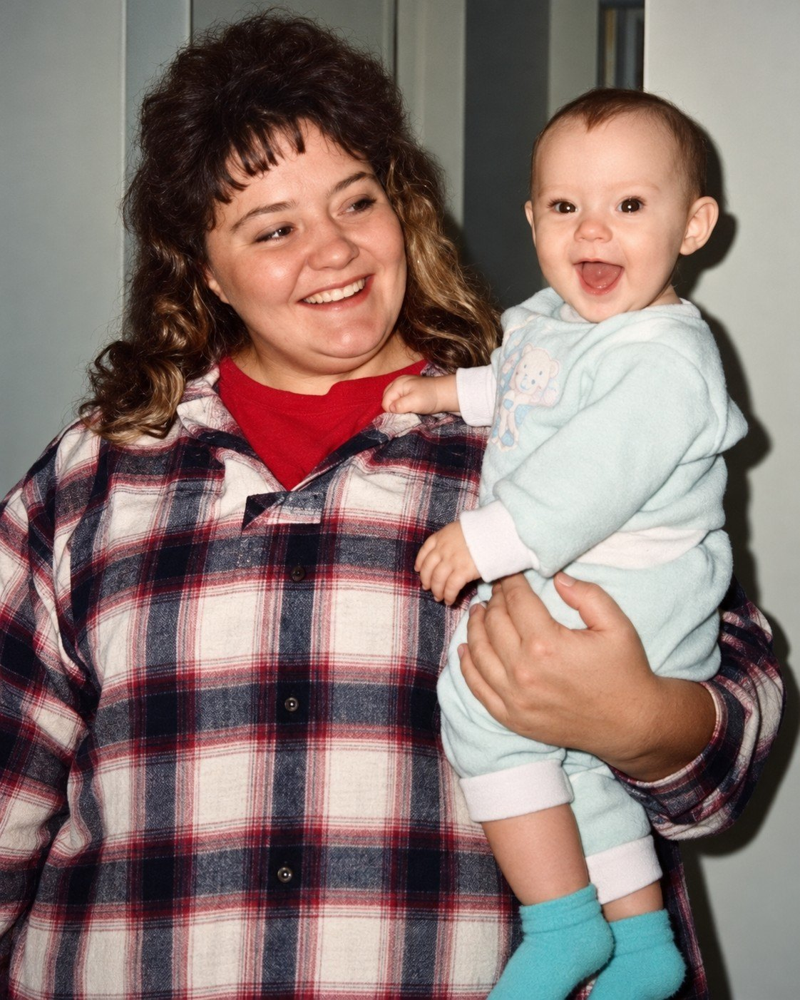
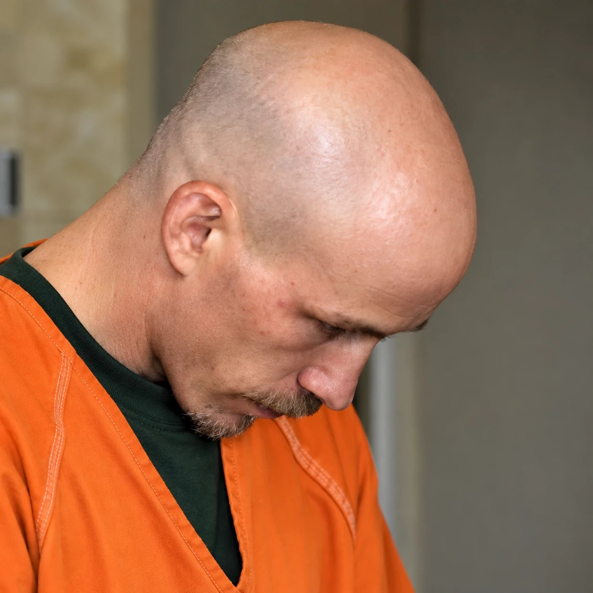
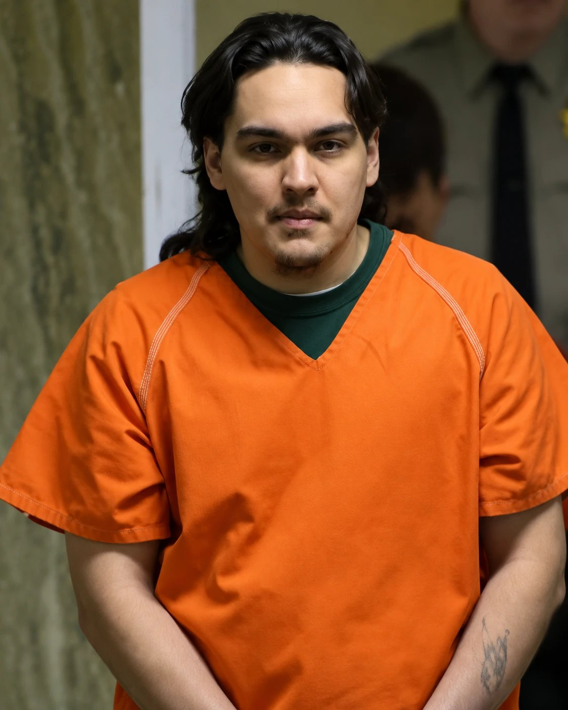
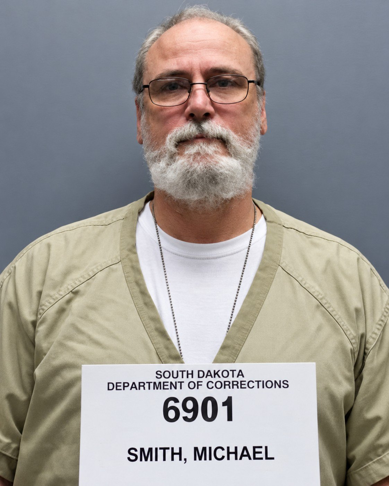
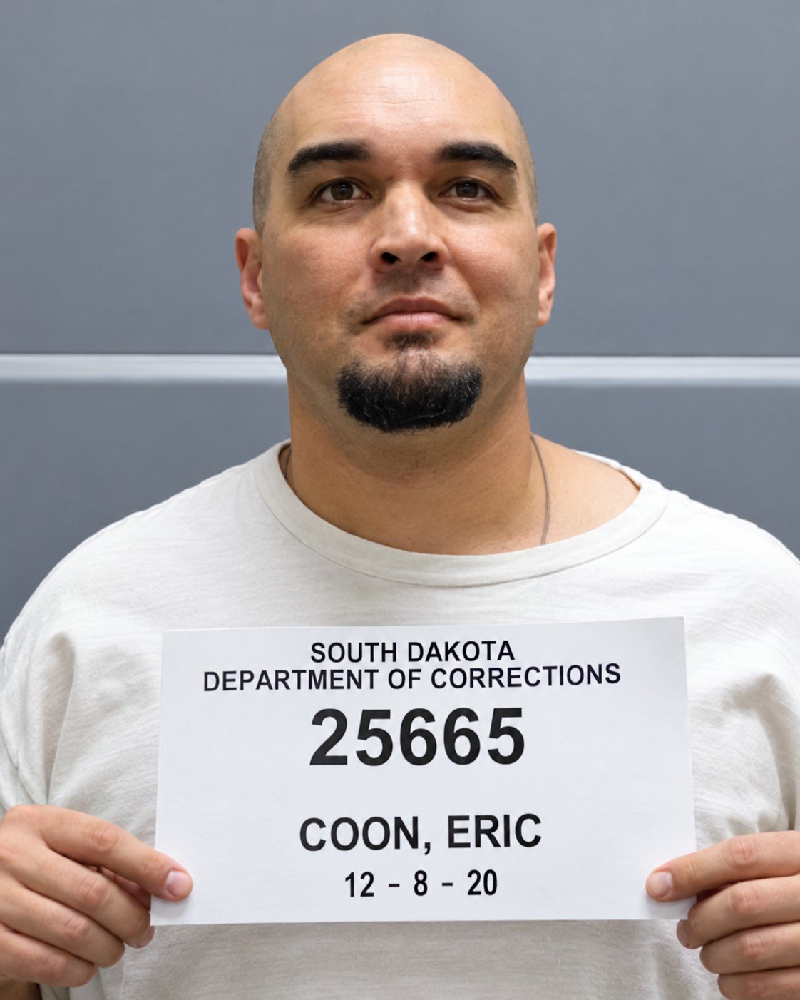

---
# Written October 19, 2026 by Poe at Justin's request. First drafted in the Mailer structure, then rewritten
# the same day in the standard structure after an editorial review (Justin approved dropping Mailer).
# Legal care:
# - Robert Power, Eric Coon and Robert Poppen pleaded guilty. Michael Lee Smith was convicted by a jury
#   of accessory to murder and conspiracy to commit murder (S1). Their acts are stated as the court
#   record gives them. Walter Craft Jr. pleaded guilty (S3) to accessory to murder (S4, and S8 citing the
#   Argus Leader). His sentence comes only from KELOLAND (S4) and stays attributed.
# - Amy (Aimee) Power was never charged with anything. She appears only as Mary's friend and roommate
#   who lost a key ring (S2). Never place her near the planning or imply she knew of it. S1 says the
#   murder was set for a weekend she was out of state.
# - The landlords (Lagow Construction and Lloyd Property Management) were sued, not found liable. S2 is a
#   ruling on summary judgment. The court had to assume Mary asked for a lock change, and said so.
#   Their employees swore she declined. Her mother swore Mary told her she asked. Both stay attributed.
#   The outcome after remand is not in any source we have. Don't guess it.
# - Power's belief that Mary was interfering with his marriage, and the marijuana complaint, are his
#   beliefs as the court states them (S3). KELOLAND's line that Mary was helping Aimee "escape an
#   abusive marriage" is KELOLAND's description and stays attributed (S4).
# - S8 is a 2003 student law review note. Facts that come only from it (the key-making machine, the crib,
#   the 911 operator, the June key loss, the trial date, no trial date on remand) are attributed to the note
#   or to what it cites. The note's source date is the issue year (Vol. 48, Issue 2, 2003). Month unknown.
# - S11 is a post on the family's Facebook page, "Justice For Mary K Ross." Facebook pages aren't normally
#   sources. Justin confirmed on October 20, 2026 that the page is the family's and approved using its school
#   details as a family statement. Use it only for that, attributed to the family.
# - Lewing's job ending a week after the murder (S8) is left out on purpose. It could read as an insinuation.
# - Sherry Smith (Mary's mother) and Michael Lee Smith share a surname. No source connects them.
# - Left out on purpose: wound details beyond the court's count, the throat, Poppen's statements about how
#   the stabbing felt, Shand Ross's "rag doll" line (it repeats the stabbing account), and the end of
#   Brindle's quote ("Little did we know...", a phrase the build bans).
# Photos: on October 20, 2026 Justin replaced every photo with an AI-enhanced copy and chose to run them,
#   each captioned "digitally enhanced." The enhancement changed details: Power's TV still lost its on-screen
#   caption and shows a short-haired, clearer face, Poppen's TV still shows more of his face, and the
#   booking-board dates were filled in. Don't cite any of those details as fact.
# Quote edits: the build bans semicolons, so Mary's quoted words from S2 are split in two at the semicolon
# after "him", with no words changed.
# Conflicts in the text: "Amy" (S2) or "Aimee Enright Power" (S4). "Power" or "Powers" within S2.
# "Mary Kay Ross" (S1) or "Mary K. Ross" (S2, S3). Power's offer to Smith: $10,000 or two pounds of meth
# (S1), or a pound of meth and $10,000 (S4, quoting Nelson). S3 says $10,000 each for Coon and Poppen.
# Amy's lost keys: S2 says July in one paragraph and June in another. S8, citing the landlords' brief, says June.
# Kristian's age: 13 months in March 1994 (S8) or 14 months in July 1995 (S4, S7). S6 calls her 29 in
# August 2022, which fits S8. Story states no exact age as fact.
# Who passed the key: S1 and S2 say Power gave it to Smith, who gave it to the killers. S4 (Armstrong, 1995)
# says Power gave Coon the key and supplies. S3 doesn't say who. Court version leads, S4 attributed.
# 911 timing: during the attack (S3) or after the killers left (S8). Both given.
# Smith's sentence: ten years plus life without parole, concurrent (S1), or "also got life" (S5).
draft: false
title: "A Key to the Apartment: The Murder of Mary K. Ross"
seoTitle: "Mary K. Ross: What Happened in Sioux Falls, SD"
description: "In 1995, Mary K. Ross, 25, was killed in her Sioux Falls apartment by men who let themselves in with a key. Four went to prison for life."
person: "Mary K. Ross"
summary: "Mary K. Ross, 25, was stabbed to death in her Sioux Falls apartment on July 9, 1995, by two men hired to kill her. They let themselves in with a key. [S3, S4] Four men were sentenced to life without parole. [S1, S5] Her family has fought their requests for clemency. [S6, S7]"
status: solved
town: "Sioux Falls"
state: SD
incidentDate: 1995-07-09
lastSeenDate: null
resolvedDate: 1998-01-14
lastChecked: 2026-10-19
lastFactChange: null
published: 2026-10-21
agency: "the Minnehaha County State's Attorney's Office"
tipLine: null
anonymousTips: null
contentNote: "a violent stabbing in a murder-for-hire plot"
image:
  src: "./mary-ross-1995.jpg"
  alt: "Mary K. Ross smiling, with curly hair, in a striped sweater with a collar"
  credit: "Ross family photo, digitally enhanced"
  license: "Family photo published in news coverage of the case"
youtubeId: null
youtubeUploadDate: null
sources:
  - { id: S1, title: "State v. Smith, 1998 SD 6, 573 N.W.2d 515", publisher: "South Dakota Supreme Court, via CourtListener", url: "https://www.courtlistener.com/opinion/900363/state-v-smith/", date: 1998-01-14 }
  - { id: S2, title: "Smith v. Lagow Construction & Developing Co., 2002 SD 37, 642 N.W.2d 187", publisher: "South Dakota Supreme Court, via CourtListener", url: "https://www.courtlistener.com/opinion/1350334/smith-v-lagow-construction-developing-co/", date: 2002-03-13 }
  - { id: S3, title: "Coon v. Weber and Poppen v. Weber, 2002 SD 48, 644 N.W.2d 638", publisher: "South Dakota Supreme Court, via CourtListener", url: "https://www.courtlistener.com/opinion/900960/coon-v-weber/", date: 2002-05-01 }
  - { id: S4, title: "The murder of Mary K. Ross", publisher: "KELOLAND News", url: "https://www.keloland.com/news/investigates/the-murder-of-mary-k-ross/", date: 2022-08-09, archive: "https://web.archive.org/web/20220811063950/https://www.keloland.com/news/investigates/the-murder-of-mary-k-ross/" }
  - { id: S5, title: "Parole Board denies killer's commutation request", publisher: "KELOLAND News", url: "https://www.keloland.com/news/investigates/parole-board-denies-killers-commutation-request/", date: 2022-08-10, archive: "https://web.archive.org/web/20220814122818/https://www.keloland.com/news/investigates/parole-board-denies-killers-commutation-request/" }
  - { id: S6, title: "Mary K. Ross' daughter confronts her mother's killer", publisher: "KELOLAND News", url: "https://www.keloland.com/news/investigates/mary-k-ross-daughter-confronts-her-mothers-killer/", date: 2022-08-10, archive: "https://web.archive.org/web/20220813002659/https://www.keloland.com/news/investigates/mary-k-ross-daughter-confronts-her-mothers-killer/" }
  - { id: S7, title: "Panel backs longer waits between clemency requests for prisoners sentenced to life", publisher: "South Dakota Searchlight", url: "https://southdakotasearchlight.com/2024/01/23/panel-backs-longer-waits-between-clemency-requests-for-prisoners-sentenced-to-life/", date: 2024-01-23, archive: "https://web.archive.org/web/20240124065408/https://southdakotasearchlight.com/2024/01/23/panel-backs-longer-waits-between-clemency-requests-for-prisoners-sentenced-to-life/" }
  - { id: S8, title: "South Dakota Supreme Court Opens the Door to Landlord Liability for Criminal Attacks Committed by Third Parties on the Premises: Smith v. Lagow Construction & Developing Company (48 S.D. L. Rev. 365)", publisher: "South Dakota Law Review (Shannon E. Kelly), via USD RED", url: "https://red.library.usd.edu/sdlrev/vol48/iss2/11", date: 2003-01-01 }
  - { id: S9, title: "Senate votes to return clemency bill for lifers to earlier, more stringent form", publisher: "South Dakota Searchlight", url: "https://southdakotasearchlight.com/2024/01/25/senate-votes-to-return-clemency-bill-for-lifers-to-earlier-more-stringent-form/", date: 2024-01-25, archive: "https://web.archive.org/web/20241231222259/https://southdakotasearchlight.com/2024/01/25/senate-votes-to-return-clemency-bill-for-lifers-to-earlier-more-stringent-form/" }
  - { id: S10, title: "Clemency request provides window into new law requiring longer wait times", publisher: "South Dakota Searchlight", url: "https://southdakotasearchlight.com/2024/03/17/serial-bank-robber-who-learned-yoga-took-courses-in-prison-offered-future-chance-for-freedom/", date: 2024-03-17, archive: "https://web.archive.org/web/20241230223645/https://southdakotasearchlight.com/2024/03/17/serial-bank-robber-who-learned-yoga-took-courses-in-prison-offered-future-chance-for-freedom/" }
  - { id: S11, title: "Post about Mary K. Ross's schooling", publisher: "Justice For Mary K Ross (the Ross family's Facebook page)", url: "https://www.facebook.com/JusticeForMaryKRoss", date: 2022-07-21 }
# Prototype, October 22, 2026: rewritten in the house story voice (story-first layout). No new facts.
# Every fact and tag comes from the October 21 version. Source conflicts are named once, where they come up,
# and are no longer listed again at the end. The reader question moved to readerQuestion.
# Quote edits: Kristian's three quotes to the board (S6) are set as one block without the "she said" tags.
# Justice Konenkamp's two quotes (S2) are set as one block without the "he wrote" tag. No words changed.
timeline:
  - { date: 1994-03-26, text: "Mary K. Ross signs a lease at Westport in Sioux Falls for herself and her daughter. [S2, S8]", section: "mary-k" }
  - { date: 1995-02, text: "Mary gives Robert Power her key so he can copy it for her babysitter. [S2]", section: "five-men" }
  - { date: 1995-05, text: "Trouble between Amy Power and her husband, Robert, grows worse. [S2]", section: "amy" }
  - { date: 1995-07, text: "Amy Power loses a key ring with Mary's key on it. Mary tells the maintenance man. The Supreme Court's opinion says July in one place and June in another. [S2, S8]", section: "the-key-ring" }
  - { date: 1995-07-09, text: "Eric Coon and Robert Poppen let themselves into Mary's apartment around 4 a.m. and kill her. [S3]", section: "4-am" }
  - { date: 1995-08-01, text: "Police gather suspects. Coon and Poppen confess. Michael Lee Smith says Power hired them. [S3]", section: "the-address-book" }
  - { date: 1995-12-15, text: "Poppen pleads guilty. [S3]", section: "a-major-miracle" }
  - { date: 1995-12-18, text: "Coon, Power and Walter Craft Jr. plead guilty. [S3]", section: "a-major-miracle" }
  - { date: 1996-03, text: "Smith goes on trial. The jury hears Mary's 911 call. [S8]", section: "the-trial" }
  - { date: 1998-01-14, text: "The South Dakota Supreme Court upholds Smith's conviction. [S1]", section: "the-trial" }
  - { date: 2002-03-13, text: "The Supreme Court revives the family's lawsuit against the landlords. [S2]", section: "a-locked-door" }
  - { date: 2022-08-10, text: "The parole board votes against recommending a shorter sentence for Coon. [S6]", section: "the-hearing" }
  - { date: 2024-01-23, text: "Mary's sister and daughter testify for longer waits between clemency requests. [S7]", section: "life-means-life" }
  - { date: 2024-01-25, text: "The Senate votes 17 to 15 for a flat four-year wait. [S9]", section: "life-means-life" }
  - { date: 2024-03-04, text: "Gov. Kristi Noem signs Senate Bill 9. It takes effect July 1, 2024. [S10]", section: "life-means-life" }
updates:
  - { date: 2026-10-21, text: "Story published." }
readerQuestion: "Mary's family has said they will keep coming to clemency hearings if they have to. What should a life sentence mean to the family left behind?"
---

Around 4 a.m. on Sunday, July 9, 1995, two men let themselves into Mary K. Ross's apartment in Sioux Falls with a key. The lights were off. Mary was asleep. Her baby daughter was in the apartment. [S3, S4]

Mary was 25. [S4]

## Mary K.

Her family called her Mary K. [S4, S6] She graduated from La Junta High School in Colorado in 1988, her family wrote. In Sioux Falls she was studying to be a paralegal at National College, now National American University. [S4, S11] She had a baby girl, Kristian. [S7]

On March 26, 1994, she signed a lease at the Westport Apartments for herself and her daughter. [S2, S8] Westport was a low-income development. [S2] Her apartment was on the third floor, the Argus Leader reported. [S8]

The rules said "lock changes or additional locks are not permitted." A lost key cost $45, which covered a new lock if one was needed. [S2]

"Mary K. was the fabric that held our family together," her brother, Shand Ross, said in 2022. [S6] Her family remembers "the joy and laughter she brought to all our lives." [S4]

## Amy

Amy Power was Mary's close friend. KELOLAND called her Mary's best friend. [S2, S4] When Amy's marriage went bad, Mary let her move in and gave her a key. [S2] KELOLAND reported that Mary was helping her escape an abusive marriage. [S4]

In May 1995, the trouble between Amy and her husband, Robert Power, got worse. [S2]

Power believed Mary was interfering with his marriage, the courts recorded. He was also upset that she had smoked marijuana in front of his child. [S3]

## The key ring

Amy lost her key ring. Mary's apartment key was on it. [S2] The Supreme Court's opinion puts this in July in one place and June in another. A 2003 law review note, citing the landlords' brief, says June. [S2, S8]

Mary told the maintenance man, Watson Lewing. He told the manager, Jodi Bentz, that one of the keys to Mary's apartment was missing. [S2]

What happened next was later disputed under oath. [S2]

Bentz said Lewing told her Mary didn't want the lock changed, because she thought the keys would "turn up." The next day, Bentz said, she asked Mary herself, and Mary said no. Another employee, Monica Price, told it the same way. Lewing said he didn't remember whether Mary asked. [S2]

Mary's mother, Sherry Smith, told it differently. She said she talked to her daughter often. In a sworn statement, she said that three days before the murder, Mary told her she had asked for a new lock and needed money to pay for it. [S2]

She said she heard fear in her daughter's voice. Mary wouldn't talk about the Powers. [S2]

> "I do not want to talk about him. He's psycho." [S2]

The lock wasn't changed. [S2]

## Five men

Five men would go to prison for what happened to Mary. They ranged in age from 18 to 22. [S4]

Robert Power wanted her dead. [S1, S3] He offered Michael Lee Smith, 21, money or methamphetamine to kill her. Smith said no. But he agreed to find someone who would, and to handle the payment. [S1] Smith shares a last name with Mary's mother. No source connects them. [S1, S2]

Smith's roommates, Eric Coon and Robert Poppen, were the ones who would go into her apartment. [S1, S3, S4] The two men believed killing her would make people afraid of them and give their egos a boost, the court wrote. Poppen said it was all about "power and money." [S3]

Power promised money and drugs. [S1, S4] "And he didn't have either one," the prosecutor, Dave Nelson, said years later. [S4]

In February, Mary had handed Power her apartment key so he could make a copy for her babysitter. [S2] Now Power gave Smith a key to Mary's apartment and a map of its floor plan. It had to happen the weekend of July 9, Power told Smith, when Power's wife would be out of the state. [S1]

At his trial, Smith said he owned a key-making machine and had used it to copy the key to Mary's apartment, according to the transcript as cited in the law review note. [S8] The courts say Smith passed the key to Coon and Poppen. [S1, S2] KELOLAND's Jessica Armstrong reported in 1995 that Power handed it to Coon himself. [S4]

A fifth man, Walter Craft Jr., would get rid of Mary's bloody clothing afterward. [S4, S8]

## Hy-Vee

Coon and Poppen were given the key, a map of the apartment and the parking lot, Power's car and $50 for supplies. [S3]

At a Hy-Vee grocery store they bought two knives and two pairs of gloves. They also bought cigarettes, soda and a frying pan, to give to Poppen's girlfriend. [S3]

Poppen explained the frying pan later. "It would look kind of fishy if we just went in and bought knives and gloves." [S3]

## 4 a.m.

They let themselves in. Mary was asleep in her bedroom. [S3, S4]

They stabbed her. Their knives broke, and they went through her kitchen drawers for more. [S3] Mary got to the kitchen phone and called 911. [S3, S4] The court wrote that she reached it during the attack. The law review note says she called after the men left. [S3, S8]

Jessica Armstrong read the 911 transcript on KELOLAND in 1995. [S4]

> "I need help. I've been stabbed."
>
> Asked where:
>
> "All over."
>
> ...
>
> The last words the dispatcher could make out:
>
> "I have a baby." [S4]

The men left her on the living room couch. They thought she was dead. [S3] The court counted 16 stab and sharp-force wounds. [S3]

Police found her baby unharmed in her crib, the Argus Leader reported. [S8] A 1997 record from Poppen's case, as cited in the law review note, says the two men didn't know Mary had a child. [S8]

## The address book

Investigators were at the apartment within about an hour. From Mary's address book and from informants, they put together a list of suspects. [S3]

On August 1, detectives brought them in and questioned them in separate rooms. Coon and Poppen each confessed. [S3] Smith insisted that Power never told him who he wanted dead. [S1] By evening, he said Power had hired Coon and Poppen. [S3]

## A major miracle

The case could carry the death penalty. "It was clearly a death case because it was murder for hire," Nelson said years later. [S4] One of Coon's lawyers wrote to the other that "a major miracle would be necessary to get an acquittal." Poppen's lawyer said the case "had the death penalty written all over it." [S3]

Poppen pleaded guilty on December 15, 1995. He told the judge one reason was that he was afraid of the death penalty. [S3] On December 18, Coon pleaded guilty. So did Power. So did Craft. [S3]

Coon and Poppen were sentenced to life. As part of their deals, they agreed to testify against the others. [S3] Power pleaded guilty to first-degree murder and got life without parole. [S2, S5] Craft pleaded guilty to accessory to murder. [S4, S8] KELOLAND reported that he got less than three years in prison. [S4]

## The trial

Only Smith went to trial. All four of the others testified against him. [S1, S3]

On the first day of testimony, in March 1996, the jury heard Mary's 911 call. She told the operator she didn't know who had attacked her, according to the Argus Leader. [S8] The jury also watched Smith's videotaped interviews with detectives. [S1]

It convicted him of accessory to murder and conspiracy to commit murder. He got ten years and life without parole, to run together. [S1] He appealed, saying his confession wasn't voluntary. On January 14, 1998, the South Dakota Supreme Court turned him down. [S1]

## A locked door

Sherry Smith sued Westport's owner and its management company, for Mary's estate and for Kristian. A circuit judge threw the case out. Landlords, the judge ruled, owed no duty to protect tenants like Mary. [S2]

On March 13, 2002, the Supreme Court sent it back, three votes to two. Justice Konenkamp wrote for the court. Someone had to decide whether Mary asked for a new lock, and at that stage the court had to assume she had. [S2]

> "A home is a citadel, and its integrity depends, at least in part, on its locks. A locked door is the first defense to a violent world."
>
> "If her lock had been changed beforehand, perhaps she would not have died." [S2]

The court also wrote that it wasn't clear how Power got a key. He might have copied the one Mary lent him in February. He might have had a chance in June, when he and his wife left Mary's apartment and Amy thought she had lost her keys in the parking lot. [S2]

Chief Justice Gilbertson dissented. Mary had given Power access to her key five months before her death, he wrote. Her side never claimed the landlord knew about the trouble between the Powers, or even that Amy was living there. [S2]

The case went back to the trial court. [S2] As of January 2003, the family's lawyer said, no trial date had been set. [S8] The sources found for this story don't say how it ended.

## Second chances

In South Dakota, life means no parole. But a lifer can ask the governor for clemency, and in 2022 could ask again every year. [S6, S7] All four men asked. [S5] Poppen was turned down by a two-person panel five times. [S6] Coon was turned down for a hearing in 2019. [S7] In 2022 he got one, in front of the full Board of Pardons and Paroles. [S6, S7]

"Mary K. Ross never got one," Nelson said of second chances. "And her daughter never got a second chance to be with her mom." [S4]

The family organized a letter-writing campaign against any shorter sentence, and put out a statement. [S4]

> "If we could bring back our amazing and much-loved Mary K., our world would be filled with the joy and laughter she brought to all our lives. We miss her more than anyone can imagine. She has been absent a lifetime with her precious daughter and never had a chance to know her grandchildren." [S4]

## The hearing

The hearing was on Wednesday, August 10, 2022, at the state penitentiary in Sioux Falls. Family members came from around the country. [S4, S5, S6] Coon was 46. [S6]

"I took a mom away from her child. I took a child away from her mom and her family. And there's nothing I can do to bring her back," he told the board. "I truly today apologize to the family. I wish I could turn around and face you." [S6]

The board's rules didn't let him turn around. [S6]

Several people spoke for him, saying he had behaved well in prison for years. [S6] Minnehaha County State's Attorney Daniel Haggar spoke against him. He cited 90 violations in prison, from theft to assault to escape. "They didn't want to be here," Haggar said of the family. [S6]

Mary's sister held up her photo. "Some claim that his accomplishments show he is a changed man, but what might Mary K.'s accomplishments over the past 27 years have been?" she said. [S6]

Then Mary's daughter spoke. Kristian was 29. [S6, S7]

> "He deserves to stay here the rest of his life. My entire life was changed and she didn't even get to know why. She didn't deserve it."
>
> "She did not deserve that and if I find it in my heart to forgive this man, that's between me and God."
>
> "If you're sorry, don't ever do this to my family again. Don't ask for commutation." [S6]

The board voted unanimously against recommending a shorter sentence. [S6] Did the apology mean anything? "Not really," Shand Ross told KELOLAND. "I hope this is a one-time deal, but if we do have to do it, I will be up here every single year." [S6]

## Life means life

On January 23, 2024, Mary's sister Rebecca Brindle testified before a South Dakota Senate committee. [S7]

"This idea that life means life was a small comfort after all the trauma we had suffered to that point," she said. Of the 2022 hearing she said, "To say I was retraumatized would be a gross understatement." [S7]

The bill would make inmates serving life for violent crimes wait longer between clemency requests. The committee changed it to let the parole board choose a wait of one to four years. [S7] Two days later, the full Senate put the flat four-year wait back in, 17 votes to 15. [S9] Gov. Kristi Noem signed Senate Bill 9 on March 4, 2024. It took effect July 1, 2024. [S10]

## Kristian

Kristian told the committee she would come to clemency hearings for all four men if she had to. Four times a year, if it came to that. [S7]

"People shouldn't have to go through that," she said. "Life means life." [S7]

She was a baby when her mother was killed. [S4, S7] On the 911 tape, the last words the dispatcher could make out were "I have a baby." [S4]
