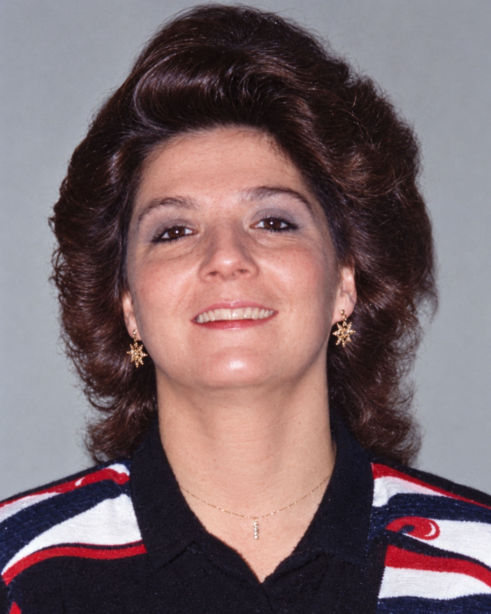
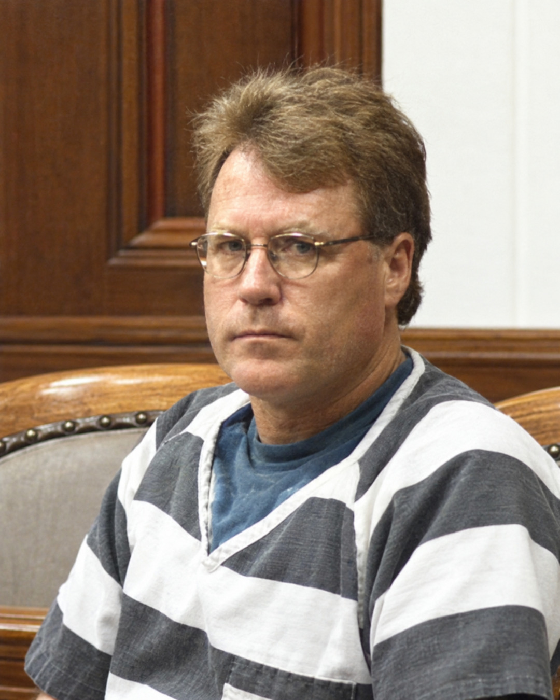
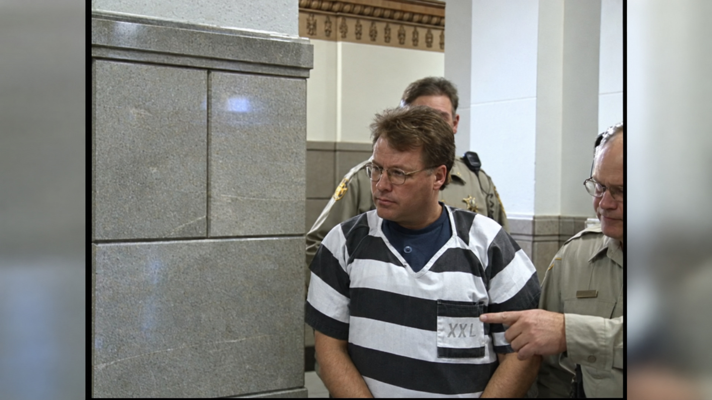
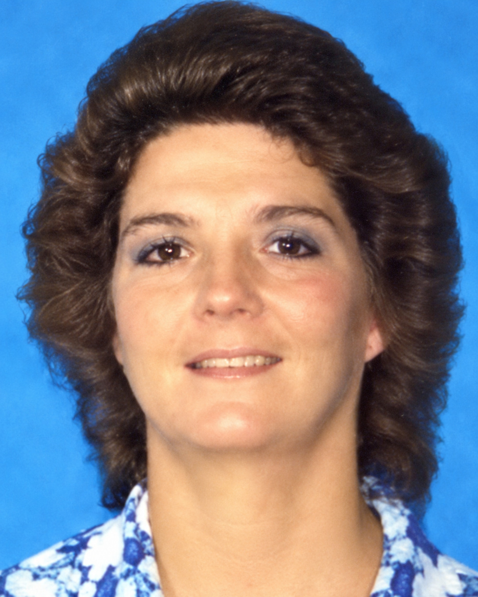

---
# Written October 21, 2026 by Poe from the Scout's handoff (Justin picked the case October 21, 2026).
# Legal care: David Asmussen was convicted by a jury of two counts of first-degree kidnapping (S3).
# He has never been charged with, or convicted of, killing her. Never state or imply that he killed
# her, that she is dead, or where her body is. Family and police words about "remains" stay in quotes,
# attributed to whoever said them. He maintains his innocence (S8). Say so near the top.
# In February 2002 police arrested him on stalking charges but did not call him a suspect in her
# disappearance (S4). Keep his role at each date to what the record said then.
# The apartment details, his statements and the vehicle account come from Forum News Service's
# description of the arrest affidavit and other court documents (S7, S8). We don't have the affidavit
# itself. Attribute every one.
# Left out on purpose: an inmate's claim about what Asmussen told him (S8, an allegation that points
# to a killing), what the 2017 well tip alleged (S8), a third person charged in 2002 with forging a
# check on Pam's account (S4, outcome not confirmed), Asmussen's earlier federal convictions (S2,
# not needed), the names of her daughter and mother (named in S2), and the names of the associates
# and relatives in S7 and S8, except where a quote needs the speaker.
# Conflicts in the text: 17 calls from Nov. 25 to Dec. 9 (S2) versus 41 calls in the month (S8).
# Sentenced in December 2006 with the judgment filed January 10, 2007 (S3), versus sentenced
# January 10, 2007 (S4). Concurrent life terms (S3) versus the defense's claim that only one sentence
# was imposed (S9, S10). Last seen December 9 (S1, S2) and missing from work December 10 (S4, S9),
# which fit together and are explained once.
# Known source errors not repeated: a 2021 KELOLAND brief says he is serving life "for violating a
# protection order" (wrong, that sentence was 40 months), and one KELOLAND line says "Sioux Falls".
# The 25th anniversary line is written for October to December 2026. Update it after December 9.
draft: false
title: "The Door Was Locked: The Disappearance of Pamela Dunn"
seoTitle: "Pamela Dunn: What Happened in Watertown, SD"
description: "Pamela Dunn, 38, vanished from her Watertown, SD, apartment in December 2001. Her ex was convicted of kidnapping her. She has never been found."
person: "Pamela Dunn"
summary: "Pamela Dunn, 38, was last heard from at her Watertown, South Dakota, home on December 9, 2001. [S1, S2] In 2006, a jury convicted her former boyfriend, David Asmussen, of kidnapping her. He denies it. [S3, S8] She has never been found. [S10]"
status: missing
town: "Watertown"
state: SD
incidentDate: 2001-12-09
lastSeenDate: 2001-12-09
resolvedDate: null
lastChecked: 2026-10-21
lastFactChange: null
published: 2026-10-23
agency: "the Watertown Police Department"
tipLine: "+16058826210"
anonymousTips: null
contentNote: null
image:
  src: "./pamela-dunn-2001.jpg"
  alt: "Pamela Dunn, smiling, in a black leather jacket at a restaurant table"
  credit: "Pamela Dunn in an undated photo"
  license: "Photo published in news coverage of the case"
youtubeId: null
youtubeUploadDate: null
sources:
  - { id: S1, title: "Missing: Pamela Jean Dunn", publisher: "South Dakota Attorney General's Office", url: "https://atg.sd.gov/docs/Missing%20Poster%20-%20Pamela%20Dunn%20updated.pdf", date: 2014-07-30 }
  - { id: S2, title: "State v. Asmussen, 2006 SD 37", publisher: "South Dakota Supreme Court", url: "https://ujs.sd.gov/media/xioncw0i/23477.pdf", date: 2006-04-12 }
  - { id: S3, title: "Asmussen v. Young, 2019 S.D. 51", publisher: "South Dakota Supreme Court, via CourtListener", url: "https://storage.courtlistener.com/pdf/2019/08/21/asmussen_v._young.pdf", date: 2019-08-21 }
  - { id: S4, title: "A look back at Pamela Dunn's case", publisher: "KELOLAND News", url: "https://www.keloland.com/keloland-com-original/a-look-back-at-pamela-dunns-case/", date: 2020-11-04, archive: "https://web.archive.org/web/20230327011024/https://www.keloland.com/keloland-com-original/a-look-back-at-pamela-dunns-case/" }
  - { id: S5, title: "Watertown cold case: 'We need this closure'", publisher: "KELOLAND News", url: "https://www.keloland.com/news/local-news/watertown-cold-case-we-need-this-closure/", date: 2020-11-05, archive: "https://web.archive.org/web/20201106162639/https://www.keloland.com/news/local-news/watertown-cold-case-we-need-this-closure/" }
  - { id: S6, title: "'20 years is too long': The tragic anniversary of Pamela Dunn's disappearance", publisher: "KELOLAND News", url: "https://www.keloland.com/news/local-news/20-years-is-too-long-the-tragic-anniversary-of-pamela-dunns-disappearance/", date: 2021-12-09, archive: "https://web.archive.org/web/20250805123443/https://www.keloland.com/news/local-news/20-years-is-too-long-the-tragic-anniversary-of-pamela-dunns-disappearance/" }
  - { id: S7, title: "With kidnapper behind bars, South Dakota family still seeking answers in Pamela Dunn's disappearance", publisher: "Forum News Service, via InForum", url: "https://www.inforum.com/news/the-vault/with-kidnapper-behind-bars-south-dakota-family-still-seeking-answers-in-pamela-dunns-disappearance", date: 2022-05-16, archive: "https://web.archive.org/web/20261021225757/https://www.inforum.com/news/the-vault/with-kidnapper-behind-bars-south-dakota-family-still-seeking-answers-in-pamela-dunns-disappearance" }
  - { id: S8, title: "Kidnapper's trail of evidence paints horrific picture in South Dakota missing woman case", publisher: "Forum News Service, via InForum", url: "https://www.inforum.com/news/the-vault/kidnappers-trail-of-evidence-paints-horrific-picture-in-south-dakota-missing-woman-case", date: 2022-05-17, archive: "https://web.archive.org/web/20261021225934/https://www.inforum.com/news/the-vault/kidnappers-trail-of-evidence-paints-horrific-picture-in-south-dakota-missing-woman-case" }
  - { id: S9, title: "KWAT Exclusive: Pamela Dunn's kidnapper files motion for new sentence", publisher: "KWAT, via Go Watertown", url: "https://www.gowatertown.net/kwat-exclusive-pamela-dunns-kidnapper-files-motion-for-new-sentence/", date: 2025-06-10, archive: "https://web.archive.org/web/20261021230020/https://www.gowatertown.net/kwat-exclusive-pamela-dunns-kidnapper-files-motion-for-new-sentence/" }
  - { id: S10, title: "Pam Dunn's kidnapper asked to have life sentence modified", publisher: "KELOLAND News", url: "https://www.keloland.com/top-stories/pam-dunns-kidnapper-asked-to-have-life-sentence-modified/", date: 2025-10-02, archive: "https://web.archive.org/web/20251008184335/https://www.keloland.com/top-stories/pam-dunns-kidnapper-asked-to-have-life-sentence-modified/" }
# Prototype, October 22, 2026: rewritten in the house story voice (story-first layout). No new facts.
# Every fact and tag comes from the October 21 version. The tip line moved to the poster and the box
# after the story. The reader question moved to readerQuestion.
# Quote edits: two of Deb's quotes (S8 "Something didn't sit right", S5 "I'm hoping") are set as one block
# each, dropping the "she said" that split them. The comma before the split became a period. No words changed.
poster:
  - { label: "Age then", text: "38 [S1]" }
  - { label: "Height", text: "5 feet 2 [S1]" }
  - { label: "Weight", text: "About 135 pounds [S1]" }
  - { label: "Hair and eyes", text: "Brown and brown [S1]" }
  - { label: "Last place", text: "Her apartment in Watertown, South Dakota [S2, S7]" }
  - { label: "Case", text: "David Asmussen was convicted of kidnapping her in 2006. He says he is innocent. [S3, S8]" }
timeline:
  - { date: 1963-10-04, text: "Pamela Jean Dunn is born. [S1]", section: "pam" }
  - { date: 2000-08-25, text: "A court issues a protection order against David Asmussen, her former boyfriend. [S2]", section: "the-order" }
  - { date: 2001-12-09, text: "Pam talks to her daughter around 8 p.m. and her mother around 11 p.m. It is the last time anyone is known to have heard from her. [S2]", section: "the-last-calls" }
  - { date: 2001-12-10, text: "She doesn't arrive at work. Police check her apartment. [S2, S7]", section: "the-television" }
  - { date: 2002-02-07, text: "Asmussen is arrested on stalking charges. Police do not call him a suspect in her disappearance. [S4]", section: "two-trials" }
  - { date: 2004-08-23, text: "A jury finds Asmussen guilty of two counts of stalking. He is later sentenced to 40 months. [S2, S4]", section: "two-trials" }
  - { date: 2006-12-12, text: "A Watertown jury convicts Asmussen of kidnapping Pam. [S3, S4]", section: "two-trials" }
  - { date: 2007-01-10, text: "The judgment is filed. He is serving life in prison. [S3, S4]", section: "two-trials" }
  - { date: 2017, text: "A search of a well in Deuel County finds human hair too degraded for DNA testing. [S5, S8]", section: "the-well" }
  - { date: 2020-11-04, text: "Investigators excavate the well on an abandoned Deuel County farm. Pam isn't found there. [S4, S5, S6]", section: "the-well" }
  - { date: 2025-06, text: "Asmussen's lawyer files a motion to correct his sentence. [S9]", section: "the-motion" }
updates:
  - { date: 2026-10-23, text: "Story published." }
readerQuestion: "Deb believes someone out there knows where Pam is. What do you think it would take for that person to come forward?"
---

At about 11 p.m. on December 9, 2001, Pamela Dunn called her mother. She said David Asmussen, her former boyfriend, had called her. He sounded upset, she said. Maybe like he was crying. [S2]

It is the last time anyone is known to have heard from her. [S2]

Five years later, a jury convicted Asmussen of kidnapping her. He is serving life in prison, and he maintains he is innocent. [S3, S4, S8] Pam has never been found. [S10]

## Pam

Pamela Jean Dunn was born on October 4, 1963. She was 38 that December. [S1] She worked at Jenkins Living Center in Watertown, and her coworkers knew her as reliable, Forum News Service reported in 2022. [S8, S9] She had a daughter. She had a dog. [S2, S7]

Deb Tarnowski was her best friend before the two of them learned they were half sisters. After that, Forum reported, they looked out for each other. [S8] As teenagers they would go to a park in Watertown together. "We used to come here just for peace and just to hang out and be kids again," Deb told KELOLAND News in 2020. [S5]

That is most of what the public record says about who Pam was. In 2012, Deb started a Facebook page, "In Memory of Pamela Dunn," and asked anyone who knew Pam to share their stories there. [S6]

## Rocky right away

Pam and Asmussen had a long relationship that ended sometime in August 2000. [S2] They broke up and got back together many times. At one point she accepted his proposal. [S7, S8]

Deb told Forum she knew almost right away that he didn't deserve her sister. [S8]

> "Something didn't sit right with me about him, but I couldn't put my thumb on it. But, it was her life and I thought, if he makes her happy, more power to them. But things started getting really rocky right away, and everyone kept telling her to get rid of him." [S8]

## The order

On August 25, 2000, a Codington County court issued a protection order against Asmussen. Across the top of its first page it said: [S2]

> VIOLATION OF THIS PROTECTION ORDER IS A CRIMINAL OFFENSE. [S2]

It barred him from contacting Pam in any way, directly or not. It barred him from contacting her daughter, her mother, the rest of her family, her employer and her coworkers. He wasn't to come within 100 feet of any vehicle she owned. The order ran until August 2003. [S2]

He called anyway. According to the South Dakota Supreme Court, phone records show 17 calls to her home phone between November 25 and December 9, 2001. [S2] Forum, citing court documents, puts the number at 41 calls in the month before she disappeared. [S8]

Three threatening and abusive messages were saved on her voice mail. The caller didn't give his name. [S2] In one, according to the court documents Forum reviewed, the caller says she will get "the full effect" for seeing someone new, and that she will "get the consequences for the rest of your life." [S8] At trial, the state identified the caller as Asmussen. [S2]

## The last calls

Around 8 p.m. on December 9, Pam's daughter called. She wanted to know whether Pam had a phone number for someone they knew. Pam said she didn't, but that Asmussen would. [S2]

He was there. While they were on the phone, Pam talked with him in the background. She explained that he was picking up the last of his things. [S2]

Then, around 11, she called her mother. [S2]

The missing poster lists December 9 as the day she went missing. Later news reports give December 10, the day she didn't come to work. [S1, S4] Both are true to the record. December 9 is the last day anyone heard from her, and December 10 is the day people noticed she was gone. [S2]

## The television

On the morning of December 10, Pam didn't show up for her shift. A coworker drove to her apartment. Pam's car was in the parking lot. As the coworker got to the door, she could hear a television that sounded like it was turned all the way up. [S7]

Watertown police were called for a welfare check, and a maintenance worker let officers in. [S7] What they found is set out in the affidavit police later filed to support Asmussen's arrest, as Forum described it in 2022. [S7]

The door had been bolted. Her keys were inside. So were her cash, her checkbook, her prescription medicine and her winter coat. So was her dog. [S7] Her purse was on the table. [S10]

The phone cord had been ripped out of the wall, and a caller ID box was gone. The one thing that seemed to be missing was the engagement ring from Asmussen. [S7] The only other person with a key, Forum reported, was Asmussen. [S7, S8]

Two days later, police brought in bloodhounds. They called the disappearance unusual, because her car was still parked outside. [S4]

## His account

Forum reported that Asmussen came to the Watertown Police Department on "the day of Dunn's disappearance," without saying whether that meant December 9 or December 10. He denied having anything to do with it. [S7]

At first, the court documents say, he denied being at her apartment the night before. Then he told officers he had been there from about 6:30 to 8:30 p.m. The two had argued and then made up, he said, and he had spent the night at his trailer in Bemis, about 20 minutes away. [S7] The state Supreme Court records that he admitted being at her home and talking to her on the phone on December 8 and 9. [S2]

## The blue Cavalier

Investigators also tracked the vehicles he drove on December 9 and 10. According to Forum's account of the court documents, his story about them didn't match what other people told police. [S7]

On the evening of December 9 he picked up a blue Chevy Cavalier from a friend. The next morning he left it at an associate's shop, where, the associate said, the two of them took off the license plate. [S7]

The car was sold before police could inspect it. When they did search it, they found hair consistent with Pam's in color and length. DNA testing couldn't show it was hers. [S7]

After December 9, the court documents show, his calls to her stopped. [S8]

Vincent Foley was the Codington County state's attorney then. What stood out to investigators, Forum reported, was Asmussen's lack of concern for Pam herself. [S7] Foley told Forum:

> "You'd think that a guy whose love of his life has gone missing, that he'd be worried about finding her. He was worried about defending himself." [S7]

## Two trials

On February 7, 2002, police arrested Asmussen, accused of stalking Pam on two separate days. They didn't call him a suspect in her disappearance. [S4] He pleaded not guilty that October. [S4]

Prosecutors went after the stalking case first. "The goal was to get him locked up and then proceed to work the bigger case. And we were able to do that," Foley told Forum. [S8]

The stalking trial was held in Huron on August 23, 2004. Three days earlier, Asmussen had dismissed his lawyers so he could represent himself. [S2] Jurors heard parts of the messages from December 5 and 6. Jon Bierne, an agent with the state Division of Criminal Investigation, testified that in his opinion the voice was Asmussen's. Asmussen made no opening statement and no closing argument. [S2] The jury found him guilty of two counts of stalking, and he was sentenced to 40 months in prison. The South Dakota Supreme Court upheld the conviction in April 2006. [S2]

That May he was back in a Watertown courtroom, this time charged with kidnapping her. [S4] The court ordered a mental evaluation before he could represent himself. [S4] He was found competent, and once again he acted as his own lawyer. [S3] At several points he tried to raise a defense based on the Uniform Commercial Code. The trial judge rejected it, and the Supreme Court later called it "nonsensical." [S3]

With Pam still missing, prosecutors had to prove at least that he had taken her from her apartment against her will, Forum reported. [S8] The ring was part of their case. Asmussen's sister-in-law at the time gave it to investigators. She told them he had dropped it off at her house before his 2004 sentencing, according to court documents. [S8]

On December 12, 2006, a Watertown jury convicted him of two counts of first-degree kidnapping. [S3, S4] He was sentenced to life in prison. [S3] KELOLAND reported the sentence as life without parole and gives the sentencing date as January 10, 2007. [S4] The state Supreme Court says he was sentenced in December 2006 and the judgment was filed on January 10. [S3]

Asmussen still maintains he is innocent, Forum reported in 2022. [S8]

## The well

In 2017, acting on a tip, authorities used a vacuum truck to search a well on an abandoned farm in Deuel County. They found human hair, but it was too degraded to test for DNA. [S5, S8]

On November 4, 2020, the state Division of Criminal Investigation, Watertown police and the Deuel County Sheriff's Office went back and dug out the well. [S4, S5] Deb told KELOLAND the news left her torn. [S5]

> "I'm hoping just for closure, but then there's part of me saying 'No, you know, hopefully something else will be found.' It's my life's mission to find answers and find what happened to her." [S5]

Most of what they dug up was animal remains. A few pieces were sent off for testing. [S5] In 2021, Capt. Chad Stahl of the Watertown Police Department said the bones weren't human. [S6] "We went for the full excavation of the well because we wanted to make sure," he told Forum in 2022. "Unfortunately, it didn't pan out the way we wanted it to." [S8]

## The motion

Asmussen never filed a direct appeal of the kidnapping conviction. He challenged it in a habeas petition in January 2015. At the end of 2018 a judge dismissed it because it was filed about six months past the deadline, the state Supreme Court said, and in 2019 that court refused to let him appeal. [S3]

In June 2025, his lawyer, Ryan Kolbeck, filed a motion asking the court to correct what he called an illegal sentence. It says the written judgment wrongly describes a voluntary guilty plea, when in fact a jury convicted him. It says the judge imposed only one life sentence, so there aren't two sentences to run at the same time. Kolbeck called the judgment "self-contradictory." [S9, S10]

KWAT reported that a hearing was set for September 22, 2025. [S9] In early October, KELOLAND reported that no hearings were scheduled. [S10] No public report of a ruling was found for this story.

Codington County State's Attorney Alison Bakken wrote to Pam's family in an email KELOLAND obtained. [S10]

> "I've made it clear to Dave and his attorney that I will not stop looking for her and investigating this case." [S10]

## Christmas

Kidnapping is the only crime Asmussen has been convicted of in Pam's case, and he says he didn't take her. [S3, S8] What the record doesn't show is what happened to her after December 9. Searches have turned up hair that couldn't be tested and bones that weren't hers. [S5, S6]

Stahl has said he hopes Asmussen will one day tell them where she is. "I don't know if he will ever do that," he told KELOLAND in 2021. "In domestic relationships and situations like that, it's a power and control thing." [S6] Deb said much the same to Forum in 2022. "It doesn't give us closure," she said of the conviction. "It's the last piece of control that he has." [S8]

"You know, 20 years is too long, you know, without answers, without closure. That's all that we want," Deb said in 2021. She said the best Christmas present her family could get would be answers. [S6]

"Somebody out there knows and can let somebody know where she is." [S6]

This December marks 25 years. [S1]
