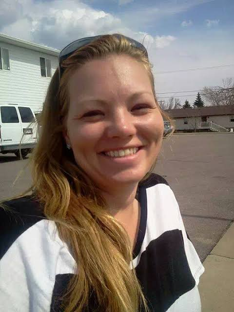
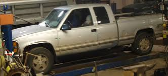
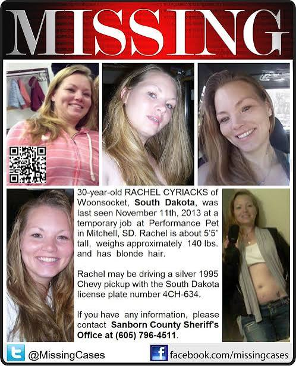
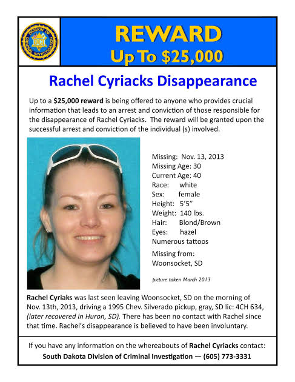

---
# From Justin's draft "The Call That Never Came," fact-checked October 15, 2026 against the sources below.
# Changes from the draft:
# - Cut "On Halloween, she turned thirty" and "she would turn forty-three on October 31." No source gives
#   her birthday. Halloween is sourced only as the night Brad was arrested (S9, S14).
# - Cut the Performance Pet job in Mitchell. Only a privately made poster says it. It is shown as a
#   photo in "What the record says," as one of the conflicting accounts.
# - Cut "her family reported her missing in December." Used S3 instead: the sheriff opened an
#   investigation about a month after she vanished.
# - Cut the second quilt description (red and white with green squares). No source found.
# - Added what Brad told investigators about driving home first (S3), the drivetrain (S3, S7),
#   the 2021 search list (S3), and the 2024 interview (S14).
# Conflicts left in the text on purpose: her mother's birthday is the 14th in S2 and S3 but the 13th
# in S7. The truck was found in December 2013 (S4) or January 2014 (S3). Three children (S3, S7, S9)
# or two (S5).
# Legal care: Brad Cyriacks has never been charged. Never state or imply he caused her disappearance.
# A DCI agent called him a "prime suspect" (S2, 2018) and the "prime subject" (S3, 2021), other
# reports say authorities called him "not a suspect" (S6), and the AG says no one has been ruled out
# (S6, S14). The story uses only "last person known to have seen her" and "never charged."
# Left out: the friend's name (S3 and S15 disagree on it, and he was never charged), the 2018 claim
# Mary attributes to Brad (S2), Mary's belief about where Rachel is buried (S14), and a family
# friend's claim about Rachel's phone (S14).
# Photos: all from Justin, October 15, 2026. They circulate in news coverage and on missing posters.
# Justin approved them for use on October 15, 2026. Family permission was not separately confirmed.
# The three photos of Rachel with Brad are left out on purpose: he was never charged, and his face
# beside "last person known to have seen her" would hint at what the record doesn't say.
# Also unused: two small, low-resolution photos of Rachel, and the DCI "Missing" poster (its truck
# photo is used on its own).
draft: false
title: "The Call That Never Came: The Disappearance of Rachel Cyriacks"
seoTitle: "Rachel Cyriacks: What Happened in Woonsocket, SD"
description: "In November 2013, Rachel Cyriacks drove from Woonsocket to Huron, SD, and vanished. Her truck came back. Her quilt never did."
person: "Rachel Cyriacks"
summary: "Rachel Cyriacks, 30, drove from Woonsocket, South Dakota, to Huron on November 13, 2013, to pick up her husband from jail. [S4, S9] She has not been heard from since. [S4] No one has been charged. [S12] The state is offering up to $25,000 for information. [S13]"
status: missing
town: "Woonsocket"
state: SD
incidentDate: 2013-11-13
lastSeenDate: 2013-11-13
resolvedDate: null
lastChecked: 2026-10-15
lastFactChange: null
published: 2026-10-15
agency: "the South Dakota Division of Criminal Investigation"
tipLine: "+16057733331"
anonymousTips: null
contentNote: null
image:
  src: "./rachel-cyriacks-2013.jpg"
  alt: "Rachel Cyriacks smiling in the driver's seat of a vehicle, sunglasses pushed up on her head"
  credit: "Rachel Cyriacks in an undated family photo"
  license: "Family photo shared in the public search for Rachel"
youtubeId: null
youtubeUploadDate: null
sources:
  - { id: S1, title: "Law Enforcement Continues to Seek Public Assistance in Search for Rachel Cyriacks", publisher: "South Dakota Attorney General's Office", url: "https://atg.sd.gov/OurOffice/Media/pressreleasesdetail.aspx?id=2121", date: 2018-11-13 }
  - { id: S2, title: "New leads give investigators hope five years later in search for Rachel Cyriacks", publisher: "KSFY (Dakota News Now)", url: "https://www.dakotanewsnow.com/content/news/New-leads-give-investigators-hope-five-years-later-in-search-for-Rachel-Cyriacks-500326111.html", date: 2018-11-12 }
  - { id: S3, title: "Investigators hone in on suspect in South Dakota missing persons case", publisher: "Forum News Service, via InForum", url: "https://www.inforum.com/news/the-vault/investigators-hone-in-on-suspect-in-missing-persons-case-rachel-cyriacks", date: 2021-12-30 }
  - { id: S4, title: "Attorney General Jackley Remembers Rachel Cyriacks Ten Years After Disappearance, Seeks Public's Help", publisher: "South Dakota Attorney General's Office", url: "https://atg.sd.gov/OurOffice/Media/pressreleasesdetail.aspx?id=2473", date: 2023-11-08 }
  - { id: S5, title: "Ten years since Rachel Cyriacks' disappearance", publisher: "Dakota News Now", url: "https://www.dakotanewsnow.com/2023/11/10/ten-years-since-rachel-cyriacks-disappearance", date: 2023-11-09 }
  - { id: S6, title: "Missing Woonsocket woman's mother speaks out", publisher: "KELOLAND News", url: "https://www.keloland.com/news/local-news/missing-woonsocket-womans-mother-speaks-out/", date: 2023-11-09 }
  - { id: S7, title: "Rachel Cyriacks vanished after picking up her husband. Her vehicle was discovered, yet the case is unsolved", publisher: "Forum News Service, via The Dickinson Press", url: "https://www.dglobe.com/news/the-vault/rachel-cyriacks-vanished-after-picking-up-her-husband-her-vehicle-was-discovered-yet-the-case-is-unsolved", date: 2023-11-20 }
  - { id: S8, title: "Search underway on Beadle County property connected to Rachel Cyriacks investigation", publisher: "KELOLAND News", url: "https://www.keloland.com/news/local-news/search-underway-on-beadle-county-property/", date: 2023-11-29 }
  - { id: S9, title: "Weeks after tip request, authorities search near spot Rachel Cyriacks was last seen 10 years ago", publisher: "Forum News Service, via Grand Forks Herald", url: "https://www.grandforksherald.com/news/the-vault/weeks-after-tip-request-authorities-search-near-spot-rachel-cyriacks-was-last-seen-10-years-ago", date: 2023-12-01 }
  - { id: S10, title: "Items found in recent search connected to Cyriacks case", publisher: "KELOLAND News", url: "https://www.keloland.com/news/local-news/items-found-in-recent-search-connected-to-cyriacks-case/", date: 2023-12-08 }
  - { id: S11, title: "AG issues statement on progress in search for Rachel Cyriacks", publisher: "Huron Plainsman", url: "https://plainsman.com/2023/12/09/ag-issues-statement-on-progress-in-search-for-rachel-cyriacks/", date: 2023-12-09 }
  - { id: S12, title: "Investigators are close to solving the case of Rachael Cyriacks", publisher: "KELOLAND News", url: "https://www.keloland.com/news/local-news/investigators-are-close-to-solving-the-case-of-rachael-cyriacks/", date: 2023-12-19 }
  - { id: S13, title: "$25K reward offered in Rachel Cyriacks case weeks after search revealed items of interest", publisher: "Forum News Service, via The Dickinson Press", url: "https://www.dglobe.com/news/the-vault/25k-reward-offered-in-rachel-cyriacks-case-weeks-after-search-revealed-items-of-interest", date: 2023-12-19 }
  - { id: S14, title: "Missing and Murdered: Search continues for Rachel Cyriacks", publisher: "Dakota News Now", url: "https://www.dakotanewsnow.com/2024/08/01/missing-murdered-search-continues-rachel-cyriacks/", date: 2024-07-31 }
  - { id: S15, title: "Rachel Lucille Cyriacks", publisher: "The Charley Project", url: "https://charleyproject.org/case/rachel-lucille-cyriacks", date: 2022-01-02 }
timeline:
  - { date: 2013-08, text: "Rachel files for a temporary protection order against her husband, Brad, citing domestic abuse. [S3, S9]", section: "the-paperwork-nobody-wants-to-file" }
  - { date: 2013-10-31, text: "Brad is jailed in Huron after a domestic assault incident. [S9, S14]", section: "the-paperwork-nobody-wants-to-file" }
  - { date: 2013-11-13, text: "Rachel drives from Woonsocket to Huron to pick Brad up. He says she dropped him at a friend's house. [S1, S9]", section: "the-last-morning" }
  - { date: 2013-11-14, text: "Rachel doesn't make the birthday call she promised her mother. [S2, S3]", section: "the-fourteenth" }
  - { date: 2013-12, text: "Her truck is found behind a building on a bee farm near Huron. Her quilt is never found. [S4]", section: "the-thing-that-went-with-her" }
  - { date: 2018-11, text: "Five years on, the DCI says tips have led to possible burial sites. [S2]", section: "what-the-record-says" }
  - { date: 2023-11-29, text: "Crews search the James River northeast of Huron. Items are sent for analysis. [S8, S10]", section: "what-the-record-says" }
  - { date: 2023-12-19, text: "The attorney general offers a reward of up to $25,000. [S13]", section: "what-the-record-says" }
  - { date: 2024-07, text: "The attorney general says new leads have come in and more sonar searches are planned. [S14]", section: "where-it-stands" }
updates:
  - { date: 2026-10-15, text: "Story published." }
---

Her mother's birthday is November 14. [S2, S3]

Hold onto that. It's a small thing, the kind of date that lives on a kitchen calendar between a dentist appointment and garbage day. But in the fall of 2013, Rachel Cyriacks made her mother a promise about that date. She said she would call. [S2, S3]

Mary Schabot waited for that call. It's the kind of waiting you don't notice you're doing until the day gets late and the phone still hasn't rung.

It never rang. [S2, S3]

Mary has said she knew by that day that something was wrong. [S2] Not a knock at the door. Not a deputy with his hat in his hands. Just a birthday that went by in silence.

That was thirteen years ago this November. Rachel hasn't been heard from since. [S4]

## A girl who liked to be outside

Her name is Cyriacks, and you say it SEER-icks. Say it once out loud. Missing people get turned into posters, and posters turn into wallpaper, and it helps to remember there's a person under the laminate.

When Rachel was five or six, the family kept horses, and she loved to ride. [S6] Her mother remembers a tomboy who liked to be outdoors, and who was "always on the go." [S5, S6] She was the baby of the family. Mary says the two of them got along well, and Rachel and her dad did too. [S2]

She grew up into a woman her mother calls "fun to be around." [S5]

Hazel eyes, dark blonde hair, a dimple in her right cheek. Her right forearm carried a whole garden of ink: two big red flowers, stars, a tree, and the initials RJ. [S15]

She had three children, and her mother says she "really loved" them. [S3, S5] She also had a quilt she cherished, green and pink and white, that she kept at home in Woonsocket. [S4, S15]

I won't dress up the rest, because that would be its own kind of lie. By 2013, both Rachel and her husband, Brad, had a history with drugs, and her children were living with relatives. [S3, S7]

But Rachel was trying. Her family says she was getting her life back together, planning a divorce, and working to get custody of her kids. [S3, S7]

She knew the roads between Woonsocket, Mitchell, Huron and Sioux Falls the way you know your own hallway in the dark. [S15]

## The paperwork nobody wants to file

In August 2013, Rachel went to court and asked for a temporary protection order against Brad. According to court records, she cited multiple incidents of domestic abuse. [S3, S9]

In the week before she disappeared, Rachel told her family the abuse was happening again. [S6]

On Halloween night, Brad was arrested after a domestic assault incident and held in Huron. [S9, S14] On Wednesday, November 13, 2013, he was getting out. [S9, S14]

Somebody had to go pick him up. Rachel did. [S9]

## The last morning

Let's slow down here, because this is the part that matters most, and it's also the part we know the least about.

On the morning of November 13, Rachel was seen in Woonsocket. [S1] She drove her gray 1995 Chevy Silverado, South Dakota plates 4CH634, to Huron. [S4, S7, S15]

Her phone records show a call to a gas station in Huron. Investigators believe that's where she picked Brad up. [S3]

And then the story narrows down to one man's account.

Brad told investigators the two of them drove home for a short while. Then, he said, Rachel drove him to a friend's house in Huron, and dropped him off, and that was the last time he saw her. [S3, S9]

Investigators say he is the last person known to have seen her alive. He has been questioned. He has never been charged in connection with her disappearance, and the attorney general has said no one has been ruled out. [S6, S12]

No one has come forward to say they saw Rachel Cyriacks after that. [S4]

## The fourteenth

The next day was the fourteenth.

You already know how that went.

Mary has said she knew something was wrong, but a missed phone call isn't evidence. It's just a promise that didn't get kept. [S2]

When a week went by with nothing, Mary used her key to let herself into Rachel's house. There was no sign of a struggle. There was no sign of Rachel. Friends and neighbors hadn't seen her either. [S3]

The Sanborn County Sheriff's Office opened its investigation about a month after she vanished. [S3]

## The thing that went with her

Now here's the part that gets under your skin.

Remember the quilt? Green, pink, and white. The one she cherished. [S15]

It was gone. [S4]

According to the attorney general's office, the quilt vanished at the same time she did. [S4] Of everything in that house, the thing that left with Rachel was the thing she loved. Investigators thought it mattered enough to put it on her missing posters. [S2]

Then the truck turned up.

Weeks after she vanished, Rachel's Silverado was found outside Huron, behind a shed on a bee farm. [S4, S9] The farm belonged to the family of the friend Brad said Rachel had dropped him off with. [S9] The truck couldn't run. Its drivetrain had been pulled out, and its undercarriage was badly damaged. [S3, S7] It wasn't brought into evidence until about two months after she disappeared. [S6]

Brad had an explanation. He and his friend told investigators they had been working on repairs. Brad said he had been driving the truck regularly after Rachel went missing. [S3]

Investigators tested the truck for DNA and searched it top to bottom. The case agent said it "didn't really answer any questions." [S3]

So the truck came back. The quilt didn't. Neither did Rachel.

## What the record says

Some of the record doesn't agree with itself, and you should know where.

Every official release says Rachel disappeared on November 13. [S1, S4] But one missing persons site lists November 12 [S15], and an early poster gave a different day and place.

The attorney general's office says the truck was found in December 2013. [S4] A detailed 2021 report says January 2014. [S3] Most reports say she had three children. [S3, S9] One says two. [S5] And one report puts her mother's birthday on the 13th, not the 14th. [S7]

What doesn't shift is the silence.

Investigators searched with ground radar, cadaver dogs, dive teams, side scan sonar and planes. They checked 20 wells, junkyards, abandoned buildings and the James River. [S3] Five years in, the case agent said tips had led searchers to possible burial sites, including a large ditch. [S2] Investigators compared Rachel's dental records to a woman found dead in Iowa. The agent said he didn't believe it was her. [S2]

That same year, a reporter asked Mary what she would say to her daughter. "I just want to hug her," she said. [S2]

Then, in the fall of 2023, ten years on, things moved.

On November 29, crews searched a farm northeast of Huron, working the banks of the James River with boats, in an area they had searched before. [S8] Items were recovered and sent for analysis. [S10] Agents began interviewing some witnesses for the first time. [S10, S11]

The woman whose land gave searchers a way down to the river told a reporter it was "odd to think" someone might have been out there for ten years with no one knowing. [S8]

In December, Attorney General Marty Jackley announced a reward of up to $25,000 for information leading to an arrest and conviction. [S13] He said investigators were "close," and that they believed "a couple of individuals" had information about her disappearance. [S12]

"It is time to bring Rachel home," he said. [S11, S13]

## Where it stands

In the summer of 2024, Jackley said more leads had come in and more sonar searches were planned. [S14] What the items from the river turned out to be has never been made public, at least not anywhere I could find. No one has been charged. [S12] The quilt has never turned up.

Mary is still looking. "Somebody needs to talk," she told a reporter. "We've got to have answers, and I'm not going to give up." [S14]

Here's where the calendar comes back around.

On November 13, it will be thirteen years since that morning in Woonsocket.

And the day after that is November 14.

Her mother's birthday. The day Rachel promised to call. [S2, S3]

Her mother has said it only takes one person "to say the right thing or know the right thing." [S6] If you were around Huron in November 2013, if you saw a gray Silverado that week, or if you have ever seen a green, pink, and white quilt somewhere it didn't belong, call the South Dakota Division of Criminal Investigation at [605-773-3331](tel:+16057733331). [S4]

So I'll ask you what I keep asking myself: after thirteen years, what would it take for the person who knows to finally pick up the phone?
