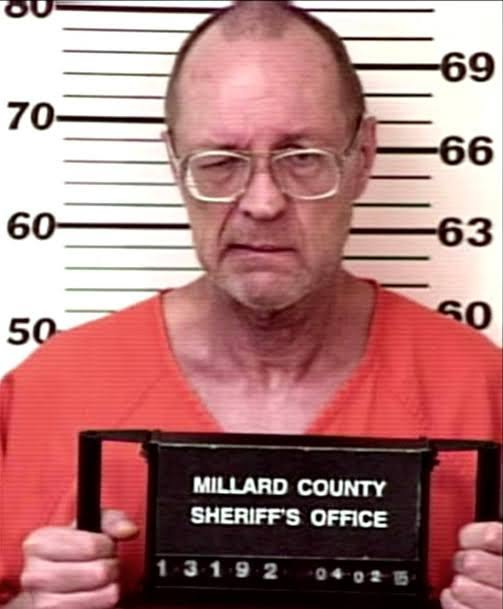

---
# From Justin's draft "The Truck Stop Killer" and the research write-up "Behind the Cab Door,"
# fact-checked October 16, 2026 against the sources below.
# Changes from the draft:
# - April 1, 1990, Trooper Mike Miller and "everything was all right" come from Tucson Weekly (S4).
#   The court opinion says only "April 1990" (S1). Rhoades's exact words were never quoted.
# - The plea for Regina's murder was September 11, 1992 (S1). Some online accounts say 1994.
# - Patricia was shot several times, police believe, after about a week of captivity (S2). That week
#   is an investigative estimate, and the text says so.
# - Patricia's remains: deer hunters, 22 miles south of Fillmore, Millard County, Utah (S3).
#   Identified by dental records in 2003 (S2, S3).
# - The 2012 plea was in Sutton County, Texas (S3), to two counts of capital murder (S2, S3).
# - Cut "torture chamber" from the headline and "Truck Stop Killer" as a title. The story ends on the names.
# Left out on purpose:
# - Regina's companion's name and fate. Deseret News (2012) says his body was never found (S3). Other
#   accounts say remains found in East Texas in 1990 may be his. Rhoades was never convicted of anything
#   involving him. The text says only what AP reported in 2012: he had never been located (S2).
# - The survivors' names. The Arizona survivor's name circulates online. Standards: we don't name sexual
#   assault victims unless they chose to speak publicly. Tucson Weekly used a pseudonym for her (S4).
# - Graphic details of the restraints and of Regina's body (S1, S4).
# - Estimates of dozens or hundreds of victims. No source proves any count beyond the three pleas.
# - Whether Rhoades is alive today. No current official source was found. Check before adding.
# Photos: from Justin, October 16, 2026, identified by him. They circulate in news coverage of the case.
# Family permission was not separately confirmed.
# Used: Regina's school portrait (cover), a colorized and enhanced portrait of Regina (captioned as such),
# Douglas's portrait, and Rhoades's 2005 Millard County booking photo (convicted, so allowed by Standards).
# Left out on purpose:
# - A photo of Regina sitting in a vehicle. Its origin is unknown. Police recovered photos Rhoades took of her
#   inside his truck (S1). Don't publish it unless a family source confirms it predates her disappearance.
# - A close-cropped photo of Patricia with bare shoulders. Same reasoning: Rhoades's apartment held photos of
#   nude women (S1, S2). Use a confirmed family photo of her instead when one turns up.
# - A photo of Regina's companion, who is left out of the text.
# - Two other prison photos of Rhoades (one booking photo is enough) and a photo of him in a leather harness.
draft: false
title: "Behind the Cab Door: Regina Walters, Patricia Walsh and Douglas Zyskowski"
seoTitle: "Regina Walters: What Happened in Greenville, IL"
description: "In 1990 a trooper found a woman chained inside a truck in Arizona. It led police to the killer of a 14-year-old girl and two newlyweds."
person: "Regina Walters"
summary: "On April 1, 1990, an Arizona trooper found a woman chained inside Robert Ben Rhoades's truck. [S4] Evidence from that stop led to 14-year-old Regina Walters, found in an Illinois barn. [S1] Rhoades pleaded guilty to her murder in 1992, and to killing newlyweds Douglas Zyskowski and Patricia Walsh in 2012. [S1, S2]"
status: solved
town: "Greenville"
state: IL
incidentDate: 1990-02-03
lastSeenDate: null
resolvedDate: 2012-03-29
lastChecked: 2026-10-16
lastFactChange: null
published: 2026-10-16
agency: "the Bond County Circuit Court"
tipLine: null
anonymousTips: null
contentNote: "the murder of a child, kidnapping, torture and sexual violence against women"
image:
  src: "./regina-walters-1990.webp"
  alt: "Black and white school portrait of Regina Walters as a young girl with shoulder-length dark hair, smiling"
  credit: "Regina Walters in an undated school photo"
  license: "Photo published in news coverage of the case"
youtubeId: null
youtubeUploadDate: null
sources:
  - { id: S1, title: "People v. Rhoades, 323 Ill. App. 3d 644 (opinion affirming the Bond County judgment)", publisher: "Appellate Court of Illinois, Fifth District, via FindLaw", url: "https://caselaw.findlaw.com/il-court-of-appeals/1345482.html", date: 2001-07-13 }
  - { id: S2, title: "'Torture dungeon' trucker pleads guilty", publisher: "Associated Press, via The Spokesman-Review", url: "https://www.spokesman.com/stories/2012/mar/30/torture-dungeon-trucker-pleads-guilty/", date: 2012-03-30 }
  - { id: S3, title: "Serial killer with Utah ties gets 2 more life sentences in Texas", publisher: "Deseret News", url: "https://www.deseret.com/2012/3/29/20500547/serial-killer-with-utah-ties-gets-2-more-life-sentences-in-texas", date: 2012-03-29 }
  - { id: S4, title: "Dead End (cover story by Karen Brandel)", publisher: "Tucson Weekly", url: "https://www.tucsonweekly.com/tw/02-29-96/cover.htm", date: 1996-02-29 }
timeline:
  - { date: 1989-11, text: "Newlyweds Douglas Zyskowski and Patricia Walsh leave Seattle, hitchhiking to Georgia. Near El Paso they accept a ride from Rhoades. [S2]", section: "two-people-headed-east" }
  - { date: 1990-01, text: "Douglas's body is found beside Interstate 10 east of Ozona, Texas. He had been shot. [S2]", section: "two-people-headed-east" }
  - { date: 1990-02-03, text: "Regina Walters, 14, is last seen at her mother's apartment in Pasadena, Texas. [S1]", section: "a-girl-from-pasadena" }
  - { date: 1990-04-01, text: "A trooper near Casa Grande, Arizona, finds a woman chained inside Rhoades's truck. Rhoades is arrested. [S4]", section: "the-truck-on-the-shoulder" }
  - { date: 1990-09-29, text: "Regina's body is found in a barn along Interstate 70 in Bond County, Illinois. [S1]", section: "the-barn-on-interstate-70" }
  - { date: 1990-10, text: "Deer hunters find Patricia's remains in Millard County, Utah. [S3]", section: "thirteen-years-without-a-name" }
  - { date: 1992-09-11, text: "Rhoades pleads guilty to Regina's murder and is sentenced to natural life in prison. [S1]", section: "the-pleas" }
  - { date: 2003, text: "Dental records identify Patricia Walsh. [S2, S3]", section: "thirteen-years-without-a-name" }
  - { date: 2012-03, text: "Rhoades pleads guilty to two counts of capital murder for Douglas and Patricia and gets two more life sentences. [S2, S3]", section: "the-pleas" }
updates:
  - { date: 2026-10-16, text: "Story published." }
---

The truck was parked on the shoulder of Interstate 10, its hazard lights blinking. [S4]

It was the early morning of April 1, 1990, at the city limits of Casa Grande, Arizona. Arizona trooper Mike Miller pulled over to check on the driver. [S4]

When he shined his light into the cab, a woman inside screamed. She was naked, handcuffed and chained in the sleeper. [S1, S4]

The driver got out. By Miller's account, the man calmly told him everything was all right. [S4]

His name was Robert Ben Rhoades. He was a long-haul trucker from Houston. [S1, S2] And that stop on the side of the road would open a case that ran from Arizona to Texas, Illinois and Utah.

## The truck on the shoulder

The woman in the truck survived. [S1] She told investigators that Rhoades had tortured and whipped her. [S2]

Rhoades was arrested that day. [S4] He was later convicted in Arizona of aggravated assault, sexual assault and unlawful imprisonment. [S2]

But the truck held something else. Among the things inside was a notebook. [S1]

It belonged to a 14-year-old girl from Texas named Regina Kay Walters. [S1]

## A girl from Pasadena

Regina was last seen at her mother's apartment in Pasadena, Texas, on February 3, 1990. [S1] She had left with an 18-year-old boyfriend, who told friends the two of them planned to hitchhike to Mexico. [S2]

By the time of Rhoades's arrest, she had been gone for two months.

After the Arizona stop, investigators got a warrant to search Rhoades's home in Houston. [S1] They found women's clothing and items that could be used to restrain a person. They found photographs of women. Regina was in some of them. [S1]

Some of the pictures showed her inside his truck. Others showed her standing in front of a barn. [S1]

Nobody knew yet where that barn was.

## The women who got away

The woman in Arizona was not the first.

The Illinois court record describes another woman, identified there only by her initials. Rhoades took her from California to Houston, the record says, and kept her chained in the back of his truck for about two weeks while he raped her. [S1] She escaped. [S1] Tucson Weekly reported she was 18, and that she got away when he failed to close a handcuff. [S4]

In Houston, a woman who had escaped him told police a story of torture much like the one told in Arizona. [S2]

Their accounts mattered. They showed that the restraints in that truck were not just objects in an evidence log. Women had lived through them, and they told police how he used them.

## The barn on Interstate 70

There was one more record in the case, a quieter one. Rhoades kept trip logs for his job. Those logs put him on Interstate 70 in Bond County, Illinois, in February or March 1990. [S1]

On September 29, 1990, Regina's body was found in a barn along Interstate 70. [S1] It was an abandoned farm near Greenville, Illinois. [S2] She had been strangled with baling wire. [S1, S2]

The photographs from Houston showed her in front of that same barn. [S1]

Prosecutors later charged that she was killed sometime between February 3 and March 17, 1990. [S1] For most of the months she was missing, she had already been dead.

The boy she left Texas with was never located, according to reports at the time of Rhoades's 2012 plea. [S2]

## Two people headed east

Part of this case began before Regina ever left home.

In November 1989, Douglas Scott Zyskowski, 28, and Patricia Walsh, 24, left Seattle together. They were newlyweds. They were hitchhiking to Georgia to preach, authorities said. [S2]

Near El Paso, Texas, they accepted a ride from Rhoades. [S2]

In January 1990, Douglas's body was found beside Interstate 10 east of Ozona, Texas, about 320 miles east of El Paso. He had been shot. [S2] He went unidentified until 1992. [S2]

## Thirteen years without a name

Patricia did not die with her husband.

Police believe Rhoades held her captive for about a week, torturing and assaulting her, before he shot her several times. [S2] That week is an investigators' estimate. No one has laid out the exact timeline in public.

In October 1990, deer hunters found her remains 22 miles south of Fillmore, in Millard County, Utah. [S3]

No one knew who she was. Her remains sat unidentified in the basement of the Millard County Sheriff's Office for 13 years. [S3] In 2003, dental records finally gave her back her name. [S2, S3]

Patricia Candace Walsh. [S3]

## The pleas

The Illinois case came first. In May 1992, prosecutors filed notice that they would seek the death penalty. [S1] On September 11, 1992, under a negotiated deal, Rhoades pleaded guilty to Regina's first-degree murder. He was sentenced to natural life in prison. [S1]

He later challenged the plea and the sentence. In July 2001, the Illinois Appellate Court let the judgment stand. [S1]

Justice for Douglas and Patricia took another two decades.

Utah charged Rhoades in Patricia's death first. That charge was dropped after Utah agreed, at the families' request, to let Texas try him for both murders. [S3] Texas authorities said that was where the couple had been kidnapped. [S2] Prosecutors planned to seek the death penalty. The trial was delayed again and again. [S2]

In March 2012, in Sutton County, Texas, Rhoades pleaded guilty to two counts of capital murder. [S3] He took two life sentences with no chance of parole, and gave up his right to appeal. [S2, S3] The Texas sentences would keep him locked up even if he were ever released in Illinois. [S2]

Three murders. Three guilty pleas.

## What the record doesn't say

Investigators have long suspected there were more victims. [S4] In 2012, the FBI said investigations involving Rhoades were continuing. [S2]

Suspicion is not proof. No court has ever tied Rhoades to any killing beyond these three. The full count of what he did on those highways has never been established.

What the record does show is how this case came apart. A woman found alive. A girl's notebook. Photographs in a Houston apartment. A trip log. Remains found in three different states. [S1, S2, S3]

If that trooper had driven past those blinking lights, how long would it all have stayed hidden?

## Their names

Regina was 14. Douglas and Patricia were newlyweds, headed east together. Two women who lived through captivity in that truck helped police see what it was.

They were not details in a trucker's story. They were people, and this is their story.

Regina Kay Walters. Patricia Candace Walsh. Douglas Scott Zyskowski.
