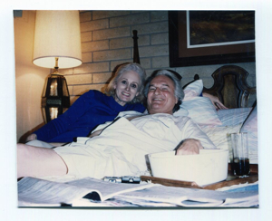
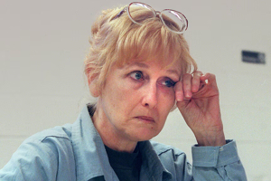
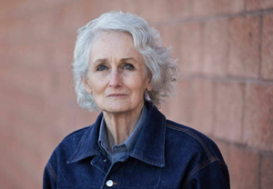

---
# Fact-checked October 9, 2026 against the full text of every source below.
# Rewritten October 11, 2026 from Justin's new draft, using only facts already sourced here.
# Legal care: Margaret Rudin's conviction was vacated (2022) and the charges dismissed with prejudice (2024).
# Never state or imply she killed Ron. Trial evidence is always attributed to testimony or prosecutors.
# Photos: captions say who and where, nothing more. Never caption a photo of Margaret as a suspect,
# fugitive or killer.
draft: false
title: "A Gun in the Lake: The Unsolved Killing of Ron Rudin"
seoTitle: "Ron Rudin: What Happened in Las Vegas, NV"
description: "Ron Rudin vanished in Las Vegas in 1994. His wife's murder conviction was later thrown out. Three decades on, no one stands convicted."
person: "Ron Rudin"
summary: "Las Vegas developer Ron Rudin disappeared on December 18, 1994. His remains were found a month later near Lake Mohave. [S1] His wife, Margaret Rudin, was convicted of his murder in 2001. A federal judge threw out that conviction in 2022, and the charges were dismissed for good in 2024. [S3] [S4] No one stands convicted of his killing."
status: unsolved
town: "Las Vegas"
state: NV
incidentDate: 1994-12-18
lastSeenDate: null
resolvedDate: null
lastChecked: 2026-10-09
lastFactChange: 2026-01-06
published: 2026-10-09
agency: "the Las Vegas Metropolitan Police Department homicide section"
tipLine: "+17028283521"
anonymousTips: { name: "Crime Stoppers of Southern Nevada (702-385-5555)", url: "https://crimestoppersofnv.com" }
contentNote: null
image:
  src: "./ron-rudin-1994.jpg"
  alt: "Ron Rudin and Margaret Rudin sitting together and smiling"
  credit: "Rudin family photo"
  license: "Family photo published in news coverage of the case"
youtubeId: null
youtubeUploadDate: null
sources:
  - { id: S1, title: "Rudin v. State, 120 Nev. 121 (opinion on the direct appeal)", publisher: "Nevada Supreme Court, via FindLaw", url: "https://caselaw.findlaw.com/court/nv-supreme-court/1417075.html", date: 2004-04-01 }
  - { id: S2, title: "What happened in Vegas? Woman alleges innocence in husband's death decades later", publisher: "ABC News (20/20)", url: "https://www.goodmorningamerica.com/news/story/happened-vegas-woman-alleges-innocence-husbands-death-decades-75949361", date: 2021-02-20 }
  - { id: S3, title: "Margaret Rudin's 2001 murder conviction vacated", publisher: "Las Vegas Review-Journal", url: "https://www.reviewjournal.com/crime/courts/margaret-rudins-2001-murder-conviction-vacated-2577410/", date: 2022-05-16 }
  - { id: S4, title: "Murder charges dismissed against Margaret Rudin", publisher: "KTNV (Channel 13 Las Vegas)", url: "https://www.ktnv.com/news/murder-charges-dismissed-against-the-black-widow-of-las-vegas-margaret-rudin", date: 2024-12-09 }
  - { id: S5, title: "Las Vegas judge dismisses Margaret Rudin's wrongful conviction lawsuit", publisher: "KLAS (8 News Now)", url: "https://www.8newsnow.com/investigators/las-vegas-judge-dismisses-margaret-rudins-wrongful-conviction-lawsuit/amp/", date: 2026-01-07 }
  - { id: S6, title: "Margaret Rudin's wrongful conviction lawsuit dismissed", publisher: "KSNV (News 3 Las Vegas)", url: "https://www.news3lv.com/news/local/margaret-rudin-wrongful-conviction-lawsuit-withdrawn-nevada-las-vegas-clark-county-court-attorneys-murder-trial-charges-dismissed", date: 2026-01-09 }
# Prototype, October 22, 2026: rewritten in the house story voice (story-first layout). No new facts.
# Every fact and tag comes from the October 11 version. The reader question moved to readerQuestion.
timeline:
  - { date: 1987-09, text: "Ron Rudin marries Margaret. [S1]", section: "a-city-going-up" }
  - { date: 1994-12-18, text: "Ron is seen for the last time, at the strip mall he owned. [S1]", section: "sunday-night" }
  - { date: 1994-12-23, text: "His Cadillac is found behind a Las Vegas strip club. [S1]", section: "the-cadillac" }
  - { date: 1995-01-21, text: "Fishermen find his remains near Nelson's Landing on Lake Mohave. [S1]", section: "nelsons-landing" }
  - { date: 1996-07-21, text: "A diver finds a .22 pistol registered to Ron in Lake Mead. [S1]" }
  - { date: 1997-04-17, text: "A grand jury indicts Margaret Rudin. She has already left Nevada. [S1]", section: "revere" }
  - { date: 1999-11, text: "She is arrested in Massachusetts. [S1]", section: "revere" }
  - { date: 2001-05-02, text: "A jury convicts her of first-degree murder. [S2]", section: "six-days" }
  - { date: 2020-01-10, text: "She is released on parole after 20 years. [S2]", section: "undone" }
  - { date: 2022-05, text: "A federal judge throws out her conviction. [S3]", section: "undone" }
  - { date: 2024-12-09, text: "The murder charges are dismissed with prejudice. [S4]", section: "undone" }
  - { date: 2026-01-06, text: "Her wrongful conviction lawsuit is dismissed without a ruling on the merits. [S5]", section: "the-prints" }
updates:
  - { date: 2026-10-09, text: "Story published." }
  - { date: 2026-10-11, text: "Story rewritten. No facts changed." }
readerQuestion: "A silenced pistol in Lake Mead. A burned trunk at Nelson's Landing. Fingerprints in a locked car that matched neither husband nor wife. If investigators could take one of those back to the lab today, which would you choose?"
---

A scuba diver found the gun at the bottom of Lake Mead in July 1996. It was wrapped in plastic bags. It was a .22 caliber Ruger pistol, and someone had attached a silencer to it. [S1]

The pistol had been registered to a Las Vegas developer named Ron Rudin in 1980. He reported it missing in 1988. [S1] Ron collected guns. [S2]

By the time the diver brought it up, Ron had been dead for a year and a half. He had been shot in the head several times with a .22. [S1] No court has ever been able to say who put that gun in the lake. [S1, S4]

## A city going up

Las Vegas in the 1980s and early 1990s was a city under construction. Ron rode the boom into real estate and became a successful developer and a powerful man in town. [S2]

He kept his world close. His realty company sat in a strip mall he owned, and his house stood right behind it. [S1] He wore slick black cowboy boots and kept his Cadillac spotless. People who knew him said he had charm and knew how to use it. In a town built on gambling, he stayed out of the casinos. [S2]

In 1994 his newest venture was an RV resort called The Retreat at Lee Canyon. [S2]

He had been married before. His third wife, Peggy, died of a gunshot wound in their home, and authorities ruled her death a suicide. [S2] He met Margaret at church. They married in September 1987. [S1, S2] She had an antique store of her own. [S1]

## Sunday night

December 18, 1994, was a Sunday, one week before Christmas. [S1]

That evening a tenant at the strip mall saw Ron walking toward Margaret's antique store. Around 8:10 p.m., a friend of Margaret's called the house and spoke with Ron. [S1]

Nothing in the public record shows anyone hearing from him after that call. [S1]

## The Cadillac

Ron opened the realty office on Monday mornings. That Monday it stayed closed. The next day, two of his employees went to the police and reported him missing. [S1]

Five days after the phone call, police found his Cadillac in an alley behind the Crazy Horse Too Saloon. It was locked. Dirt had been tracked onto all four floorboards. [S1]

Investigators lifted several fingerprints from the car. None of them were Ron's. None of them were Margaret's. [S1]

For a month, the car was all anyone found of him.

## Nelson's Landing

On the night of January 21, 1995, fishermen near Nelson's Landing on Lake Mohave found human remains. They had been burned. Beside them were the burned remains of a large steamer trunk. [S1]

Dental records said it was Ron. He had been shot in the head several times. He had been missing for 34 days. [S1]

## The bedroom

Police searched the house behind the strip mall. On the bedroom walls and ceiling they found tiny splatters of what appeared to be blood. [S1] While they searched, on January 27, 1995, Margaret left Nevada. [S1]

A day laborer later testified about that January. He said Margaret had him tear out the bedroom carpet, which he said had dark stains, and haul the mattress away. [S1]

Margaret's sister testified that she had seen a trunk like the burned one in Margaret's antique shop. An antique dealer recalled selling her one. [S1]

## The instruction

Four years into the marriage, Ron had gone to his lawyer with something he wanted kept secret. According to testimony the Nevada Supreme Court later summarized, he said in 1991 that Margaret was becoming "vicious and violent." [S1]

He wrote down an instruction. If he died by violent means, his trustees should investigate. [S1]

Two years later he raised her share of his trust from 40 to 60 percent. [S1] His estate was worth at least $8 million. Prosecutors would argue she killed him for that money. [S3]

Margaret has always said she did not kill her husband. [S3] She has said investigators were so focused on her that they missed other motives, among them the Lee Canyon project. Her lawyer has raised questions about where that project's money came from. [S2]

## Revere

A grand jury indicted Margaret for murder on April 17, 1997. [S1] She was already gone, moving from place to place under different names. [S2]

The tip came nearly five years after she left Nevada. She was mailing packages from a post office in Revere, Massachusetts. [S1, S2] Police there arrested her in November 1999. [S1] One of the officers who helped make the arrest was posing as a pizza delivery man. [S2]

## Six days

The trial began March 2, 2001. Her lead lawyer was Michael Amador. In the first days, Margaret told the judge he wasn't prepared. [S1] While it went on, prosecutors were looking into reports that he had taken money from media companies for her story. [S1]

When the jury went out, one juror held out for not guilty. She held out for six days. Then she gave in. She later said it was the biggest regret of her life. [S2]

The verdict came on May 2, 2001. Guilty of first-degree murder. Margaret was sentenced to life in prison, with a chance at parole after 20 years. [S2] Over the years she turned down five plea deals. She said she would not plead guilty to something she didn't do. [S2]

The judge who presided, Joseph Bonaventure, later talked to ABC News about the trial. [S2]

> "In 42 years, that is the worst trial that I've ever had." [S2]

## Undone

The Nevada Supreme Court upheld the conviction in 2004, over a dissent that would have ordered a new trial. The majority said questions about her lawyer belonged in a separate proceeding. [S1]

Margaret served 20 years. She was released on parole on January 10, 2020. [S2]

In 2022, U.S. District Judge Richard Boulware threw out her conviction. He found she had been denied effective counsel, and he called Amador's work at trial "self-absorbed, ill-prepared, and incompetent." Amador had since died. [S3]

The judge also found no evidence linking Margaret to the murder weapon, to Ron's abandoned car, or to the suspected crime scene. [S5]

The state chose not to try her again. [S5] On December 9, 2024, a Clark County judge dismissed the murder charges with prejudice, so she can never be tried for them again. [S4] The state never said she was innocent. It agreed she'd had poor legal representation. [S5]

"Margaret has never been convicted legally of any crimes and she can never be re-prosecuted," her lawyer, Adam Breeden, said. [S4]

## The prints

Margaret sued Nevada in 2024 for wrongful conviction, seeking compensation and a certificate of innocence. [S6] A judge dismissed the suit without prejudice on January 6, 2026, so it can be filed again. Her lawyer said it ended without any ruling on the merits, for confidential reasons. [S5, S6]

She says she doesn't know who killed her husband. Her lawyers say a fingerprint could be the key to finding out. [S5]

The Cadillac had been locked when police found it, two days before Christmas, 1994. There was dirt on all four floorboards. The fingerprints lifted from it were not Ron's, and they were not Margaret's. [S1]

In 1991, Ron had asked in writing for an investigation if he died by violence. [S1] No one stands convicted of killing him. [S4]
