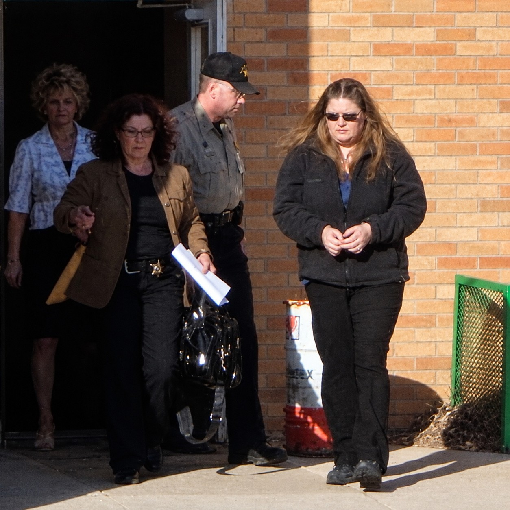
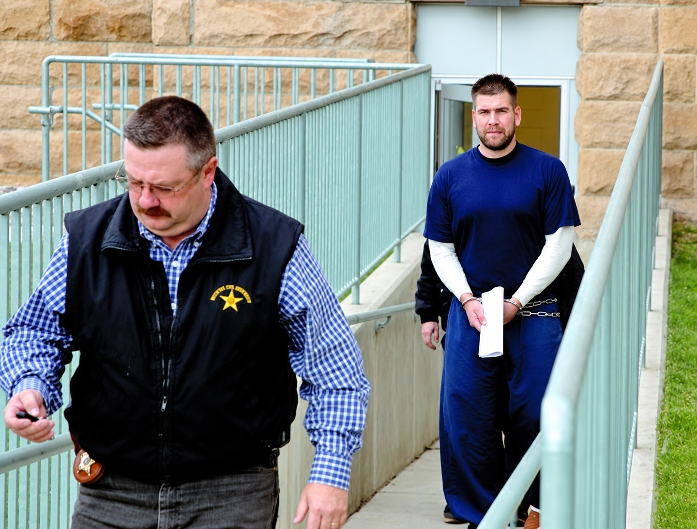

---
# Written October 27, 2026 by Claude at Justin's request, from a research brief Justin supplied and the sources
# below. The brief itself is not a source. Every fact here was checked against a source listed in `sources`.
# Case status checked October 27, 2026: no newer coverage found.
# Legal care:
# - Tory Tiegen was convicted by a jury of kidnapping (S1) and pleaded guilty to first-degree murder (S2).
#   His acts are stated as the court record gives them. His own later accounts (the toolbox, the time of death,
#   what Corean knew) stay attributed to him.
# - Jamie Corean was convicted by a jury of accessory to murder and aiding and abetting aggravated
#   kidnapping, and the conviction was affirmed (S2). She maintained her innocence at sentencing (S7). That
#   line stays in.
# - Cynthia Kindall pleaded guilty but mentally ill to kidnapping and was sentenced to 20 years in prison (S6,
#   read in full from its archived copy, and S7). Her acts come from the court's account in S2 and her own
#   statements as the courts give them.
# - Tell Cook pleaded guilty to misprision of a felony (S1), a misdemeanor (S2), and got probation (S4).
#   Tiegen later testified that Cook drove Klug to a gravel road and struck him. Cook denied it (S2, note 3).
#   Cook was never charged with that, so the claim is left out on purpose.
# - James Kusick, Eric Haar and Abby DeJong appear only as witnesses, by what they testified. S2 says Haar
#   and DeJong had plea agreements, were not charged and were given immunity. The archived S7 says Kusick
#   pleaded guilty to accessory to murder. The story keeps him as a witness only until Justin decides whether
#   to add that. Never imply a charge or a clearing beyond what a source says.
# - Duanna Beebe, Robert Highley, Jamie Keefe and the North Dakota homeowner were never shown to be charged.
#   The homeowner (named in S1) is left unnamed. Keep each person's part to what the record says.
# - "Snitch" and "rat" are Tiegen's and Kindall's words as witnesses gave them (S1, S2). No source shows that
#   Klug gave information to police. The drug debt is Kindall's and Beebe's account (S1 calls it alleged).
# - Left out on purpose: the trunk details beyond the binding, the condition of the car beyond bleach and the
#   stain, Tiegen's account of facial injuries, and the jail notes about "fish food." All are in S1 or S2.
# - Rapid City Journal sources are paywalled. S6, S7, S9 and S13 were read in full from the archived copies
#   linked below. For S3, S4, S5 and S15 only the headline and free first paragraph were read, and nothing
#   else from them is used. Black Hills Pioneer sources (S10, S12) are the same. Only the free first
#   paragraphs were read.
# - S14 is the family's obituary on the funeral home's site. The page is undated. Its date here is the
#   visitation date it announces.
# Quote edits: the judge's words at Corean's sentencing (S2) contain a semicolon, which the build bans. Only
# the first clause is quoted.
# The cologne line: S1 gives it to Tiegen in its account of the facts and to Kindall in its account of
# Beebe's trial testimony. The story names both.
# Name: Justin chose the court spelling, Tiegen, on October 28, 2026. Source titles keep the news spelling.
# Conflicts in the text: "Tiegen" (S1, S2) or "Teigen" (news). "Duanna" (S1) or "Duana" (S2) Beebe. "Jamie"
# (S2) or "Jamee" (S7) Corean. Beebe's first visit at 9:30 p.m. (S1) or around 9 (S2). Cook's first visit at
# 3 a.m. (S1) or around 2 (S2), and Wednesday (Cook) or Tuesday (Tiegen and Kindall) per S2 note 3. Time of
# death: dead by 3 p.m. Tuesday (Tiegen, found not credible), alive early Wednesday (Cook), Wednesday at the
# earliest (the entomologist, S2), July 15 (the obituary, S14). Plea date: S9's page is dated March 31, 2009, but its text says
# "Wednesday," as S10 does, and S13 says April 1. The story and resolvedDate use April 1, 2009.
# Mother's name: the obituary (S14) gives Anita (Joyce) Hinsch-Klug. The Black Hills Pioneer (S12) calls her
# Joyce Klug. The story uses the obituary form and notes the Pioneer's form once.
# Order: S2 gives no date for the hearing on Corean's new trial request, only that it came after Tiegen's
# plea. The Journal reported the circuit court's denial on January 20, 2010 (S15). So "A raw deal" comes
# after Sheep Mountain, and the story ends on the rulings. The obituary's survivor list (June 2009) can't
# be the ending without breaking time order. Editor's call, see the PR.
# Not used: the Charley Project page, which misspells his name and gets the charging history wrong.
# Photos: Justin supplied five photos on October 27, 2026, each larger than any published copy found, so
# they appear to be enlarged. Three are used. The portrait matches the obituary photo on S14. The Tiegen and
# Corean photos match Rapid City Journal file photos, captioned as in the Journal. Not used: a Journal photo
# of James Kusick (his case outcome isn't sourced here) and a small Charley Project photo of Klug (its origin
# isn't recorded). On October 28, 2026, Justin confirmed he holds the rights to all the photos and asked
# that they be marked digitally enhanced. See the PR rights register.
draft: false
title: "The Garage in Belle Fourche: The Killing of Troy Klug"
seoTitle: "Troy Klug: What Happened in Rapid City, SD"
description: "In July 2004, Troy Klug, 26, was kidnapped in Rapid City and held in a car trunk and a garage toolbox. Five years later his killer helped find his grave."
person: "Troy Klug"
summary: "Troy Klug, 26, of Rapid City, was kidnapped on July 12, 2004, and held in a car trunk and a toolbox in a Belle Fourche garage. [S1, S2] Tory Tiegen was convicted of kidnapping him and later pleaded guilty to his murder. [S1, S2] In May 2009, Tiegen helped investigators find his grave in eastern Montana. [S11]"
status: solved
town: "Rapid City"
state: SD
incidentDate: 2004-07-12
lastSeenDate: null
resolvedDate: 2009-04-01
lastChecked: 2026-10-27
lastFactChange: null
published: 2026-10-28
agency: "the South Dakota Division of Criminal Investigation"
tipLine: null
anonymousTips: null
contentNote: "a kidnapping and a beating death"
image:
  src: "./troy-klug-2004.jpg"
  alt: "Troy Klug smiling, with short dark hair, in a black tuxedo, white bow tie and a white boutonniere"
  credit: "Klug family photo from his obituary. Digitally enhanced."
  license: "Used with permission"
youtubeId: null
youtubeUploadDate: null
readerQuestion: "Years later, Tiegen testified that Klug was dead by Tuesday afternoon. An entomologist put his death on Wednesday at the earliest, and the circuit court found Tiegen not credible. How much weight do you think a convicted man's account should get, years after the crime?"
sources:
  - { id: S1, title: "State v. Tiegen, 2008 SD 6, 744 N.W.2d 578", publisher: "South Dakota Supreme Court, via CourtListener", url: "https://www.courtlistener.com/opinion/901798/state-v-tiegen/", date: 2008-01-16 }
  - { id: S2, title: "State v. Corean, 2010 S.D. 85, 791 N.W.2d 44", publisher: "South Dakota Supreme Court, via CourtListener", url: "https://www.courtlistener.com/opinion/901935/state-v-corean/", date: 2010-11-03 }
  - { id: S3, title: "A mother holds onto memories of missing son", publisher: "Rapid City Journal", url: "https://rapidcityjournal.com/news/local/article_03a8a15d-1477-55b1-ba56-a6effba2141b.html", date: 2004-09-24, archive: "https://web.archive.org/web/20261028023714/https://rapidcityjournal.com/news/local/article_03a8a15d-1477-55b1-ba56-a6effba2141b.html" }
  - { id: S4, title: "Man gets probation in kidnap case", publisher: "Rapid City Journal", url: "https://rapidcityjournal.com/news/local/article_a47f18ba-b240-59b0-aa9e-08b7d8717e14.html", date: 2005-07-11, archive: "https://web.archive.org/web/20261028023738/https://rapidcityjournal.com/news/local/article_a47f18ba-b240-59b0-aa9e-08b7d8717e14.html" }
  - { id: S5, title: "Kidnapper gets 100 years", publisher: "Rapid City Journal", url: "https://rapidcityjournal.com/news/article_7f034e46-c325-52e0-ac70-7322c9066098.html", date: 2005-08-01, archive: "https://web.archive.org/web/20261028023802/https://rapidcityjournal.com/news/article_7f034e46-c325-52e0-ac70-7322c9066098.html" }
  - { id: S6, title: "Kindall faces victim's mother at sentencing", publisher: "Rapid City Journal", url: "https://rapidcityjournal.com/news/local/top-stories/article_7277899f-383f-5072-844a-2a1d0d827c19.html", date: 2007-01-11, archive: "https://web.archive.org/web/20250726121749/https://rapidcityjournal.com/news/local/top-stories/article_7277899f-383f-5072-844a-2a1d0d827c19.html" }
  - { id: S7, title: "Belle Fourche woman gets life for aiding in kidnapping", publisher: "Rapid City Journal", url: "https://rapidcityjournal.com/news/local/article_414b77ae-31d8-55d7-ba61-6a5fdf9dc36e.html", date: 2008-09-09, archive: "https://web.archive.org/web/20100831104309/http://www.rapidcityjournal.com:80/news/local/article_414b77ae-31d8-55d7-ba61-6a5fdf9dc36e.html" }
  - { id: S8, title: "Murder charge in '04 disappearance (AP)", publisher: "Mitchell Republic", url: "https://www.mitchellrepublic.com/news/murder-charge-in-04-disappearance", date: 2008-11-21, archive: "https://web.archive.org/web/20261028023827/https://www.mitchellrepublic.com/news/murder-charge-in-04-disappearance" }
  - { id: S9, title: "Tory Teigen admits to murder, gets life without possibility of parole", publisher: "Rapid City Journal", url: "https://rapidcityjournal.com/news/local/top-stories/article_0cba59df-422d-5cd5-9af0-2e1ce49fd089.html", date: 2009-03-31, archive: "https://web.archive.org/web/20100831103630/http://www.rapidcityjournal.com:80/news/local/top-stories/article_0cba59df-422d-5cd5-9af0-2e1ce49fd089.html" }
  - { id: S10, title: "Rapid City man pleads guilty to 2004 murder (AP)", publisher: "Black Hills Pioneer", url: "https://www.bhpioneer.com/local_news/rapid-city-man-pleads-guilty-to-2004-murder/article_39e4e01c-8a7b-56e5-8ee4-a3e27e886403.html", date: 2009-04-02, archive: "https://web.archive.org/web/20261028023934/https://www.bhpioneer.com/local_news/rapid-city-man-pleads-guilty-to-2004-murder/article_39e4e01c-8a7b-56e5-8ee4-a3e27e886403.html" }
  - { id: S11, title: "Man's body found in Montana (AP)", publisher: "The Dickinson Press", url: "https://www.thedickinsonpress.com/news/mans-body-found-in-montana", date: 2009-05-06, archive: "https://web.archive.org/web/20261028024059/https://www.thedickinsonpress.com/news/mans-body-found-in-montana" }
  - { id: S12, title: "Klug case resolution a relief to many", publisher: "Black Hills Pioneer", url: "https://www.bhpioneer.com/news/klug-case-resolution-a-relief-to-many/article_56540489-7303-5ae0-b46e-43891d47e41a.html", date: 2009-05-07, archive: "https://web.archive.org/web/20261028024134/https://www.bhpioneer.com/news/klug-case-resolution-a-relief-to-many/article_56540489-7303-5ae0-b46e-43891d47e41a.html" }
  - { id: S13, title: "Montana remains identified as Troy Klug's", publisher: "Rapid City Journal", url: "https://rapidcityjournal.com/news/local/top-stories/article_e25bc4fb-e9ad-5d07-b753-39184f99c4cc.html", date: 2009-05-12, archive: "https://web.archive.org/web/20091107171052/http://www.rapidcityjournal.com:80/news/local/top-stories/article_e25bc4fb-e9ad-5d07-b753-39184f99c4cc.html" }
  - { id: S14, title: "Troy Jason Klug obituary", publisher: "Osheim & Schmidt Funeral Home", url: "https://www.osheimschmidt.com/obituaries/troy-klug", date: 2009-06-05 }
  - { id: S15, title: "Belle Fourche woman's request for new trial denied in meth murder case", publisher: "Rapid City Journal", url: "https://rapidcityjournal.com/news/belle-fourche-womans-request-for-new-trial-denied-in-meth-murder-case/article_86952a06-0640-11df-9cc8-001cc4c03286.html", date: 2010-01-20, archive: "https://web.archive.org/web/20261028024158/https://rapidcityjournal.com/news/belle-fourche-womans-request-for-new-trial-denied-in-meth-murder-case/article_86952a06-0640-11df-9cc8-001cc4c03286.html" }
timeline:
  - { date: 1978-05-27, text: "Troy Jason Klug is born in Rapid City. [S14]", section: "tuxedos" }
  - { date: 2004-07-12, text: "Klug goes to Cynthia Kindall's house in Rapid City. By the court's account, Tiegen binds him and he is put in the trunk of Kindall's car. [S2]", section: "the-front" }
  - { date: 2004-07-13, text: "Kusick testifies that Tiegen pulls Klug from the trunk in a Belle Fourche garage. Tiegen later says he put him in a toolbox there. [S2]", section: "the-garage" }
  - { date: 2004-07-14, text: "Cook testifies that he sees Klug alive in the trunk in the early morning hours. [S1, S2]", section: "the-trunk" }
  - { date: 2004-07-15, text: "Tiegen and Kindall leave Belle Fourche for Montana. [S2]", section: "no-water" }
  - { date: 2004-07-23, text: "Tiegen is charged with kidnapping Klug. [S1]", section: "pound-the-pavement" }
  - { date: 2004-09-30, text: "Cook meets with investigators and turns over notes from Tiegen. A plea agreement follows. [S1]", section: "kites" }
  - { date: 2005-06-20, text: "Tiegen's kidnapping trial begins. He is convicted and sentenced to 100 years. [S1]", section: "the-verdict" }
  - { date: 2007-01, text: "Kindall, who pleaded guilty but mentally ill to kidnapping, is sentenced to 20 years in prison. [S6]", section: "sanctuary" }
  - { date: 2008-01-16, text: "The South Dakota Supreme Court upholds Tiegen's kidnapping conviction. [S1]", section: "sanctuary" }
  - { date: 2008-09-09, text: "Corean is sentenced to a mandatory life term. [S7]", section: "sanctuary" }
  - { date: 2008-11-18, text: "Tiegen is indicted for first-degree murder. [S2]", section: "the-plea" }
  - { date: 2009-04-01, text: "Tiegen pleads guilty to first-degree murder and is sentenced to life without parole. [S9, S13]", section: "the-plea" }
  - { date: 2009-05, text: "Tiegen leads investigators to a spot about 100 feet from the grave in the Sheep Mountain Range of Carter County, Montana. [S11]", section: "sheep-mountain" }
  - { date: 2010-01-20, text: "The Rapid City Journal reports that the circuit court has denied Corean's request for a new trial. [S15]", section: "a-raw-deal" }
  - { date: 2010-11-03, text: "The South Dakota Supreme Court upholds Corean's convictions and life sentence. [S2]", section: "a-raw-deal" }
updates:
  - { date: 2026-10-28, text: "Story published." }
---

On Monday, July 12, 2004, Troy Klug called his girlfriend, Duanna Beebe, again and again. She didn't answer. She was upset with him for buying drugs. [S1]

Later that day he sent her a text. He asked if her brother, Robert, was with her. She wrote back that he wasn't. It was the last she heard from him. [S1]

As the day went on, he didn't come home. She called his cellphone and left messages. After 7 p.m. his voice mailbox was full. [S1]

He was 26. In 2005 a jury convicted Tory Tiegen of kidnapping him. In 2009 Tiegen pleaded guilty to his murder and helped investigators find his grave in eastern Montana. [S1, S2, S11]

## Tuxedos

Troy Jason Klug was born in Rapid City on May 27, 1978, to Ronald Klug and Anita (Joyce) Hinsch-Klug. He was baptized at the Cathedral of Our Lady of Perpetual Help, and received his First Communion and Confirmation there. [S14]

He was active in Scouts. He ran track and played baseball, and he loved soccer. His family wrote that he was "very light and fast on his feet and ran like a deer." [S14]

He hunted, fished, camped and hiked with his father and his friends. Most of the time he worked in masonry and construction. [S14]

His family remembered how much he loved getting ready for proms. The tuxedo, the flowers, dinner, the dance. [S14]

He was his mother's only son, the Rapid City Journal reported. [S5] In September 2004, the Journal reported that he had never been embarrassed to tell her he loved her. [S3] His father died before him. [S14]

## The front

That Monday, Klug and Beebe's brother, Robert Highley, went to Cynthia Kindall's house in Rapid City to get methamphetamine, the South Dakota Supreme Court wrote. [S2]

Beebe testified that Klug wanted the drugs "as a front," so he could pay off a drug debt to Kindall. A front, she explained, is drugs handed over without money, paid back later. [S2] Kindall admitted selling him drugs. The 2010 opinion says he had owed her money for drugs for about two to three years. [S2] The 2008 opinion describes an alleged debt of $300. [S1]

Tory Tiegen had been staying at Kindall's house. [S2] The courts spell his last name Tiegen, as this story does. Newspapers spell it Teigen. [S1, S2, S8]

Highley was asked to leave. He drove off in Klug's car. Kindall left soon after. [S2]

When she came back, according to the court's account, Klug was alive and Tiegen had bound him with duct tape. The two of them put him in the trunk of her black Nissan and drove away. [S2]

## Cologne

Around 9 that night, Kindall and Tiegen showed up at the house Beebe shared with Klug. The 2008 opinion puts it at 9:30, the 2010 opinion at about 9. [S1, S2]

They came upstairs to her bedroom. She asked if they knew where Klug was. Kindall said he had come to her house and she had told him to leave. [S1]

Beebe testified that the two of them went through his things. One of them picked up a bottle of his cologne. [S1]

> "Well, if it's Troy's, it's ours now." [S1]

The 2008 opinion's account of the facts gives those words to Tiegen. Its account of Beebe's trial testimony gives them to Kindall. [S1]

She pressed them. Kindall said Klug was no longer a problem. "Isn't that right, Tory," she said, and Tiegen said yes. Beebe said they were smirking. [S1]

Just after midnight they came back. They climbed in through her living room window and ran up the stairs. Beebe was in bed, recovering from an operation, and her incision had become infected. [S1]

"Honey, I need you to come with me," Kindall told her. "I got to go away for awhile and I need you to go with me." Beebe refused. Tiegen paced and said they didn't have time. [S1]

Beebe told them she had filed a missing persons report on Klug, and that she was probably under twenty-four-hour surveillance. They left. [S1]

## The garage

Between 6 and 7 that Tuesday morning, July 13, Tiegen drove Kindall's car into the garage of a house in Belle Fourche. James Kusick lived there with Jamie Corean. [S2] The Journal spelled her first name Jamee. [S7]

Kusick testified that Tiegen opened the trunk. Klug "couldn't see, his arms were duct taped, his legs were duct taped." [S2]

Tiegen pulled him out and "threw him on the floor," Kusick said. He called Klug "a rat, a snitch," and kicked him in the stomach. Kusick heard him moan. [S2]

Kusick went back inside and told Corean that Tiegen "had somebody with him." She did not suggest that they step in, the court wrote. [S2]

Tiegen later testified that he put Klug in a toolbox in the garage that morning. [S2] Kusick said he "wanted nothing to do with" it, and he left for work. [S2]

Corean testified that after she went to work, she came back to see if Tiegen was gone. He was. She locked the garage. [S2]

## Six-thirty

On the drive home that afternoon, Kusick told Eric Haar that Tiegen had left Klug at the house, and asked him to check the toolbox. [S2]

Haar opened it. Kusick, standing by the door, testified that he "could see somebody in it." Haar testified that he "only caught a glimpse" before he shut it, and that "there was no movement, no nothing." [S2]

Neither man testified that he saw Klug alive that afternoon, the Supreme Court later noted. [S2] When Corean got home, Kusick testified, they told her the man was still there. [S2]

Abby DeJong, Corean's best friend, came over around 6:30 that evening. She testified that Corean told her Tiegen had put a person in a box in her garage, and that he was being "held against [his] will." [S2]

"I think we need to do something," DeJong told her. [S2]

> "No, the cops will get them." [S2]

DeJong tried to get her to call the police. "No, you're not going to," Corean said, DeJong testified. DeJong said that if she were the one in the toolbox, she "would want someone to help me." Corean said again that the cops would get them. [S2]

Late that night Tiegen and Kindall came back with drugs, and everyone there used methamphetamine, DeJong testified. She asked Tiegen, in front of Corean, why he was keeping Klug in the toolbox. Kindall answered "that Klug had owed them money." [S2]

## The trunk

Tell Cook also lived in Belle Fourche. He testified that Tiegen and Kindall came to his house early on Wednesday, July 14. The 2008 opinion says 3 a.m. The 2010 opinion says about 2. [S1, S2]

They were going on about people owing money and about snitches, Cook said. [S1] Tiegen took him out to Kindall's car and opened the trunk. [S1]

A man was inside, face down. His hands, feet and head were bound with duct tape. [S1, S2] Tiegen punched him in the back and yelled at him to wake up. He made muffled noises. Cook believed he was alive. [S1]

Cook asked what Tiegen was going to do. Tiegen said they would either "go to Denver and turn him in or go to North Dakota and dig a hole." [S1]

Tiegen and Kindall later said that visit came on Tuesday, not Wednesday. Kindall conceded she didn't remember the dates well. [S2] Cook said four times on the stand that it was Wednesday. He remembered because he was leaving that Friday for a race track in Denver. [S2]

## No water

Tiegen and Kindall got back to Corean's house around 5:30 that morning. [S2] Later, Kusick testified, Tiegen told him he had "woke [Klug] up," and that he was leaving. Before he left, he told Kusick to wash out the toolbox. [S2]

Kusick took it to a car wash. There was "absolutely nothing" in it to wash, he testified. "It had already been cleaned." [S2]

That evening Kusick and Corean were at the house with DeJong and Haar. Kusick said he "wanted to tell the cops." [S2]

> "We had a conversation that none of us would ever talk about it, we'd never say anything." [S2]

He also remembered hearing Corean say they needed an alibi. [S2]

Tiegen came back to Cook's house on Thursday morning, July 15. He told Cook he had put the man in a toolbox and left him there all day. Cook asked if he had given him any water. [S1, S2]

> "No, I didn't give him any water, too late for that anyway." [S2]

Cook testified that Tiegen boasted of going back to the toolbox several times that day to beat him. [S2]

That Thursday, Kindall and Tiegen left Belle Fourche for Montana. According to Kindall, Klug was dead by then, and still in the trunk of her car. In Montana, she said, they drove into a canyon, and Tiegen buried him by a fallen tree. [S2]

## Bleach

At 4 a.m. on Saturday, July 17, Kindall and Tiegen arrived at a house in North Dakota. Jamie Keefe saw them there. [S1]

That night, Keefe testified, Tiegen was cutting the fringe off a blanket while Kindall did laundry. He asked whether she was washing it in cold water. "Yes, I washed it in cold water," Kindall said. [S1]

The next day Keefe helped them clean out Kindall's car. The inside had been stripped to the metal frame, and bleach had been poured in it. Tiegen told her he had used about three gallons. [S1]

She scrubbed the floorboards, which had a rust-colored stain. The rags were taken to a fire and burned. [S1] At one point, Keefe said, Kindall yelled at Tiegen that the car should have been cleaned five days ago. [S1]

## Pound the pavement

Brent Gromer, a special agent with the South Dakota Division of Criminal Investigation, was assigned to Klug's disappearance. After he interviewed Beebe, Tiegen was a suspect. [S1]

On July 20, Gromer and two other officers interviewed Cook. Cook said Tiegen and Kindall had been at his house, but he repeatedly denied seeing anyone in a trunk. [S1]

He did remember Tiegen talking about "snatchin some guy," and saying, "Could be in the trunk outside." He remembered the name Troy. [S1]

The officers didn't think he was telling them everything. Gromer told him to "pound the pavement" and "do every God damn thing" he could to find Tiegen and Kindall. [S1]

On July 22, Gromer and Special Agent John Griswold interviewed Tiegen in North Dakota. The next day he was charged with kidnapping Klug. On August 4 he was indicted. [S1]

Cook was arrested on August 6 and put in the Pennington County jail. [S1]

In September, Corean told Gromer that Tiegen had been driving a red pickup that Tuesday morning. Earlier, Gromer testified, she had said it was the black Nissan. [S2]

## Kites

In the jail, Tiegen was put in the cell next to Cook's. Inmates passed notes between cells, a system they called kiting. Cook wrote to Tiegen, and Tiegen wrote back. [S1]

Tiegen called Cook "Chopper." Cook called Tiegen "Mad Hatter." [S1]

Cook, Tiegen and Kindall were arraigned together on August 16. Cook testified that he saw one of Klug's family members crying in court, and felt the weight of what had happened. He suggested to his lawyer that he cooperate. [S1]

On September 30, Cook and his lawyer met with investigators. He told them about the man in the trunk, and he turned over some of the notes. A plea agreement followed. [S1] One note read:

> "And Believe Me they ain't gonna find No body unless some one else planted somebody. It may have taken me a while to decide what to do but once I figured it out, it was the best plan, and I executed it with 'grinding' precision! Don't worry about them finding a body." [S1]

At that meeting Cook said he had been "playing cop." Gromer made a remark about using "every trick in the book." [S1]

Tiegen later argued that Cook had worked the notes out of him for the police. The trial court found that Cook acted on his own, and that officers did not direct that the two men be housed next to each other. The Supreme Court agreed. [S1]

## The verdict

Kindall was found incompetent to stand trial. She had a history of brain injury and mental illness, the Supreme Court wrote. She did not testify at Tiegen's trial. Some of her statements to Beebe, Cook and Keefe were used instead. [S1]

Cook pleaded guilty to misprision of a felony, for failing to contact authorities when he saw a felony taking place. [S1] In July 2005 he was sentenced to two years of probation. Klug's mother told Judge Janine Kern that Cook could have been a hero, the Journal reported. [S4]

Tiegen's trial began on June 20, 2005. Klug's body had not been found. [S1]

The jury heard Cook describe the man in the trunk. The notes were admitted. There was also DNA evidence, the Supreme Court later wrote, "strongly tending to prove" that Klug had been in Kindall's trunk. [S1]

The jury found Tiegen guilty of kidnapping. At sentencing, the judge described what the evidence showed. [S1]

> "The evidence establishes that Troy was bound, beaten, detained in the trunk of a car in sweltering heat, duct taped. That he was then transferred to a toolbox where he was intermittently beaten until his death. He suffered terror, loneliness, misery and death. His body was destroyed and concealed. He was denied a burial...." [S1]

The judge sentenced Tiegen to 100 years in prison. [S1]

## Sanctuary

Kindall was later found competent. [S1] She pleaded guilty but mentally ill to kidnapping. In January 2007 she was sentenced to 20 years in prison for her role in the kidnapping and death of Troy Klug, the Journal reported. [S6]

On January 16, 2008, the South Dakota Supreme Court upheld Tiegen's conviction. It found that one of Kindall's statements should not have been admitted, but that the error didn't change the outcome, given what it called "overwhelming evidence." [S1]

That year a jury convicted Corean of accessory to murder and of aiding and abetting aggravated kidnapping. [S2, S7] Kusick, Haar and DeJong testified against her. Haar and DeJong had plea agreements under which they were not charged and were given immunity. [S2]

The trial court found that Corean had provided her home "as a sanctuary" while Klug was held there. [S2]

On September 9, 2008, she was sentenced to a mandatory term of life in prison. She maintained her innocence, the Journal reported. [S7] "There is no discretion," the judge said. [S2]

## The plea

On November 18, 2008, Tiegen was indicted for Klug's murder. [S2] He pleaded not guilty to alternate counts of first-degree murder, felony murder and two counts of second-degree murder, the Associated Press reported. He could have faced the death penalty. [S8]

Tiegen later testified that by the time of Corean's trial in 2008, the state had already offered him a plea agreement that took the death penalty off the table. He said he chose not to accept it then. [S2]

On April 1, 2009, in a Belle Fourche courtroom, Tiegen pleaded guilty to first-degree murder. [S2, S10, S13] He cried as he acknowledged beating Klug over an unpaid drug debt and locking him in a large toolbox in 100-degree heat, which killed him, the AP reported. [S10, S11] He was sentenced to life without the possibility of parole, according to the Journal. [S9]

## Sheep Mountain

In May 2009, Tiegen took authorities to eastern Montana. [S11]

That Tuesday he led investigators to a spot about 100 feet from where the grave was found, in the Sheep Mountain Range of Carter County, a prosecutor told the AP. [S11]

An assistant South Dakota attorney general said the remains needed to be tested. Personal items were found with them, including a wallet with Klug's picture. [S11]

His mother had gone almost five years without knowing where her son's body was, the Black Hills Pioneer reported. The paper called her Joyce Klug. [S12]

On May 12, the Journal reported that the remains had been identified as his. [S13]

Visitation was set for Friday, June 5, 2009, at Osheim & Schmidt Funeral Home. The funeral was the next afternoon. Burial was to follow at Mt. Calvary Cemetery in Rapid City. [S14]

The first survivor the obituary named was his mother, Anita (Joyce) Hinsch-Klug, of Florence. [S14]

## A raw deal

After his plea, Tiegen testified at a hearing on Corean's request for a new trial. The 2010 opinion doesn't give the date of the hearing. [S2] He said Corean "never indicated" that she knew about the kidnapping. He said Klug was dead by 3 p.m. that Tuesday. [S2]

Asked whether he was rewarding her for her loyalty, he said, "I wouldn't put it that way." He said he felt she "really got a raw deal." [S2]

The Supreme Court wrote that he had essentially conceded bias. His plea agreement included an offer to Corean, and she was the only one who had not testified against him, the court said. [S2]

Kindall testified that during the kidnapping, Tiegen had been using methamphetamine, had been awake for about a week, and wasn't thinking clearly. [S2]

The circuit court found Tiegen's testimony biased and not credible. An entomologist, Dr. Neal Haskell, had found that Klug died on Wednesday, July 14, at the earliest. [S2] Corean argued that the entomologist had worked from a wrong date the prosecution gave him. [S2]

His family's obituary gives the date of his death as July 15, 2004. [S14]

In January 2010, the Journal reported that the circuit court had denied Corean's request. [S15] On November 3, 2010, the South Dakota Supreme Court upheld her convictions and her life sentence. [S2]
