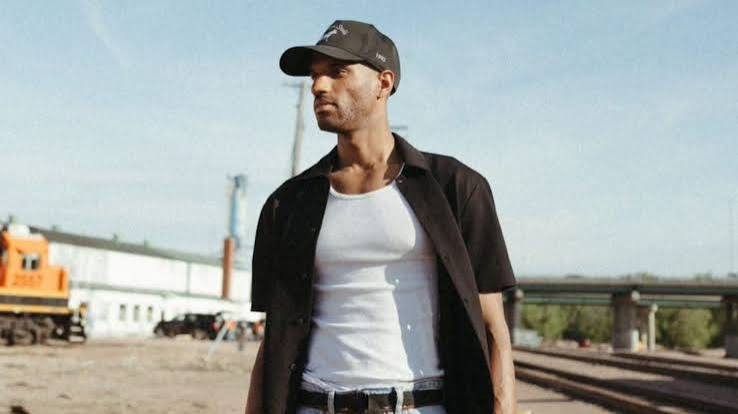
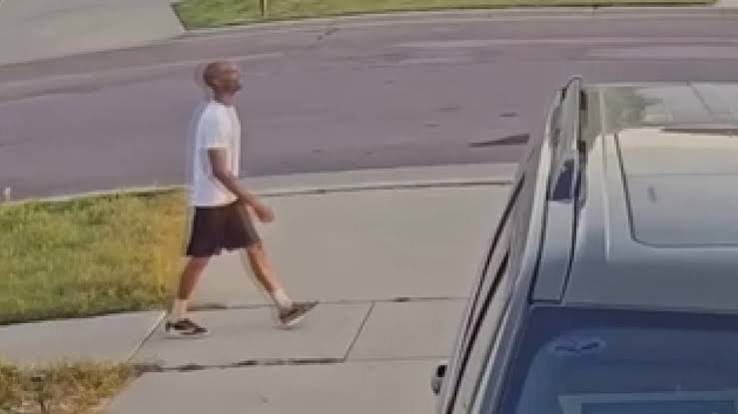
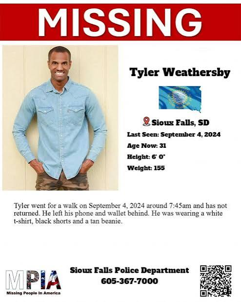

---
# From Justin's draft "The Second Walk," fact-checked October 16, 2026 against the sources below.
# Changes from the draft:
# - "We love you" is now "Love you, bye," the words MonaLisa recalls (S1).
# - The mother's visit was planned for August 26 through September 4 (S1). Her arrival date isn't given.
# - Gregory thought Tyler needed to "blow off some steam." The "cool off" idea was MonaLisa's mother's (S1).
# - Police didn't explain withholding the dashcam as "consistent with other details." Clemens said it is
#   part of the police report and police don't release reports (S4). Police had it "for quite some time."
# - The October 2024 "no foul play" line is no longer the latest. In February 2025 the chief called it an
#   open and active investigation, said federal and local agencies had reviewed the file, and KELOLAND
#   reported no suspects and no foul play suspected (S3). August 2025: still actively investigating (S5).
# - The draft said "no FBI role confirmed." The chief said unnamed federal agencies reviewed the file (S3).
# - Cut "scruffy beard" (no source, his head was shaved, S1, S6) and NamUs MP129352 (couldn't confirm).
# - Cut "He would be 34 now." KXRB says 33 in September 2026 (S7) and 34 in October 2026 (S8), and
#   Dateline said he would be 32 by October 2024 (S1). No source gives his birthday.
# - Silver Hyundai Santa Fe and the boy on the bike are sourced to KXRB's description of the Legal Eye
#   video (S7, S8). In February 2025 MonaLisa repeated a police description: talking to a car and to
#   someone on a bicycle (S4). The "tan stocking hat" in the closing scene is the Charley Project's
#   "stocking cap" and other reports' "beanie" (S5, S6).
# Conflicts left in the text on purpose: 7:45 (S1, S2) vs. 7:15 (S6) departure, and northeast (S1)
# vs. northwest (S4) vs. western (S5) Sioux Falls. Weight: 154 (S6), 155 (S5), 160 (S1).
# Legal care: no one has been named a suspect or charged. Police said they had no reason to believe a
# crime occurred (S1). MonaLisa Perez's 2017 case is left out on purpose: in a case where police say there
# is no sign of a crime, a spouse's past reads as an implication. Do not add it without a current police
# statement. The cyclist and the driver are not suspected of anything in any source. Don't imply it.
# Photos: from Justin, October 16, 2026. They circulate in news coverage and on missing posters. Justin
# approved them for use. Family permission was not separately confirmed.
# Left out on purpose: three photos of Tyler with MonaLisa (one also shows a young child), a still of
# MonaLisa from a TV interview (same reasoning as the Cyriacks story: the spouse was the last to see him
# at home), a KELOLAND broadcast frame with the station logo, and a second poster that repeats the facts.
# Tip line: posters and KELOLAND use the non-emergency line 605-367-7000 (S5). Dateline, the Charley
# Project and KXRB give 605-367-7212 (S1, S6, S7). Confirm which one SFPD wants.
draft: false
title: "The Second Walk: The Disappearance of Tyler Blake Weathersby"
seoTitle: "Tyler Weathersby: What Happened in Sioux Falls, SD"
description: "Tyler Weathersby left his Sioux Falls home on foot in 2024 without his phone, wallet, or keys. A dashcam caught him approaching a car. Then nothing."
person: "Tyler Weathersby"
summary: "Tyler Weathersby, 31, set out on foot from his Sioux Falls, South Dakota, home on the morning of September 4, 2024, without his phone, wallet or keys. [S1] He hasn't been seen since. [S7] Police say the case is open and active. No one has been named a suspect. [S3, S5]"
status: missing
town: "Sioux Falls"
state: SD
incidentDate: 2024-09-04
lastSeenDate: 2024-09-04
resolvedDate: null
lastChecked: 2026-10-16
lastFactChange: null
published: 2026-10-16
agency: "the Sioux Falls Police Department"
tipLine: "+16053677000"
anonymousTips: { name: "Sioux Falls Area Crime Stoppers", url: "https://www.p3tips.com/TipForm.aspx?ID=635&P3ID=635&DSID=635" }
contentNote: null
image:
  src: "./tyler-weathersby-2024.jpg"
  alt: "Black and white portrait of Tyler Weathersby in a knit cap and white shirt, his chin resting on his fist"
  credit: "Tyler Weathersby in an undated photo"
  license: "Photo shared in the public search for Tyler"
youtubeId: null
youtubeUploadDate: null
sources:
  - { id: S1, title: "Tyler Weathersby walked away from his South Dakota home in September and hasn't returned", publisher: "NBC News, Dateline", url: "https://www.nbcnews.com/dateline/missing-in-america/tyler-weathersby-missing-sioux-falls-rcna176891", date: 2024-10-23 }
  - { id: S2, title: "Sioux Falls Police ask public for info on Tyler Weathersby", publisher: "Dakota News Now", url: "https://www.dakotanewsnow.com/2024/09/19/sioux-falls-police-ask-public-info-tyler-weathersby/", date: 2024-09-19 }
  - { id: S3, title: "Chief on Weathersby: 'Still an active investigation'", publisher: "KELOLAND News", url: "https://www.keloland.com/news/local-news/chief-on-weathersby-still-an-active-investigation/", date: 2025-02-20 }
  - { id: S4, title: "Tyler Weathersby's wife weighs in on newly released dashcam video", publisher: "Dakota News Now", url: "https://www.dakotanewsnow.com/2025/02/26/tyler-weathersbys-wife-weighs-newly-released-dashcam-video/", date: 2025-02-25 }
  - { id: S5, title: "1 year after Tyler Weathersby disappearance", publisher: "KELOLAND News", url: "https://www.keloland.com/keloland-com-original/1-year-after-tyler-weathersby-disappearance/", date: 2025-08-27 }
  - { id: S6, title: "Tyler Blake Weathersby", publisher: "The Charley Project", url: "https://charleyproject.org/case/tyler-blake-weathersby", date: 2026-06-03 }
  - { id: S7, title: "Sioux Falls Continues Search for Tyler Weathersby 2 Years Later", publisher: "KXRB", url: "https://kxrb.com/sioux-falls-tyler-weathersby-missing-anniversary/", date: 2026-09-02 }
  - { id: S8, title: "Sioux Falls Protest Set For Missing Local Man Tyler Weathersby", publisher: "KXRB", url: "https://kxrb.com/sioux-falls-police-protest-tyler-weathersby/", date: 2026-10-12 }
timeline:
  - { date: 2021, text: "Tyler marries MonaLisa Perez, his partner in the Wake brand. [S1]", section: "the-one-behind-the-camera" }
  - { date: 2024-03, text: "The couple's daughter is born. [S1]", section: "the-one-behind-the-camera" }
  - { date: 2024-09-03, text: "Tyler and his mother argue. That evening he drives her to the airport a day early. [S1]", section: "the-night-before" }
  - { date: 2024-09-04, text: "Tyler leaves home on foot around 7:45 a.m. without his phone, wallet or keys. Police get the missing person report that afternoon. [S1]", section: "the-second-walk" }
  - { date: 2024-09-19, text: "Police say they've had well over 100 tips. [S2]", section: "the-second-walk" }
  - { date: 2025-02, text: "The chief calls it an open and active investigation. Private investigators release dashcam video from Marion Road and Madison Street. [S3, S4]", section: "the-car-at-the-intersection" }
  - { date: 2026-10-21, text: "A community group plans a demonstration outside the Sioux Falls Police Department. [S8]", section: "where-it-stands" }
updates:
  - { date: 2026-10-16, text: "Story published." }
---

He had already been out once that morning.

By the time MonaLisa Perez got up on Wednesday, September 4, 2024, her husband had gone for a walk and come back. [S1] As she tells it, the family said goodbye in the garage as she left to take the kids to school. "We give him a kiss," she told Dateline. The words were the everyday kind: love you, bye. [S1]

Then she pulled out of the driveway, and Tyler Weathersby started walking again. [S1]

He didn't take his phone. He didn't take his wallet or his keys. [S1] Cameras would later catch him alone, heading toward the interstate. [S1]

That's about where the certainty ends. More than two years later, no one has been able to say where the second walk went. [S7]

## The one behind the camera

Janine Weathersby Harris raised four children. [S1] Tyler was shy as a boy, she said, "but he was inquisitive." He never stopped telling her he loved her. "Mama, I love you," he'd write in his texts. [S1]

He was closest to his brother, Gregory. Their mother called them "two peas in a pod." [S1]

As teenagers the brothers got into dance and started a performance group. Gregory says a talent agency in Los Angeles signed them. Later they made music and toured two or three times. [S1] Tyler shot all of Gregory's music videos and his photos, and helped market the work. Together they started a clothing brand called Millions United. [S1]

Eventually Tyler wanted a path of his own, and Gregory respected that. In the mid-2010s Tyler moved to South Dakota and started a business built around "self-love and community." [S1]

He called it Wake. It began as streetwear. MonaLisa became his business partner, and together they ran pop-up shops, fashion shows and mental health events. Over time Wake grew into a creative agency doing marketing and public relations for other brands. [S1]

They married in 2021. Tyler became a stepfather to MonaLisa's two children, and in March 2024 the couple had a daughter. [S1]

"He loves to create and build and just really influence the people around him in such a positive way," MonaLisa said. [S1]

He also walked. Tyler sometimes struggled with depression, his wife said, and walking was how he meditated and reset, how he would "revamp and rejuvenate." [S1] His mother described a disciplined life: daily exercise, clean eating, intermittent fasting. [S1]

A walk could last an hour and a half. Sometimes two. [S1]

Remember that. It's the reason nobody panicked at first.

## The night before

Janine's visit to Sioux Falls was planned for August 26 through September 4, so she could spend time with her new granddaughter. By her account, everything was good. [S1]

Then came September 3.

She and Tyler argued that day. For her, it had no precedent. "We've never had an argument," she told Dateline. [S1] What the argument was about has never been made public.

That evening, Tyler drove his mother to the airport. Her flight wasn't until the next day. Gregory arranged a hotel room for her. [S1]

Then Gregory got his brother on the phone. Tyler didn't sound like himself, he said, and never clearly explained what had happened. "It was like he was speaking in circles." [S1]

At home, MonaLisa noticed it too. The things Tyler said that night, she later said, were "really, really odd." He was still upset when he got back. Neither of them slept much. [S1]

By morning, he was already out the door.

## The second walk

The first walk came and went before MonaLisa was up. Tyler was home again as she got the kids ready to go. [S1]

Picture it the way she describes it. The family in the garage. A kiss. Love you, bye. [S1]

She pulled away. He set out on foot. Police put the time at about 7:45 a.m. [S1, S2]

Behind him, at home, were his phone, his wallet and his keys. [S1]

For the first couple of hours, MonaLisa wasn't worried. That was a normal walk for Tyler. By about 10:30, it wasn't. She called her family. She searched the neighborhood. She checked the place where he went to meditate. [S1]

He wasn't there.

"We were called in the afternoon, maybe around 4:30 p.m.," the police spokesperson said of the missing person report. [S1]

The next day, MonaLisa reached Gregory, and he called their mother right away. At first Gregory thought his brother might have needed to blow off some steam. [S1] Each day without a call made that harder to believe.

Within two weeks, police had received well over 100 tips. "We believe that somebody out there has some piece of information," spokesperson Sam Clemens said. [S2]

## The car at the intersection

The footage police found, from the neighborhood and a nearby business, showed Tyler walking on his own. Clemens told Dateline it did not show anyone forcing him to go anywhere. He seemed to be heading toward an interstate. Whether he reached it, or turned off somewhere, investigators said they didn't know. [S1]

Here's where the record gets less precise. The Charley Project places Tyler on a surveillance camera near West Madison Street and North Marion Road at 7:50 a.m., walking east toward Interstate 29. It lists his departure as 7:15, not 7:45. [S6] Dateline described his neighborhood as northeast Sioux Falls. [S1] Dakota News Now says northwest, and KELOLAND says western. [S4, S5]

His family's own poster split the difference.

Then, in February 2025, Legal Eye Investigations, the private firm his family hired, released a dashcam video from the intersection of Marion Road and West Madison Street. [S1, S4]

According to KXRB's description of it, Tyler is waiting to cross the street. He talks with a young boy on a bicycle. Then he approaches the driver of a silver Hyundai Santa Fe. [S7, S8] MonaLisa said police had given her the same outline: he was talking to a car, and to someone on a bike. [S4]

Think about what he was carrying. No phone to call anyone. No wallet. No keys. A man who walked to clear his head, on a morning when the people closest to him said he wasn't himself, stepping toward a car.

What was said has never been made public. Neither has whether police identified the boy or the driver. Nothing in the public record suggests either one did anything wrong.

It's the last glimpse of Tyler the public has been given.

## What we know now

Police said they'd had the dashcam video "for quite some time." It's part of the police report, Clemens said, and the department doesn't release police reports or their details. [S4] MonaLisa called the video "very helpful and eye-opening" and said she believes police have more footage of Tyler walking toward the interstate. [S4] That hasn't been confirmed.

In the first weeks, investigators reviewed video, talked at length with the people closest to Tyler, and flew a drone over different areas. Tips came in. None led to him. [S1] "We don't have any reason at this point to believe there was anything criminal that happened," Clemens told Dateline in October 2024. [S1]

In February 2025, Police Chief Jon Thum said the file had been reviewed by other agencies, federal and local, though he didn't name them. "This is still an open and active investigation," he said. [S3] KELOLAND reported there were no suspects and no foul play suspected. [S3]

The family organized searches, some with dog teams. Legal Eye hung posters, searched, reviewed neighbors' video and interviewed people connected to the case. [S1] Gregory started a GoFundMe to help pay for it and said online questions about the money hurt. "I'm past being hurt. I'm angry," he said. [S1] Nothing in the reporting supports any claim of wrongdoing.

His mother and his wife have both said they don't believe Tyler would hurt himself. MonaLisa thinks he's alive somewhere, just not thinking clearly. [S1]

## Where it stands

In August 2025, a police spokesperson said there was no new information. "The department is still actively investigating this case." [S5]

Two years on, the frustration has gone public. A community group called the Lone Wolves Initiative has announced a demonstration outside the Sioux Falls Police Department for Wednesday, October 21, at 11 a.m. It's calling for transparency, independent reviews and digital evidence work, among other things. [S8] Those are demands, not findings.

Tyler Blake Weathersby is still missing. [S6, S7] He was 31 when he walked away from his garage. [S1]

He's 6 feet tall, about 155 pounds, with brown eyes. His head was shaved when he disappeared, and his hair and beard may have grown back. He has a scar on one leg from ankle to knee and a tattoo of a crown with a halo above it on his right wrist. [S1, S5, S6] He was last seen in a white T-shirt, black shorts and a tan stocking cap. [S5, S6]

Somewhere, there's a driver who had a man in a white T-shirt walk up to their silver Hyundai one September morning in Sioux Falls. [S7] Somewhere, there's a boy, older now, who remembers a stranger at an intersection.

One of them might hold the next piece.

If you were near Madison Street and Marion Road that morning, or you know anything at all, don't post it in the comments. Call the Sioux Falls Police Department at [605-367-7000](tel:+16053677000), or Crime Stoppers at [605-367-7007](tel:+16053677007). [S5]

What do you think happened after Tyler reached that car?
